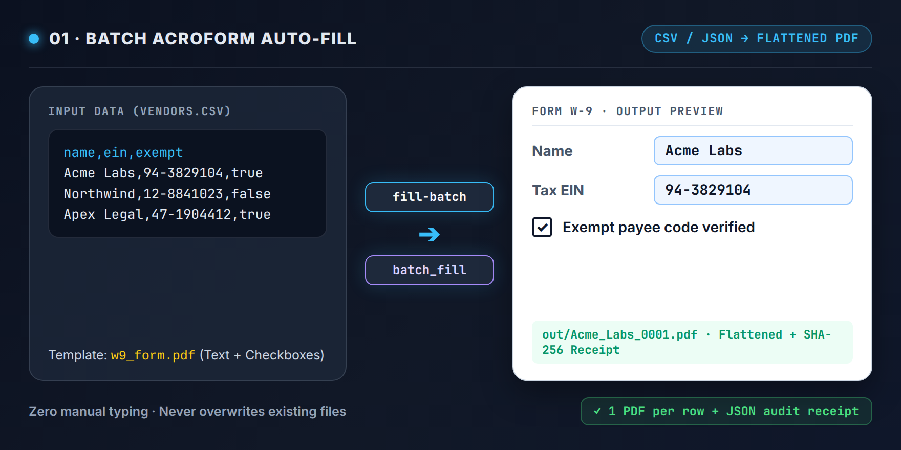
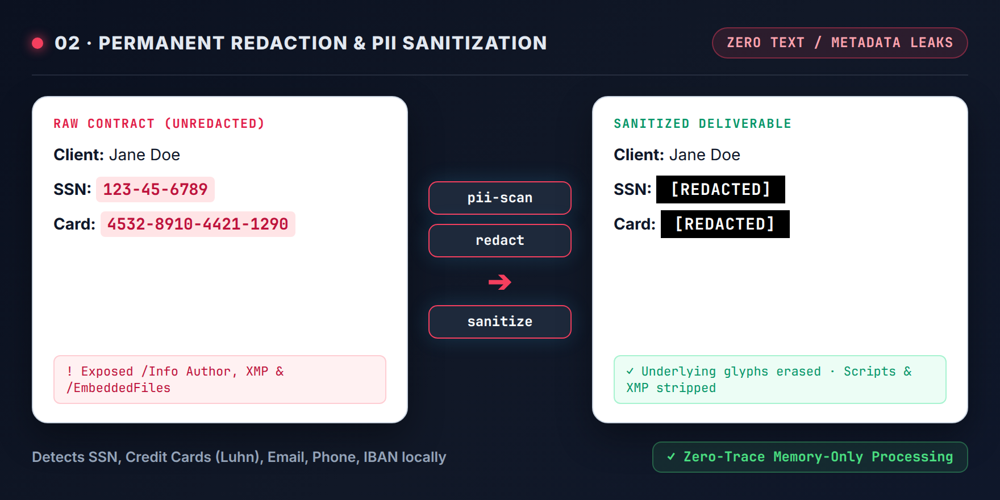
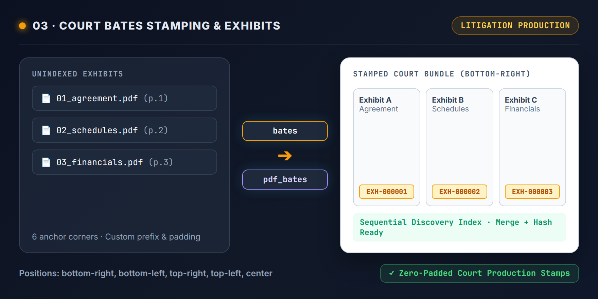
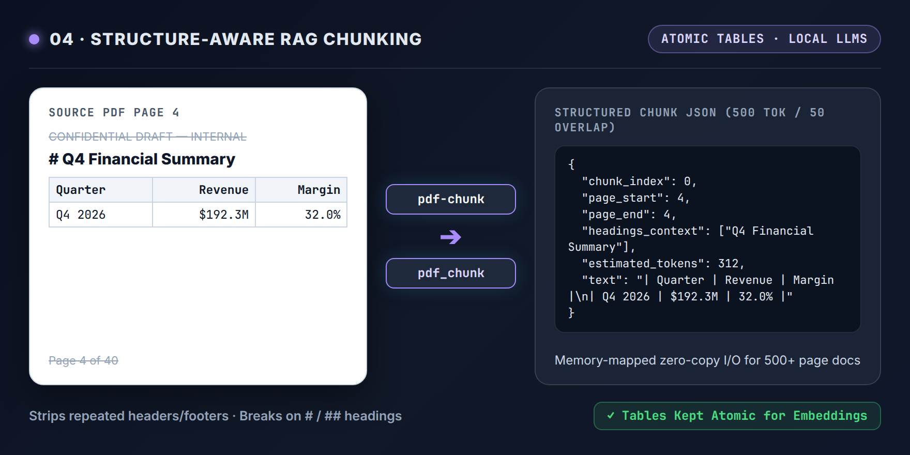
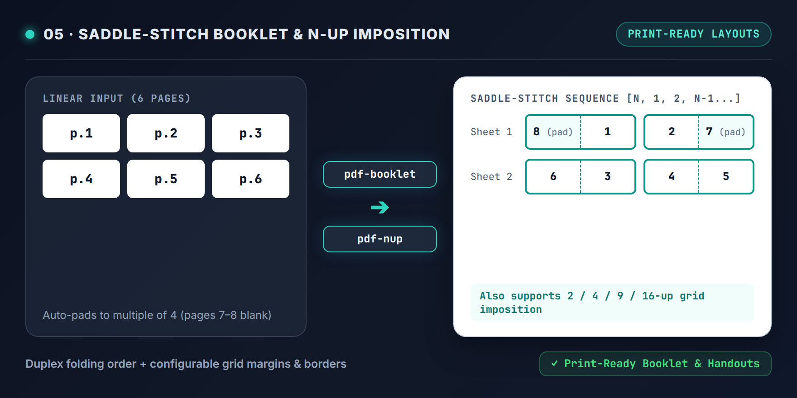
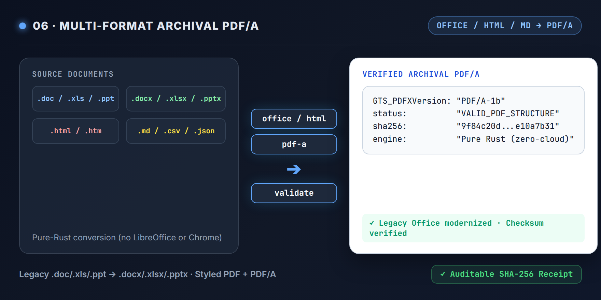

# PaperPilot

**PDF tools for your AI agent — and for you. Pure Rust. Runs locally. Files never leave your machine.**

> **Let the LLM be the brain. Let PaperPilot handle the documents.**  
> *Save your tokens for reasoning — parse, chunk, redact, and transform PDFs locally in pure Rust at zero token cost.*

[](https://github.com/KrushnaVardhanReddy/PaperPilot/actions)
[](https://github.com/KrushnaVardhanReddy/PaperPilot/releases)
[](https://www.npmjs.com/package/@usepaperpilot/mcp)
[](https://github.com/rust-unofficial/awesome-rust#utilities)
[](https://www.npmjs.com/package/@usepaperpilot/mcp)
[](https://glama.ai/mcp/servers/KrushnaVardhanReddy/PaperPilot)
[](SECURITY.md)
[](SECURITY.md)
[](LICENSE)
[](https://www.rust-lang.org)
[](https://modelcontextprotocol.io)
[](CONTRIBUTING.md)


[**Try it in your browser →**](https://usepaperpilot.com) · [Download](https://github.com/KrushnaVardhanReddy/PaperPilot/releases) · [Contributing](CONTRIBUTING.md) · [Roadmap](ROADMAP.md)

PaperPilot is a PDF and document toolkit written in Rust. The same engine runs as:

| Surface | Use it for |
|---|---|
| **MCP server** | Give Codex, Claude Code, Gemini CLI, Cursor, Claude Desktop, or any MCP client instant document superpowers |
| **CLI** | High-speed batch workflows and automated terminal pipelines |
| **Browser Extension** | In-tab right-click actions on web/arXiv PDFs, clean article capture, and WASM toolkit |
| **Browser (WASM)** | Zero-install web tools; files are processed in browser memory, nothing is uploaded |
| **Desktop app** | Tauri + Svelte 5 GUI with interactive canvas, viewer, and pipeline builder |
| **Local REST API** | Call it from Python, Node.js, n8n, LangChain, or LlamaIndex at `localhost:7823` |

No Chromium, no C++ runtime, no cloud calls.

---

## Stop Doing Document Drudgery by Hand

> **Bureaucratic forms, discovery bundles, and compliance PDFs waste hours on repetitive manual work—and one sloppy click in a viewer can leak sensitive client data.**

- **Bureaucratic form fatigue:** Stop hand-typing the same client entities, EINs, addresses, and checkboxes across multi-page tax packets (W-9s), bank onboarding, insurance claims, government filings, and rental applications. Point `paperpilot fill-batch` at a CSV/JSON dataset and generate flattened, verified PDFs in milliseconds.
- **Litigation & exhibit numbering headaches:** Turn disorganized closing or discovery folders into sequentially stamped `EXH-000001` court exhibits across six configurable anchor corners—ready to re-index in seconds whenever counsel swaps an exhibit order.
- **False-sense-of-security redactions:** Covering text with black rectangles in standard viewers often leaves selectable SSNs, account numbers, XMP author tags, JavaScript triggers, and embedded attachments intact. PaperPilot permanently erases underlying text glyphs and scrubs hidden document internals strictly offline.

---

## Quick start

### 1. Flash Install PaperPilot (5-Second Setup — No Rust or Node.js Required)

Install PaperPilot with zero toolchain prerequisites. Choose between **Homebrew**, the **Quick Installer**, standalone **CLI**, or **All-in-One**:

#### Package Manager (Homebrew)

**macOS (Desktop GUI App):**
```bash
brew install --cask KrushnaVardhanReddy/tap/paperpilot
```

**macOS & Linux (CLI Only):**
```bash
brew install KrushnaVardhanReddy/tap/paperpilot
```

#### Python SDK (PyPI)

```bash
pip install usepaperpilot
```

#### Quick Installer (curl / irm)

**Linux & macOS:**
```bash
# Default: installs Desktop App when GUI is available (or CLI on headless Linux servers)
curl -fsSL https://raw.githubusercontent.com/KrushnaVardhanReddy/PaperPilot/main/scripts/install.sh | bash

# Explicit component flags:
curl -fsSL https://raw.githubusercontent.com/KrushnaVardhanReddy/PaperPilot/main/scripts/install.sh | bash -s -- --desktop
curl -fsSL https://raw.githubusercontent.com/KrushnaVardhanReddy/PaperPilot/main/scripts/install.sh | bash -s -- --cli
curl -fsSL https://raw.githubusercontent.com/KrushnaVardhanReddy/PaperPilot/main/scripts/install.sh | bash -s -- --all
```

**Windows (PowerShell):**
```powershell
# Default: installs Desktop App (or prompts interactively for Desktop / CLI / All-in-One)
irm https://raw.githubusercontent.com/KrushnaVardhanReddy/PaperPilot/main/scripts/install.ps1 | iex

# Select component explicitly via $env:PAPERPILOT_COMPONENT or -Component:
$env:PAPERPILOT_COMPONENT="All"; irm https://raw.githubusercontent.com/KrushnaVardhanReddy/PaperPilot/main/scripts/install.ps1 | iex
.\scripts\install.ps1 -Component Desktop   # Desktop GUI App (.exe / .msi) [Default]
.\scripts\install.ps1 -Component CLI       # Standalone paperpilot.exe CLI only
.\scripts\install.ps1 -Component All       # Desktop App + CLI + MCP Server
```

When run directly in an interactive terminal without component flags, the installer prompts you to pick **1) Desktop App [Default]**, **2) CLI only**, or **3) All-in-One**.

To pin a specific release version instead of `latest` (leading `v` is normalized automatically) or preview actions with `--dry-run` / `DRY_RUN=1`:

```bash
# Linux & macOS: pass version as an argument or via VERSION / PAPERPILOT_VERSION
curl -fsSL https://raw.githubusercontent.com/KrushnaVardhanReddy/PaperPilot/main/scripts/install.sh | bash -s -- --all 0.7.0
curl -fsSL https://raw.githubusercontent.com/KrushnaVardhanReddy/PaperPilot/main/scripts/install.sh | VERSION=v0.7.0 COMPONENT=cli bash
DRY_RUN=1 sh scripts/install.sh --desktop
```

```powershell
# Windows PowerShell: set $env:PAPERPILOT_VERSION or pass -Version / -DryRun locally
$env:PAPERPILOT_VERSION="0.7.0"; irm https://raw.githubusercontent.com/KrushnaVardhanReddy/PaperPilot/main/scripts/install.ps1 | iex
.\scripts\install.ps1 -Component All -Version 0.7.0 -DryRun
```

> **Install locations & verification:**
> - **Desktop App:** On Linux, places the verified AppImage at `~/.local/bin/paperpilot-desktop` (or `/usr/local/bin` as `root`) and registers an application icon + launcher at `~/.local/share/applications/paperpilot.desktop`. On macOS, mounts the `.dmg` and installs `PaperPilot.app` to `/Applications`. On Windows, downloads and runs the `.exe` / `.msi` desktop installer.
> - **CLI & MCP (`--cli` / `--all`):** Linux/macOS installs `paperpilot` (and `paperpilot-mcp` with `--all`) to `~/.local/bin` (or `/usr/local/bin` as `root`), verifies SHA-256 checksums, and validates `--version`. Windows installs `paperpilot.exe` (and `paperpilot-mcp.exe` with `-Component All`) to `$HOME\.paperpilot\bin` and adds it to your User `PATH`.

### 2. Use it with your AI / Coding Agent (5-Second MCP Setup)

No manual build or binary download required! Run instantly via `npx`:

```bash
# Test MCP server directly
npx -y @usepaperpilot/mcp --help
```

Add to **Claude Desktop** (`claude_desktop_config.json`), **Cursor** (`cursor_mcp_config.json`), **Windsurf**, or **Zed**:

```json
{
  "mcpServers": {
    "paperpilot": {
      "command": "npx",
      "args": ["-y", "@usepaperpilot/mcp"]
    }
  }
}
```

Or if using the precompiled native binary, download `paperpilot-mcp` from [Releases](https://github.com/KrushnaVardhanReddy/PaperPilot/releases) or use client config generators:
```bash
paperpilot-mcp --client-config cursor
# Also: claude-desktop, claude-code, codex, kimi-code, pi
```

Restart Claude and try: *"Merge these two PDFs and compress the result."*

### 3. Use the CLI

```bash
# Semantic Chunking for AI Agents & RAG (Spec 159)
paperpilot pdf-chunk --input contract.pdf --target-tokens 500 --overlap 50 --json

# Merge multiple documents
paperpilot merge --inputs doc1.pdf doc2.pdf --output merged.pdf

# High-efficiency compression
paperpilot compress --input in.pdf --quality 75 --output compressed.pdf

# Search pattern or keywords across document pages
paperpilot search --input in.pdf --query "Invoice" --json

# Rotate pages 1, 3–5 by 90°
paperpilot rotate --input in.pdf --pages 1,3-5 --angle 90 --output out.pdf
```

### 4. Use it in the browser & extension

- **Web App**: Go to [usepaperpilot.com](https://usepaperpilot.com) for zero-install client-side WebAssembly tools.
- **Companion Extension**: Load the Manifest V3 browser extension from [`apps/extension`](apps/extension) for in-tab context menus, right-click PDF actions, and clean web article capture.

### 5. Build from source

```bash
git clone https://github.com/KrushnaVardhanReddy/PaperPilot.git
cd PaperPilot
cargo build --release -p paperpilot-cli -p paperpilot-mcp -p paperpilot-gateway
```

Desktop app:

```bash
cd apps/desktop && pnpm install && pnpm tauri dev
```

Requires Rust 1.75+, Node.js, and pnpm.

---

## Self-Healing System Diagnostics
Verify your environment, gateway port, temp storage, and OCR models with one command:
```bash
paperpilot doctor
# PaperPilot System Diagnostics (v0.8.2)
# ==================================================
# Status:    Healthy
# [✓] Temp Directory: /tmp (writable & ephemeral cleanup verified)
# [✓] Gateway Port: 7823 available
# [✓] OCR Models: models/ocr/ppocrv4 (det.onnx, rec.onnx found)
# [✓] Disk Space: > 5 GB available
```

**Open-WebUI integration (source builds):** use the local gateway as a
PDF-only Tika-compatible extraction server. See the
[Open-WebUI setup guide](docs/integrations/open_webui.md).

---

## Real-World Use Cases & Visual Showcase

Every workflow below runs offline through the same pure-Rust engine across CLI scripts, `.ppflow` recipes, and MCP coding agents:

| Workflow & Visual Preview | Exact CLI & MCP Commands |
|---|---|
| **1. Form Auto-Filling**<br>Batch-fill government, tax, bank, or rental AcroForms from CSV/JSON rows into flattened PDFs in milliseconds with SHA-256 audit receipts—without overwriting existing files. Sample: [`preview.png`](reports/fill-batch-validation/preview.png) · [report](reports/CLI_FILL_BATCH_REPORT.md).<br><br> | **CLI:** `paperpilot fill-batch --template w9.pdf --data vendors.csv --output-dir ./out --name-template '{row.name}_{index:04}.pdf'`<br>*(single form: `paperpilot pdf-fill-form --input w9.pdf --data values.json --output filled.pdf`)*<br><br>**MCP (`batch_fill`):** `{"template": "w9.pdf", "data": "vendors.csv", "output_dir": "./out", "name_template": "{row.name}_{index:04}.pdf"}` |
| **2. Permanent Redaction & PII Sanitization**<br>Detect SSNs, credit cards, emails, phones, and IBANs locally; erase underlying text glyphs across pages with blackout overlays; and strip `/Info`, XMP metadata, attachments, and scripts. Live demo: [PII scan GIF](docs/assets/gifs/demo_02_pii_security_scan.gif).<br><br> | **CLI:** `paperpilot pii-scan --input doc.pdf && paperpilot redact --input doc.pdf --pages all --regex '\b\d{3}-\d{2}-\d{4}\b' --overlay-text '[REDACTED]' --output red.pdf && paperpilot sanitize --input red.pdf --output clean.pdf`<br><br>**MCP (`document_pii_scan` → `pdf_redact` → `pdf_sanitize`):** `{"input": "doc.pdf"}` → `{"input": "doc.pdf", "regex": "\\b\\d{3}-\\d{2}-\\d{4}\\b", "overlay_text": "[REDACTED]", "output": "red.pdf"}` → `{"input": "red.pdf", "output": "clean.pdf"}` |
| **3. Court Bates Stamping & Exhibit Numbering**<br>Apply zero-padded sequential discovery stamps across 6 anchor corners (`bottom-right`, `bottom-left`, `top-right`, `top-left`, `bottom-center`, `top-center`) for litigation packets. See [legal discovery walkthrough](demo/legal_discovery/README.md).<br><br> | **CLI:** `paperpilot bates --input exhibits.pdf --prefix 'EXH-' --start 1 --position bottom-right --output exhibits-bates.pdf`<br><br>**MCP (`pdf_bates`):** `{"input": "exhibits.pdf", "prefix": "EXH-", "start_number": 1, "padding": 6, "position": "bottom-right", "output": "exhibits-bates.pdf"}` |
| **4. Structure-Aware RAG Chunking**<br>Chunk 500+ page technical manuals via memory-mapped zero-copy I/O (`>= 10 MB`), stripping repeated headers/footers, splitting on `#`/`##` headings, and keeping Markdown tables atomic for local LLMs.<br><br> | **CLI:** `paperpilot pdf-chunk --input manual.pdf --target-tokens 500 --overlap 50 --output chunks.json`<br><br>**MCP (`pdf_chunk`):** `{"input": "manual.pdf", "target_tokens": 500, "overlap_tokens": 50, "strip_boilerplate": true, "break_on_headings": true, "output": "chunks.json"}` |
| **5. Saddle-Stitch Booklet & N-Up Imposition**<br>Auto-pad page counts to multiples of 4 and reorder duplex sheets (`[N, 1, 2, N-1, ...]`) for saddle-stitch folding, or arrange 2, 4, 9, or 16 pages per sheet with configurable margins and borders.<br><br> | **CLI:** `paperpilot pdf-booklet --input zine.pdf --output booklet.pdf`<br>*(N-up grid: `paperpilot pdf-nup --input slides.pdf --nup 4 --draw-borders --output handout.pdf`)*<br><br>**MCP (`pdf_booklet` / `pdf_nup`):** `{"input": "zine.pdf", "output": "booklet.pdf"}` / `{"input": "slides.pdf", "nup": 4, "draw_borders": true, "output": "handout.pdf"}` |
| **6. Multi-Format Archival Conversion**<br>Modernize legacy `.doc`/`.xls`/`.ppt` files to `.docx`/`.xlsx`/`.pptx`, convert Office files to Markdown, render HTML/Markdown/Excel natively in Rust to styled PDFs, stamp `PDF/A` metadata, and verify structural validity + SHA-256 checksums.<br><br> | **CLI:** `paperpilot office modernize --input legacy.doc --output modern.docx` · `paperpilot html-to-pdf --input report.html --output report.pdf && paperpilot pdf-a --input report.pdf --output archival.pdf && paperpilot validate --input archival.pdf` *(also `md-to-pdf`, `convert-excel`, `office to-markdown`, `hash`)*<br><br>**MCP (`office_modernize_legacy`, `pdf_convert_html`, `pdf_to_pdf_a`, `pdf_validate`):** `{"input": "legacy.doc", "output": "modern.docx"}` → `{"input": "report.html", "output": "report.pdf"}` → `{"input": "report.pdf", "output": "archival.pdf"}` → `{"input": "archival.pdf"}` |

> **More live agent recordings:** [`demo_05_mcp_agent_workflow.gif`](docs/assets/gifs/demo_05_mcp_agent_workflow.gif) (multi-step MCP agent execution) · [`demo_06_pipeline_conditional_workflow.gif`](docs/assets/gifs/demo_06_pipeline_conditional_workflow.gif) (declarative `.ppflow` DAG pipeline)

---

## Ecosystem Synergies

Authoring and typesetting engines focus on *generating* source drafts—and deliberately leave legal discovery, permanent PII destruction, signature prep, imposition, and RAG ingestion out of scope. **PaperPilot complements them as the offline lifecycle, security, signing, and post-processing engine:**

```text
Authoring & Typesetting Engines              PaperPilot (Offline Lifecycle & Security Engine)
────────────────────────────────────         ─────────────────────────────────────────────────
• office-oxide-mcp (.docx/.xlsx/.pptx)  ──▶  • office modernize / to-markdown (legacy binary Office)
• Pandoc (Markdown / HTML / TeX)        ──▶  • html-to-pdf · md-to-pdf · convert-excel (pure Rust)
• Typst / LaTeX / Browser Exports       ──▶  • pii-scan · redact · sanitize   (zero metadata leaks)
                                             • bates · pdf-overlay-underlay · signature · pdf-timestamp · hash
                                             • pdf-booklet · pdf-nup · pdf-a · validate
                                             • pdf-chunk · workspace-search   (atomic-table RAG)
```

| Upstream Engine | Upstream Role | PaperPilot Offline Post-Processing Stage |
|---|---|---|
| **`office-oxide-mcp` & Legacy Office** | Authoring and programmatic editing of `.docx`, `.xlsx`, and `.pptx` deliverables (shares pure-Rust [`office_oxide`](reports/OFFICE_OXIDE_INTEGRATION_REPORT.md) foundations) | Upgrade legacy binary `.doc`/`.xls`/`.ppt` archives (`office modernize`), extract `.docx`/`.xlsx`/`.pptx` to Markdown (`office to-markdown`), render spreadsheets directly (`convert-excel`), and stamp `pdf-a` + SHA-256 `hash` receipts. |
| **Pandoc** | Cross-markup document conversion to clean Markdown or standalone HTML | Render Pandoc Markdown/HTML into styled PDFs (`md-to-pdf` / `html-to-pdf`) with zero Chromium or TeX runtime, then scrub (`pii-scan` → `redact` → `sanitize`), sign (`signature` / `pdf_sign`), and archive (`pdf-a`). |
| **Typst** | High-speed programmable typesetting to clean multi-page PDFs | Prepare Typst outputs for legal, print, or audit release: apply Bates stamps (`bates`), letterheads (`pdf-overlay-underlay`), RFC 3161 timestamps (`pdf-timestamp`), signature placeholders/validation (`pdf-validate-signatures`), or duplex booklets (`pdf-booklet` / `pdf-nup`). |
| **Local LLM & Vector Stacks** *(Ollama, Open-WebUI, LlamaIndex, LangChain)* | Local embeddings, vector databases, and private agentic Q&A | Serve sub-5ms in-memory `/tika/text` or `/api/v1/*` extraction via `paperpilot serve`, or generate boilerplate-free, table-atomic RAG chunks via `pdf-chunk` / `pdf_chunk`. |

---

## What it can do (100 Tools Across 5 Interfaces)

- **AI Agent Intelligence, Semantic Search & Local SLM Routing**:
  - `document_workflow` & `recipe_run`: Declarative `.ppflow` DAG workflows with step dependencies, conditions, and cryptographic audit receipts.
  - `workspace_search` & `semantic_search`: Multi-format recursive workspace search (`.pdf`, `.docx`, `.xlsx`, `.md`, `.txt`, `.csv`, `.json`) and normalized vector chunk retrieval.
  - `cli_ask`: Natural language intent planner and instant execution agent.
  - `pdf_chunk` & `pdf_rag_chunks`: Structure-aware semantic chunker respecting `#`/`##` headings, `\n\n` paragraphs, and keeping Markdown tables atomic.
  - `pdf_search` & `pdf_extract_patterns`: High-precision regex and pattern extraction for invoices, order IDs, and legal identifiers.
  - `pdf_classify_type`: Automatic document categorization (invoices, receipts, legal briefs, tax filings, research papers).
  - **On-Device SLM (Local Qwen2.5-0.5B)**: Fine-tuned local SLM (`PaperPilot-Qwen-0.5B-Instruct`) with 96.40% validation accuracy across single tools and multi-step recipes; quantized GGUF (380 MB, <400 MB RAM) available on Hugging Face for offline function calling.
- **Image Intelligence & Animated Showcase Studio (v0.8.x New)**:
  - `img_deskew`: Automatic skew angle detection and straightening for scanned documents and camera captures.
  - `img_crop_to_content`: Intelligent bounding-box detection to strip whitespace and borders down to document content.
  - `img_redact`: Visual pixel-level redaction with blackout boxes for scanned image artifacts.
  - `img_optimize_for_llm`: Adaptive image scaling, contrast normalization, and token-cost optimization tailored for Vision-Language Models (VLMs).
  - `img_convert`: High-throughput cross-format image conversion (PNG, JPEG, WebP, TIFF).
  - `pdf_to_gif` & `images_to_gif`: Render PDF page sequences or image lists into optimized, animated GIFs with configurable frame delays.
  - `showcase_gif`: Generate animated before/after transition GIFs highlighting document processing steps.
- **Core Layout, Bates Numbering & Imposition**:
  - `pdf_bates`: Standard legal discovery Bates numbering across 6 customizable anchor positions.
  - Merge, split, rotate, delete pages, reorder pages, extract pages, booklet imposition, N-up grid, and multi-sheet poster tile slicing (`pdf_posterize`).
  - Interactive forms: read form fields (`pdf_read_form`), fill (`pdf_fill_form`, `batch_fill`), create form fields (`pdf_create_form_field`), and flatten (`pdf_flatten`).
  - Digital signatures & timestamps (`pdf_sign`, `pdf_validate_signatures`, `pdf_timestamp`), bookmarks (`pdf_bookmarks`), and crop/scale (`pdf_crop`, `pdf_scale_pages`).
- **Office & Cross-Format Transformations**:
  - Bidirectional PDF ⇄ Word (`pdf_to_docx`, `pdf_convert_markdown`).
  - Bidirectional PDF ⇄ Excel (`pdf_to_xlsx`, `pdf_convert_excel`, `excel_to_csv`, `excel_to_json`).
  - EPUB eBooks (`pdf_to_epub`), PowerPoint slides (`pdf_to_pptx`), HTML (`pdf_to_html`, `pdf_convert_html`), and JSON ASTs (`pdf_to_json`, `json_to_pdf`).
  - Legacy Office modernization (`office_modernize_legacy`, `office_extract_text`, `office_to_markdown`).
- **OCR & Document Vision**:
  - Neural PP-OCRv4 detection & recognition via `rten` and `ocrs` (det.onnx + rec.onnx).
  - Searchable OCR text layer injection, auto-rotation (`pdf_auto_rotate`), page rendering (`pdf_render`), and blank page removal (`pdf_remove_blank`).
- **Security & PII Redaction**:
  - Automated PII scanning (`document_pii_scan`) detecting SSNs, credit cards, emails, phone numbers, and IBANs.
  - Permanent redaction (`pdf_redact`) via coordinates, keywords, regex, or structured JSON datasets.
  - Cryptographic validation & hashing (`pdf_validate`, `pdf_hash`), encryption/decryption (`pdf_encrypt`, `pdf_decrypt`), permissions bitmask (`pdf_change_permissions`), and sanitization (`pdf_sanitize`).
- **Zero-Copy High Performance Engine**:
  - Zero-copy memory-mapped I/O (`DocumentSource` via `memmap2`) for files $\ge 10\text{ MB}$, keeping resident memory flat (< 100 MB) during search, chunking, and PII scanning of 500+ page documents.
  - Universal streaming page batching (`PageBatchIterator`) to prevent OOM errors.

---

## Why another PDF tool?

- **Private by default.** Everything runs locally or in your browser tab.
- **Agent-ready.** MCP support is first-class, not an afterthought.
- **One engine, many surfaces.** CLI, MCP, REST, WASM, and desktop share the same Rust core, so behavior is consistent.
- **Small and dependency-light.** Pure Rust, built on [`lopdf`](https://github.com/J-F-Liu/lopdf), [`pdf_oxide`](https://crates.io/crates/pdf_oxide), [`rten`](https://github.com/robertknight/rten), and friends.

## Benchmarks

PaperPilot delivers extreme throughput and sub-10ms response times while maintaining a flat memory footprint across thousands of operations:

| Operation | Max Input Size | P50 Latency | P99 Latency | Throughput | Memory Footprint |
|---|---|---|---|---|---|
| **`pdf_encrypt`** | 500 pages | 1.20 ms | 3.61 ms | **144,578 pages/s** | < 40 MB RSS (Flat) |
| **`pdf_watermark`** | 500 pages | 1.85 ms | 4.79 ms | **105,719 pages/s** | < 40 MB RSS (Flat) |
| **`pdf_split`** | 500 pages | 2.40 ms | 11.20 ms | **45,594 pages/s** | < 40 MB RSS (Flat) |
| **`pdf_merge`** | 500 pages | 3.12 ms | 6.28 ms | **16,845 pages/s** | < 40 MB RSS (Flat) |
| **`pdf_compress`** | 500 pages | 7.80 ms | 30.49 ms | **16,534 pages/s** | < 40 MB RSS (Flat) |
| **`pdf_extract_text`** | 500 pages | 18.50 ms | 124.60 ms | **4,032 pages/s** | < 40 MB RSS (Flat) |
| **MCP Concurrency** | 50 clients | 12.85 ms | 13.97 ms | **296.11 ops/s** | Zero crashes / 0% err |
| **On-Device SLM** | Qwen2.5-0.5B GGUF | 0.92 s | 2.31 s | **96.40% Accuracy** | < 400 MB RAM (380MB disk) |

- **Zero Memory Leaks**: Flat 39.05 MB RSS verified over 1,000 continuous iterations and 46,116-operation soak tests.
- **Microsecond Cold Start**: Cold start latency overhead is $< 550\ \mu\text{s}$ over warm state.
- **Deep Dive**: See comprehensive methodology, scaling curves, and multi-interface SLA breakdowns in [**docs/benchmarks.md**](docs/benchmarks.md).

---

## Architecture

```
Desktop (Tauri) · CLI · REST (Axum) · MCP (stdio) · WASM (browser / edge)
                              │
                       Rust core workspace
   paperpilot-core · paperpilot-pdf · paperpilot-nlp · paperpilot-gateway
   paperpilot-mcp · paperpilot-wasm · paperpilot-storage
```

## Embed in your own site

```html
<script src="https://usepaperpilot.com/embed.js" data-tools="merge,compress,ocr"></script>
<div id="paperpilot-widget"></div>
```

## Local REST API & Document Ingestion
 
```bash
paperpilot serve --port 7823
# Standard PDF Operations (JSON & multipart)
curl -X POST http://localhost:7823/api/v1/pdf/merge \
  -H "Content-Type: application/json" \
  -d '{"inputs": ["a.pdf", "b.pdf"], "output": "out.pdf"}'

# Open-WebUI & Tika In-Memory Ingestion (sub-5ms)
curl -X PUT http://localhost:7823/tika/text \
  -H "Content-Type: application/pdf" \
  --data-binary @sample.pdf
```

Interactive Swagger OpenAPI docs at `http://localhost:7823/swagger-ui`.

## Security & Supply Chain Integrity

PaperPilot processes sensitive, proprietary, and personal documents on-device without cloud dependencies. We maintain rigorous software supply chain and security compliance:

- **OpenSSF Scorecard**: **8.2 / 10**
- **Token Permissions**: 100% scoped to `permissions: read-all` (principle of least privilege).
- **SAST & Secret Gate**: Continuous Semgrep OSS and Trivy security audits gating all commits.
- **Dependency Hardening**: All third-party GitHub Actions pinned to immutable 40-character commit SHAs.
- **Responsible Disclosure**: See [`SECURITY.md`](SECURITY.md) for our vulnerability disclosure policy and 48-hour response SLA.

---

## Contributing & Community


Issues and PRs are welcome. Good first contributions: bug reports with a sample PDF, new tool requests, and docs fixes.

Special thanks to all community members and contributors recognized in [CONTRIBUTORS.md](CONTRIBUTORS.md).

## License

Community Edition (this repo): [Apache 2.0](LICENSE). It includes the CLI, MCP server, REST gateway, WASM engine, and desktop app.

An Enterprise Edition (SSO, RBAC, audit logs, DLP) is developed separately.
