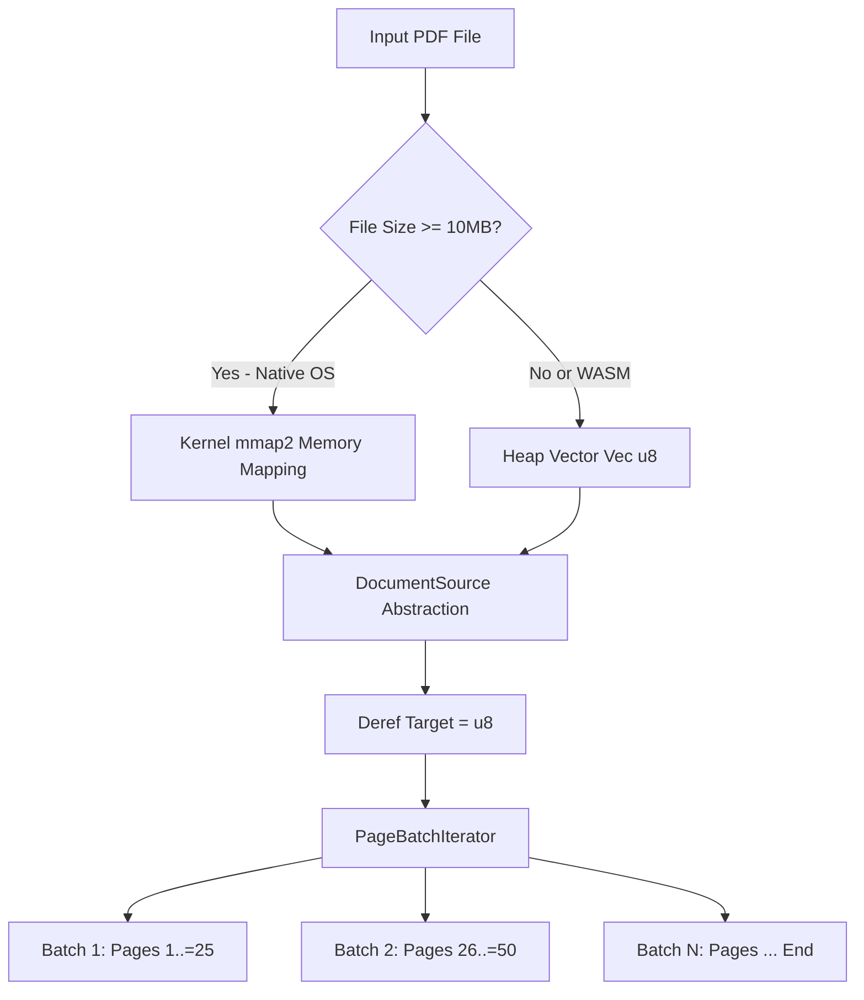

## Overview

PaperPilot is engineered to process massive documents—from multi-gigabyte corporate dossiers to 500+ page legal archives—within resource-constrained environments such as desktop applications, developer gateways, and AI agent sandboxes.

Historically, naive PDF pipelines load entire files into heap-allocated `Vec<u8>` buffers. For large documents or parallel pipelines, this strategy leads to severe memory pressure, cache thrashing, and process termination via Out-Of-Memory (OOM) killers.

**Spec 163** resolves this by introducing two foundational abstractions into `paperpilot-core` and `paperpilot-pdf`:
1. **`DocumentSource`**: A zero-copy memory abstraction that automatically leverages kernel-level memory mapping (`memmap2`) for files $\ge 10\text{ MB}$ on native operating systems.
2. **`PageBatchIterator`**: A streaming page-windowing iterator that processes large documents in discrete, bounded-memory batches.



---

## 1. Zero-Copy `DocumentSource` Architecture

The `DocumentSource` enum in `paperpilot-core` abstracts the underlying storage mechanism:

```rust
pub enum DocumentSource {
    /// In-memory byte buffer (used for small files, synthesized bytes, and WASM)
    Bytes(Vec<u8>),
    /// Zero-copy OS memory-mapped buffer
    #[cfg(not(target_arch = "wasm32"))]
    Mmap(memmap2::Mmap),
}
```

### Transparent Slicing via `Deref`
To ensure backward compatibility across all operations, `DocumentSource` implements `std::ops::Deref<Target = [u8]>` and `AsRef<[u8]>`:

```rust
impl std::ops::Deref for DocumentSource {
    type Target = [u8];

    fn deref(&self) -> &Self::Target {
        match self {
            Self::Bytes(vec) => vec.as_slice(),
            #[cfg(not(target_arch = "wasm32"))]
            Self::Mmap(mmap) => mmap.as_ref(),
        }
    }
}
```

Any existing function expecting a slice `&[u8]` (such as parsers, tokenizers, and cryptography hashers) works immediately with `&DocumentSource` without heap allocations or buffer copying.

---

## 2. Automatic 10MB Memory-Mapped I/O

When opening a document via `DocumentSource::open(path, threshold_bytes)`:

```rust
let source = DocumentSource::open("large_report.pdf", None)?;
```

- **Threshold Evaluation**: If `threshold_bytes` is unspecified, it defaults to **10 MB** (`10 * 1024 * 1024` bytes).
- **Native OS Execution (Linux, macOS, Windows)**:
  - Files $\ge 10\text{ MB}$ invoke `memmap2::MmapOptions::new().map(&file)`.
  - The OS assigns virtual memory addresses directly to the file on disk. Physical memory pages are paged in lazily by the kernel as accessed and discarded when memory pressure occurs, maintaining a minimal working set RSS.
  - Files $< 10\text{ MB}$ bypass mapping overhead and use standard `std::fs::read` into `DocumentSource::Bytes`.

---

## 3. Universal Page Batching via `PageBatchIterator`

Processing 500+ pages in a single unbroken loop can cause runaway memory growth from intermediate ASTs, text representations, and token structures.

`PageBatchIterator` standardizes chunked processing across all iterative tools (e.g. search, regex pattern extraction, PII scanning, OCR):

```rust
pub struct PageBatchIterator {
    total_pages: usize,
    batch_size: usize,
    current_page: usize,
}
```

### Usage Pattern
```rust
use paperpilot_core::PageBatchIterator;

let total_pages = 500;
let batch_size = 25;
let iterator = PageBatchIterator::new(total_pages, batch_size);

for page_range in iterator {
    // page_range is std::ops::RangeInclusive<usize>
    // Iteration 1: 1..=25
    // Iteration 2: 26..=50
    // ...
    process_pages(&document_source, page_range)?;
}
```

Benefits:
- **Peak RAM Reduction**: Allows intermediate ASTs and page tokens to be deallocated at the end of each batch.
- **Progress Telemetry**: Emits incremental progress events over WebSockets and MCP notifications during lengthy operations.
- **Cooperative Cancellation**: Checkpoints between batches allow the runtime to abort early if requested.

---

## 4. WebAssembly & Browser Runtime Parity

WebAssembly runtimes (`wasm32-unknown-unknown`) run in a sandboxed linear memory space with no operating system kernel or POSIX `mmap` syscalls.

To guarantee zero WASM regressions:
- All `memmap2` dependencies and `Mmap` variants are strictly gated by `#[cfg(not(target_arch = "wasm32"))]`.
- On WASM, `DocumentSource::open` or buffer loads instantiate `DocumentSource::Bytes(Vec<u8>)`.
- The public API surface remains 100% identical between native binaries and WASM builds.

---

## 5. Tool Integration Reference

The following PaperPilot tools natively leverage `DocumentSource` and streaming page batching:

| Tool | Capability | Memory Mode |
|---|---|---|
| `pdf_chunk` | Semantic Chunking & Overlap | Zero-copy mmap with heading context caching |
| `pdf_search` | Indexed Text Search | Zero-copy mmap with `PageBatchIterator` |
| `pdf_extract_patterns` | Regex & Keyword Extraction | Zero-copy mmap with bounded regex buffer |
| `document_pii_scan` | Compliance PII Extraction | Streaming page batching with privacy masking |
