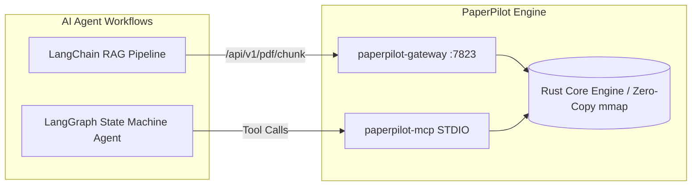

# LangChain & LangGraph Integration Guide

Integrate PaperPilot's zero-copy Rust document engine into Python **LangChain** and **LangGraph** workflows for high-performance, deterministic document processing, OCR, layout extraction, and semantic chunking.

---

## 1. Architecture Overview

PaperPilot provides two high-speed integration paths:
1. **REST Microservice Gateway** (`http://127.0.0.1:7823`): Direct HTTP integration for semantic chunking (`/api/v1/pdf/chunk`), OCR (`/api/v1/pdf/tools/pdf_ocr`), and document conversion.
2. **Model Context Protocol (MCP)**: Autonomous tool-calling via `paperpilot-mcp` (91 native PDF tools).



---

## 2. Quickstart: Start the PaperPilot Gateway

Run the local PaperPilot Gateway daemon on port 7823:

```bash
paperpilot serve --port 7823
# Or via cargo
cargo run -p paperpilot-cli -- serve --port 7823
```

---

## 3. LangChain Semantic Document Loader & Chunker

Use PaperPilot's native `pdf_chunk` endpoint as a lightning-fast replacement for `PyPDFLoader` + `RecursiveCharacterTextSplitter`. PaperPilot preserves layout context, Markdown tables, and section headings directly in Rust.

```python
import httpx
from typing import List
from langchain_core.documents import Document

class PaperPilotDocumentLoader:
    """Zero-overhead PDF loader and semantic chunker powered by PaperPilot Gateway."""
    
    def __init__(self, gateway_url: str = "http://127.0.0.1:7823"):
        self.gateway_url = gateway_url.rstrip("/")

    def load_and_split(self, pdf_path: str, target_tokens: int = 500) -> List[Document]:
        url = f"{self.gateway_url}/api/v1/pdf/chunk"
        payload = {
            "input": pdf_path,
            "target_tokens": target_tokens
        }
        
        with httpx.Client(timeout=60.0) as client:
            response = client.post(url, json=payload)
            response.raise_for_status()
            data = response.json()
            
        docs = []
        for chunk in data.get("chunks", []):
            metadata = {
                "source": pdf_path,
                "chunk_index": chunk["chunk_index"],
                "page_start": chunk["page_start"],
                "page_end": chunk["page_end"],
                "headings_context": chunk.get("headings_context", []),
                "estimated_tokens": chunk.get("estimated_tokens", 0)
            }
            docs.append(Document(page_content=chunk["text"], metadata=metadata))
            
        return docs

# Usage in a LangChain VectorStore pipeline:
loader = PaperPilotDocumentLoader()
documents = loader.load_and_split("contracts/master_agreement.pdf", target_tokens=400)

print(f"Extracted {len(documents)} semantic chunks with headings context!")
for doc in documents[:2]:
    print(f"Page [{doc.metadata['page_start']}-{doc.metadata['page_end']}]: {doc.page_content[:120]}...\n")
```

---

## 4. LangGraph Multi-Tool Agent Integration

LangGraph agents can invoke any of PaperPilot's 91 tools dynamically via LangChain `@tool` decorators backed by the PaperPilot Gateway:

```python
import httpx
from langchain_core.tools import tool
from langgraph.prebuilt import create_react_agent
from langchain_openai import ChatOpenAI

GATEWAY_URL = "http://127.0.0.1:7823/api/v1/pdf/tools"

@tool
def pdf_ocr(input_path: str, output_path: str) -> str:
    """Run neural OCR on a scanned or image-only PDF and save searchable output."""
    res = httpx.post(f"{GATEWAY_URL}/pdf_ocr", json={"input": input_path, "output": output_path}, timeout=120)
    res.raise_for_status()
    return f"Successfully generated OCR document at {output_path}"

@tool
def pdf_extract_text(input_path: str) -> str:
    """Extract clean Markdown text and tables from a PDF document."""
    res = httpx.post(f"{GATEWAY_URL}/pdf_extract_text", json={"input": input_path}, timeout=60)
    res.raise_for_status()
    data = res.json()
    return data["output"]["content"][0]["text"]

@tool
def pdf_merge(input_files: list[str], output_path: str) -> str:
    """Merge multiple PDF documents together into a single unified file."""
    res = httpx.post(f"{GATEWAY_URL}/pdf_merge", json={"inputs": input_files, "output": output_path}, timeout=60)
    res.raise_for_status()
    return f"Merged {len(input_files)} PDFs into {output_path}"

tools = [pdf_ocr, pdf_extract_text, pdf_merge]
llm = ChatOpenAI(model="gpt-4o", temperature=0)

# Create LangGraph ReAct Agent
agent = create_react_agent(llm, tools)

# Run Agent Workflow
inputs = {"messages": [("user", "Extract text from 'tests/e2e_fixtures/real/single_page.pdf' and summarize its key invoice amount.")]}
for step in agent.stream(inputs, stream_mode="values"):
    step["messages"][-1].pretty_print()
```

---

## 5. Direct Model Context Protocol (MCP) in Python

If your agent framework supports Model Context Protocol (e.g., Anthropic Claude Desktop, Cursor, or MCP Python client):

```python
from mcp import ClientSession, StdioServerParameters
from mcp.client.stdio import stdio_client

server_params = StdioServerParameters(
    command="paperpilot-mcp",
    args=[],
    env=None
)

async with stdio_client(server_params) as (read, write):
    async with ClientSession(read, write) as session:
        await session.initialize()
        tools = await session.list_tools()
        print(f"Connected to PaperPilot MCP! Available tools: {len(tools.tools)}")
```
