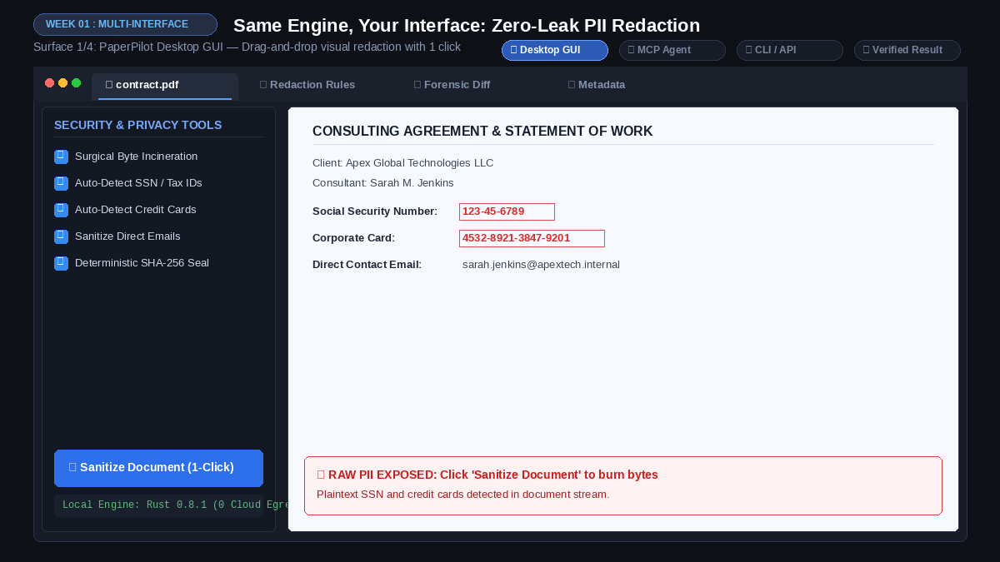

# Week 01: The Zero-Leak LLM Pipeline: Irreversible PII Redaction & Sanitization

**Theme:** Enterprise AI Privacy & Security  
**Tools Featured:** `pdf_redact`, `pdf_hash` (PaperPilot CLI & MCP)  
**Target Audience:** AI Engineers, Legal Tech, Security & Compliance, n8n/LangChain Builders  
**Asset:** 

---

## 📝 LinkedIn Post Copy

### Hook
Most PDF "redaction" tools don't actually delete your sensitive data. They just slap a black rectangle on top of it. 🛑

Feed that file into an LLM or OCR parser, and your client's SSN, credit card, and private health records get ingested straight into model context—or worse, logged to cloud APIs.

---

### The Problem
When building autonomous AI document pipelines (using n8n, LangChain, or Claude Desktop), engineering teams often assume:
> *"We drew redaction annotations over customer PII, so it's safe to send to OpenAI / Anthropic."*

Here's the harsh reality:
Traditional PDF annotations (`/Square`, `/Highlight`) merely render a visual mask on the viewport. The raw glyph streams, font descriptors, and underlying text objects remain 100% intact in the PDF byte stream. A 2-line Python script or standard `pdftotext` extracts it effortlessly.

---

### The PaperPilot Solution
PaperPilot (`pdf_redact` + `pdf_hash`) takes a zero-leak, cryptographic-first approach:

1. **Irreversible Stream Incineration (`pdf_redact`)**:
   Locates the exact coordinates of PII patterns (SSN, credit cards, emails, names) across text streams and vector objects, surgically excising the character byte sequences from the document content stream. It leaves zero extractable glyphs underneath.
2. **Deterministic Cryptographic Hashing (`pdf_hash`)**:
   Computes a SHA-256 audit digest of the sanitized artifact immediately upon output, providing verifiable chain-of-custody proof for compliance (SOC 2, HIPAA, GDPR).
3. **Sub-15ms Execution**:
   Written in native Rust. No bloated Python runtimes, no headless Chrome, and zero outbound network egress.

---

### Terminal Walkthrough
```bash
# 1. Surgically burn PII from document stream
paperpilot redact \
  --input client_agreement.pdf \
  --output agreement_sanitized.pdf \
  --regex '\d{3}-\d{2}-\d{4}'

# 2. Cryptographic audit fingerprint
paperpilot hash --input agreement_sanitized.pdf
# => SHA-256: 4f9a88...c1e3 (Zero extractable PII)
```

In the animated demo below, watch the PaperPilot CLI execute stream redaction and audit hashing in milliseconds. When attempting copy-paste on the output, the underlying PII bytes no longer exist.

---

### Key Takeaway for AI Architects
Before piping legal, financial, or healthcare PDFs into external LLM endpoints:
- Never trust visual annotation overlays.
- Sanitize at the byte-stream level locally.
- Stamp an immutable hash for your audit logs.

PaperPilot is 100% open-source, local-first, and available as a native CLI, REST API, and Model Context Protocol (MCP) server.

⭐ Star the project on GitHub: https://github.com/usepaperpilot/paperpilot  
📦 Install via brew / cargo / npx: `cargo install paperpilot-cli` or `npx @usepaperpilot/mcp`

#AI #CyberSecurity #DataPrivacy #Rust #LLM #InfoSec #LegalTech #MCP #OpenSource
