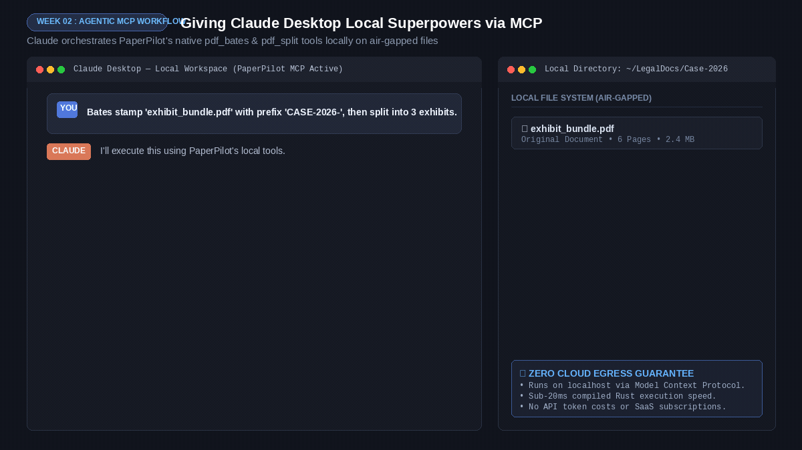

# Week 02: Giving Claude Desktop Local Superpowers via MCP: Autonomous Legal Clerk

**Theme:** Model Context Protocol (MCP) & Autonomous AI Agents  
**Tools Featured:** `pdf_bates`, `pdf_split`, `pdf_reorder` (PaperPilot MCP Server)  
**Target Audience:** Claude Desktop & Cursor Users, Legal Technologists, AI Workflow Architects  
**Asset:** 

---

## 📝 LinkedIn Post Copy

### Hook
Claude Desktop is great at reading text. But give it an actual local PDF task—like *"Bates stamp these 50 trial exhibits and split them by section"*—and it hits a dead end. 🚫

Unless you wire it directly to local tools via MCP. ⚡

---

### The Problem
Law firms, compliance officers, and contract managers handle gigabytes of sensitive discovery files every week.
Commercial e-discovery tools charge thousands of dollars per seat for basic tasks:
- Applying sequential Bates numbering (`CONF-000001` .. `CONF-000045`)
- Splitting exhibits into individual deposition files
- Reordering exhibits into court-mandated filings

Teams either spend hours doing this manually in Acrobat, or upload confidential discovery files to unvetted SaaS web tools.

---

### The PaperPilot Solution
By connecting PaperPilot's Model Context Protocol (MCP) server to Claude Desktop or Cursor:

```json
{
  "mcpServers": {
    "paperpilot": {
      "command": "npx",
      "args": ["-y", "@usepaperpilot/mcp"]
    }
  }
}
```

Claude gains 92 deterministic, lightning-fast native tools running entirely on localhost.

When you ask Claude:
> *"Stamp exhibit_bundle.pdf with Bates prefix 'CASE-2026-', bottom-right corner, then split each exhibit into a standalone PDF."*

Claude automatically:
1. Calls `pdf_bates` with `{ "prefix": "CASE-2026-", "start": 1, "position": "bottom-right" }` (14ms).
2. Inspects page ranges and invokes `pdf_split` to divide the stamped bundle into clean exhibits.
3. Reports execution logs directly back to your chat window.

Zero bytes leave your machine. No cloud uploads. Total data confidentiality.

---

### Why MCP + Rust Is the Future of Desktop Agents
- **Deterministic Accuracy**: LLMs don't try to manipulate raw PDF bytes through fragile Python scripts—they call compiled, battle-tested Rust primitives.
- **Microsecond Latency**: Operations complete faster than Claude can generate its next token.
- **Air-Gapped Compliance**: Works 100% offline. Ideal for defense counsel, hospitals, and banking.

Watch the animated demo below to see Claude Desktop orchestrate `pdf_bates` and `pdf_split` in real time!

---

⭐ Try it on your machine today: https://github.com/usepaperpilot/paperpilot  
Run locally: `npx @usepaperpilot/mcp` or `paperpilot serve --mcp`

#Claude #Anthropic #MCP #ModelContextProtocol #LegalTech #AIWorkflow #Automation #OpenSource #Rust
