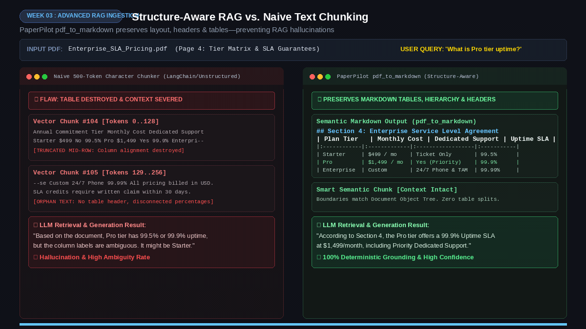

# Week 03: Structure-Aware RAG vs. Naive Text Chunking

**Theme:** Advanced Retrieval-Augmented Generation (RAG) & Vector Ingestion  
**Tools Featured:** `pdf_to_markdown`, `pdf_extract_text`, `pdf_chunk` (PaperPilot Desktop, MCP, CLI & REST API)  
**Target Audience:** AI Engineers, Vector DB Specialists (Qdrant, Pinecone, Weaviate), RAG Practitioners  
**Asset:** 

---

## 📝 LinkedIn Post Copy

Why does your enterprise RAG pipeline hallucinate on financial tables and pricing agreements? 📉

It's not your embedding model. It's your chunker. 🧩

When a naive 500-token character window hits a multi-column pricing matrix:
- Column headers get severed from their data rows.
- Numbers lose context (`$1,499` floats without knowing if it's "Monthly Cost" or "Setup Fee").
- When a user asks *"What is Pro tier uptime SLA?"*, vector search returns an orphan row, and your LLM hallucinates.

PaperPilot takes a structure-aware approach: preserving GFM Markdown pipes (`| Tier | Monthly | SLA |`) and attaching H1/H2 parent headers to child chunks in 11ms.

Same task, your choice of interface:

🖥️ **Desktop GUI (Dual-Pane Visual Inspector)**
Open any complex PDF in PaperPilot Desktop -> Select "Structured Markdown" -> View original PDF on the left and live GitHub Flavored Markdown with table syntax on the right. Export with 1 click.

🤖 **AI Agent / MCP (Claude & Cursor Ingestion)**
```json
{
  "server": "paperpilot",
  "tool": "pdf_to_markdown",
  "arguments": {
    "input": "Enterprise_SLA_Pricing.pdf",
    "table_mode": "github_pipes",
    "preserve_hierarchy": true
  }
}
```

💻 **CLI (High-Speed Ingestion Pipeline)**
```bash
# Convert complex tables to pristine GFM markdown in 11ms
paperpilot pdf-to-markdown -i SLA_Pricing.pdf -o sla.md --table-mode github_pipes
paperpilot chunk -i sla.md --strategy semantic
```

🌐 **Python / REST API (Sub-5ms Microservice)**
```python
resp = requests.post("http://localhost:8080/api/v1/to-markdown", json={
    "input_path": "Enterprise_SLA.pdf",
    "extract_tables": True,
    "chunk_strategy": "semantic_headers"
})
chunks = resp.json()["chunks"] # 0 orphan rows, 100% grounded retrieval
```

Garbage in, garbage out. High-performance RAG starts with structure-aware document parsing.

⭐ GitHub: https://github.com/KrushnaVardhanReddy/PaperPilot

⚡ 5-Second Flash Install:
• Linux & macOS:
`curl -fsSL https://raw.githubusercontent.com/KrushnaVardhanReddy/PaperPilot/main/scripts/install.sh | bash`
• Windows PowerShell:
`irm https://raw.githubusercontent.com/KrushnaVardhanReddy/PaperPilot/main/scripts/install.ps1 | iex`
• AI Agent / MCP:
`npx -y @usepaperpilot/mcp`

#RAG #GenerativeAI #VectorDatabase #AI #MachineLearning #LlamaIndex #LangChain #DataEngineering #Rust #OpenSource
