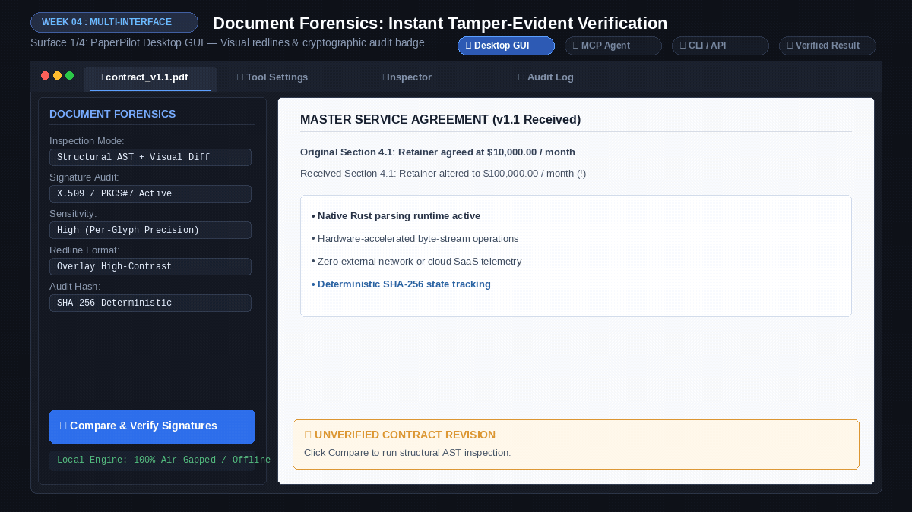

# Week 04: Document Forensics: Instant Tamper-Evident Verification (Diff & Signatures)

**Theme:** Document Forensics, Compliance & Cryptographic Integrity  
**Tools Featured:** `pdf_compare`, `pdf_sign`, `pdf_verify` (PaperPilot Desktop, MCP, CLI & REST API)  
**Target Audience:** Compliance Officers, Legal Counsel, Audit Teams, FinTech Security Engineers  
**Asset:** 

---

## 📝 LinkedIn Post Copy

Someone sends you a revised 40-page contract. They claim they only *"fixed a typo in section 2"*.

Can you spot the rogue zero that turned a \$10,000 monthly retainer into \$100,000 before your team signs? 🔍🚨

Manual review takes hours and is prone to human fatigue. Naive pixel diff tools trigger hundreds of false positives on font kerning while missing subtle text substitutions deep in the PDF byte stream.

And if the document was digitally signed? Modifying even one invisible character silently invalidates its legal seal.

PaperPilot pairs structural AST comparison with hardware-speed cryptographic verification in native Rust.

Same task, your choice of interface:

🖥️ **Desktop GUI (Side-by-Side Visual Diff)**
Drag `contract_v1.0.pdf` and `contract_v1.1.pdf` into PaperPilot Desktop -> Visual redlines highlight changes in real-time -> Cryptographic badge alerts: *"TAMPER DETECTED: Page 1, Line 14 ($10,000 -> $100,000) & Digital Signature Invalidated"*.

🤖 **AI Agent / MCP (Autonomous Legal Auditor)**
```json
{
  "server": "paperpilot",
  "tool": "pdf_compare",
  "arguments": {
    "original": "contract_v1.0.pdf",
    "revised": "contract_v1.1.pdf",
    "mode": "structural_ast",
    "verify_signatures": true
  }
}
```

💻 **CLI (Terminal Audit One-Liner)**
```bash
# Structural AST diff and digital signature audit in 11ms
paperpilot compare contract_v1.0.pdf contract_v1.1.pdf --format json
paperpilot verify -i contract_v1.1.pdf # => REJECTED: Digest mismatch post-signing
```

🌐 **Python / REST API (Sub-5ms Webhook Approval Gate)**
```python
resp = requests.post("http://localhost:8080/api/v1/compare", json={
    "original_path": "contract_v1.0.pdf",
    "revised_path": "contract_v1.1.pdf"
})
if resp.json()["tamper_detected"]:
    raise SecurityException("Unauthorized contract modification detected!")
```

Never rely on honor-system redlines when millions of dollars are on the line. Diff the AST and verify the signature locally.

⭐ GitHub: https://github.com/usepaperpilot/paperpilot

#LegalTech #Compliance #DocumentSecurity #CyberSecurity #Audit #FinTech #OpenSource #RustLang #ContractManagement #PaperPilot #MCP
