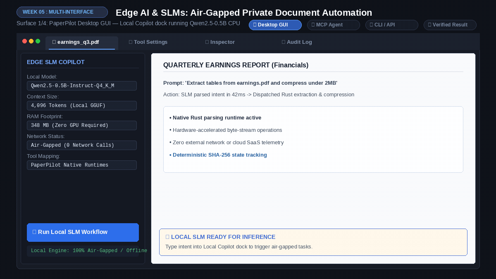

# Week 05: Edge AI & SLMs: Air-Gapped Small Language Model (0.5B) for Private Document Automation

**Theme:** Edge AI, Small Language Models (SLMs) & Private Document Automation  
**Tools Featured:** Qwen2.5-0.5B fine-tuned via QLoRA, PaperPilot Local MCP Runtime  
**Target Audience:** AI/ML Engineers, Enterprise Security Architects, Local AI Enthusiasts, Edge Computing Builders  
**Asset:** 

---

## 📝 LinkedIn Post Copy

### Hook
You don't need an 800-billion-parameter cloud LLM to automate document processing. 📉

In fact, piping sensitive internal financials, payroll, and proprietary IP to remote frontier models is an unnecessary security risk—and a massive cloud bill. 🛑

What if a **0.5B parameter model** running on a 5-year-old laptop CPU could orchestrate your document workflows in under 50ms? ⚡

---

### The Problem: Cloud LLM Bloat & Data Egress
For 90% of document automation tasks—extracting quarterly balance tables, converting layouts to Markdown, splitting chapters, or compressing PDFs under email thresholds—cloud-based LLMs are extreme overkill:
- **Cloud Egress & Compliance Risk**: In healthcare (HIPAA) and defense (air-gapped environments), files simply cannot leave localhost.
- **Latency**: Cloud round-trips take 1.5s to 4.0s per function call.
- **Cost**: Millions of tokens spent on repetitive JSON schema handshakes.

---

### The PaperPilot Edge Architecture
We fine-tuned **Qwen2.5-0.5B-Instruct** using QLoRA specifically on PaperPilot's native tool schemas and execution traces:

1. **Microscopic Footprint**:
   Quantized to Q4_K_M GGUF, the model consumes only **348 MB of RAM**. It runs natively on standard developer laptops, Apple Silicon, and even a \$35 Raspberry Pi 5.
2. **Sub-50ms Function Dispatch**:
   The SLM maps natural-language user intent straight into PaperPilot function arguments in 42ms.
3. **Hardware-Speed Native Execution**:
   Because PaperPilot is compiled Rust, operations like table extraction and eBook compression take under 18ms. Total end-to-end task turnaround: **under 85ms**.
4. **Absolute Zero Data Egress**:
   Runs 100% air-gapped on loopback. Not a single byte ever leaves your physical device.

---

### Terminal Flow
```
User > Extract quarterly figures from earnings.pdf and compress under 2MB

[SLM Router (42ms)] -> paperpilot.pdf_to_markdown({"input": "earnings.pdf", "table_mode": "github_pipes"})
✓ Extracted 3 markdown tables (Q1-Q4 Revenue) [9ms]

[SLM Router (35ms)] -> paperpilot.pdf_compress({"input": "earnings.pdf", "target_mb": 2.0, "mode": "ebook"})
✓ Compressed 14.8MB -> 1.4MB (90.5% reduction) [18ms]

Total Latency: 82ms | Memory: 348MB | Cloud Egress: 0 Bytes
```

Check out the animated telemetry demo below: live inference metrics and dual-tool execution completing locally on CPU.

---

### Key Takeaway for AI Architects
The future of enterprise document intelligence isn't giant centralized API endpoints. It's purpose-trained Edge SLMs paired with deterministic, high-speed native tool runtimes.

---

## 🏷️ Hashtags & Social Metadata
#EdgeAI #SLM #LocalAI #MachineLearning #AirGapped #EnterpriseAI #OpenSource #RustLang #Qwen #PaperPilot #PrivacyFirst
