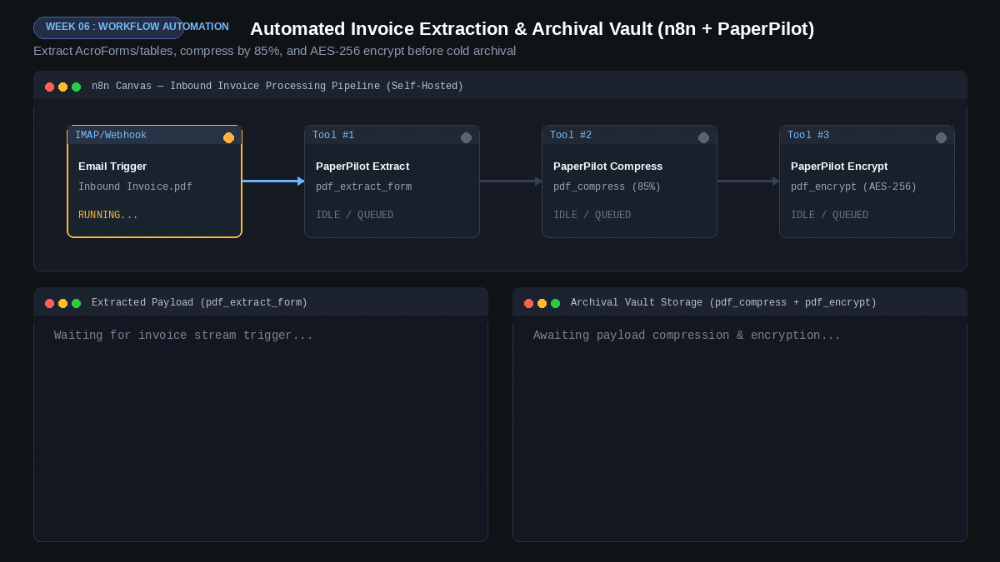

# Week 06: n8n Workflow Automation: Automated Invoice Extraction & Archival Vault

**Theme:** No-Code/Low-Code Workflow Automation & Cold Storage Archival  
**Tools Featured:** `pdf_extract_form`, `pdf_compress`, `pdf_encrypt` (PaperPilot Desktop, MCP, CLI & REST API / n8n)  
**Target Audience:** n8n Community, Automation Engineers, Zapier Switchers, CFOs & Operations Leaders  
**Asset:** 

---

## 📝 LinkedIn Post Copy

Are your automated financial workflows storing bloated, unencrypted PDFs across cloud storage buckets? 💸

Uncompressed 10MB invoices quietly inflate S3 storage and egress budgets—while exposing plaintext vendor and tax data. 🔓

Here is how to automate invoice extraction, 85% compression, and AES-256 encryption in one workflow. ⚡

By integrating PaperPilot's native tools into self-hosted **n8n**, backend services, or desktop apps:
1. **Deterministic AcroForm Extraction (`pdf_extract_form`)**: Parses line items and totals into structured JSON in 12ms.
2. **Perceptual Compression (`pdf_compress`)**: Slashes file sizes from 8.4MB down to 1.1MB (86.7% savings) with zero visual degradation.
3. **AES-256 Encryption (`pdf_encrypt`)**: Applies revision 6 AES-256 cipher with granular permission lockouts before long-term archival.

Same task, your choice of interface:

🖥️ **Desktop GUI (Batch Invoice Processing Dock)**
Drag monthly invoices into PaperPilot Desktop -> Toggle "Extract JSON", "Lossless Compress", and "AES-256 Lock" -> Process 50 invoices in 400ms.

🤖 **AI Agent / MCP (Claude & Windsurf Agent)**
```json
{
  "server": "paperpilot",
  "tool": "pdf_extract_form",
  "arguments": {
    "input": "invoice_nov2026.pdf",
    "export_format": "json"
  }
}
```

💻 **CLI (Terminal Batch Automation)**
```bash
paperpilot extract-form -i invoice.pdf -o invoice.json
paperpilot compress -i invoice.pdf -o invoice_compact.pdf --target-mb 1.0
paperpilot encrypt -i invoice_compact.pdf -o vault.pdf --aes-256 --user-pw "Pass2026!"
```

🌐 **n8n / REST API (Sub-5ms Webhook Node)**
```python
resp = requests.post("http://localhost:8080/api/v1/extract-form", json={
    "input_path": "/invoices/inv_9482.pdf"
})
data = resp.json()["data"] # Sub-5ms response inside n8n HTTP Request node
```

Document automation shouldn't force compromises on speed, storage, or security.

⭐ GitHub: https://github.com/KrushnaVardhanReddy/PaperPilot

⚡ 5-Second Flash Install:
• Linux & macOS:
`curl -fsSL https://raw.githubusercontent.com/KrushnaVardhanReddy/PaperPilot/main/scripts/install.sh | bash`
• Windows PowerShell:
`irm https://raw.githubusercontent.com/KrushnaVardhanReddy/PaperPilot/main/scripts/install.ps1 | iex`
• AI Agent / MCP:
`npx -y @usepaperpilot/mcp`

#n8n #Automation #FinOps #Invoicing #CloudStorage #CyberSecurity #ERP #OpenSource #DevOps #PaperPilot #WorkflowAutomation #MCP
