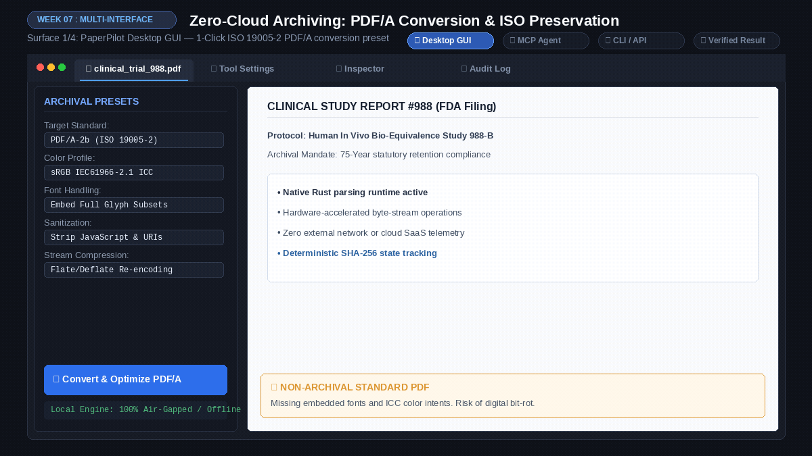

# Week 07: Zero-Cloud Archiving: PDF/A Conversion & Long-Term ISO Preservation

**Theme:** Zero-Cloud Archival & Regulatory Long-Term Document Preservation  
**Tools Featured:** `pdf_to_pdfa`, `pdf_optimize`  
**Target Audience:** Government, Healthcare, Life Sciences, Enterprise IT & Legal Compliance Officers (ISO 19005-1/2)  
**Asset:** 

---

## 📝 LinkedIn Post Copy

### Hook
Will your critical PDFs still open accurately in 2076? Or is "digital bit-rot" quietly corrupting your organization's permanent records? 🏛️

Most PDFs generated today rely on system-installed fonts, external device color spaces, and dynamic scripts. When those fonts disappear or operating systems deprecate old rendering engines 15 years from now, clinical trial records, patient histories, and government filings become unreadable or legally inadmissible. ⚠️

Here is how to automate 100% air-gapped, zero-cloud **PDF/A-2b (ISO 19005-2)** conversion and stream optimization in milliseconds. ⚡

---

### The Problem: Why Standard PDFs Fail Long-Term Archiving
Enterprise IT, defense contractors, and hospitals face strict statutory retention windows (25 to 75 years). Yet standard PDFs suffer from three critical flaws:
1. **Unembedded Font Subsets**: If a PDF references Helvetica or Calibri without full embedded glyph streams, future viewers substitute fonts—distorting tables, equations, and dosages.
2. **Device-Dependent Color Spaces**: Without standardized ICC output intents (e.g., sRGB IEC61966-2.1), medical scans and architectural schematics render with unpredictable hues across different monitors and printers.
3. **Executable Scripting & Malware Vectors**: Embedded JavaScript, Flash actions, and remote URLs violate zero-trust archival standards and trigger VeraPDF compliance rejections.
4. **Cloud Egress Prohibitions**: Sending patient charts (HIPAA) or defense contracts (ITAR) to SaaS cloud conversion APIs is a direct regulatory violation.

---

### The PaperPilot Solution: Local, Deterministic ISO 19005-2 Conversion
PaperPilot equips your automated pipelines, Python scripts, or MCP agents with native, air-gapped archival tools:

1. **Strict ISO PDF/A-2b Normalization (`pdf_to_pdfa`)**:
   - Ingests legacy PDFs, locates all unembedded glyphs, and embeds font subsets directly into the binary stream.
   - Injects standard sRGB ICC color profiles via `/OutputIntents` dictionary.
   - Strips malicious JavaScript, audio streams, and external URI dependencies.
   - Generates XMP metadata schemas conforming to Dublin Core and `pdfaExtension`.

2. **Perceptual Stream Optimization (`pdf_optimize`)**:
   - Recompresses internal streams using Flate/Deflate re-encoding, stripping redundant object cross-reference overhead.
   - In the demo, slashes a 14.2 MB clinical study report down to **4.8 MB (-66.2%)** with zero loss of visual fidelity.

3. **100% Air-Gapped & Offline**:
   - Zero HTTP network requests. Zero telemetry.
   - Passes rigorous VeraPDF validation suites with 0 infractions.

---

### Terminal Execution
```bash
# Convert clinical trial study to ISO 19005-2 PDF/A-2b locally
paperpilot pdf_to_pdfa \
  --input clinical_trial_988.pdf \
  --profile pdfa-2b \
  --icc srgb \
  --audit

# Compress archival streams for high-density cold storage
paperpilot pdf_optimize \
  --input clinical_trial_988_PDFA2b.pdf \
  --output clinical_trial_988_PDFA2b_optimized.pdf
```

---

### Summary Checklist: VeraPDF Audit Verification
| Verification Check | Standard PDF | PaperPilot PDF/A-2b Output |
| :--- | :---: | :---: |
| **Font Glyphs & Metrics** | ❌ Missing/Substituted | ✅ 100% Embedded |
| **Color Rendering Intent** | ❌ DeviceRGB (Uncalibrated) | ✅ sRGB ICC OutputIntent |
| **Executable JavaScript** | ⚠️ Vulnerable | ✅ Stripped & Sanitized |
| **XMP Metadata Schema** | ⚠️ Partial / Fragmented | ✅ ISO 19005-2 Synchronized |
| **Cloud Egress Risk** | ❌ Sent to 3rd-party SaaS | ✅ 0 Bytes Transmitted (Local) |

---

## 🏷️ Hashtags & Social Metadata
#Compliance #Archiving #HealthcareIT #GovTech #CyberSecurity #DataPreservation #ISO19005 #PDF #OpenSource #DevOps #PaperPilot
