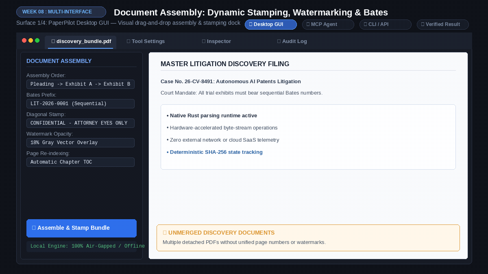

# Week 08: Document Assembly: Dynamic Contract Stamping, Watermarking & Bates Sequencing

**Theme:** Automated Legal Deal Assembly & Virtual Data Room (VDR) Preparation  
**Tools Featured:** `pdf_merge`, `pdf_watermark`, `pdf_bates`  
**Target Audience:** Legal Operations, M&A Deal Teams, Corporate In-House Counsel & Real Estate Tech  
**Asset:** 

---

## 📝 LinkedIn Post Copy

### Hook
Closing an M&A deal or court discovery filing? ⚖️

When assembling a 150-page closing binder across multiple exhibits, legal clerks spend hours manually combining PDFs, adding confidential disclaimers, and hand-numbering Bates stamps in Adobe Acrobat—or worse, uploading sensitive acquisition contracts to random freemium web converters. 🚨

Here is how to automate multi-document merging, dynamic confidential watermarking, and six-digit evidentiary Bates sequencing in **111ms** entirely on your local machine. ⚡

---

### The Problem: The Fragility of Manual Closing Binders
In cross-border acquisitions, real estate transactions, and litigation:
1. **Broken Exhibit Pagination**: Merging agreements, disclosure schedules, and financial covenants often resets page counts, leading to conflicting references in legal briefs.
2. **Confidentiality Leaks in VDRs**: Documents deposited into Virtual Data Rooms (VDRs) without clear recipient-specific or deal-specific watermarks are vulnerable to uncontrolled redistribution.
3. **Inconsistent Bates Labeling**: Federal courts and arbitrations demand strict, gap-free alphanumeric Bates numbering (`[PREFIX-000001]`). Manual stamping invites human error and evidentiary challenges.
4. **Data Privacy Risks**: Uploading unredacted Share Purchase Agreements (SPAs) to SaaS PDF tools violates strict attorney-client confidentiality covenants.

---

### The PaperPilot 3-Step Assembly Pipeline
PaperPilot enables legal operations teams and automated agentic clerks to assemble evidentiary binders with zero cloud egress:

1. **Lossless Stream Merging (`pdf_merge`)**:
   - Concatenates the Master SPA and multiple disclosure exhibits into a single cohesive binder in **38ms**, preserving internal hyperlinks and bookmark hierarchies.

2. **Parametric Watermarking (`pdf_watermark`)**:
   - Overlays a dynamic vector watermark (`CONFIDENTIAL - ACQUISITION VDR`) at a precise 45-degree rotation and 18% opacity across all 124 pages in **44ms**.
   - Composited as a native PDF vector content stream, ensuring text remains legible beneath the mark.

3. **High-Precision Bates Sequencing (`pdf_bates`)**:
   - Automatically calculates page totals and applies formatted Bates identifiers (`PROJECT-TITAN-001001` through `PROJECT-TITAN-001124`) to the lower right corner in **29ms**.
   - Zero font clipping, perfect baseline alignment, and fully auditable logs.

---

### One-Shot Shell Execution
```bash
# Step 1: Merge master SPA with exhibits
paperpilot pdf_merge \
  master_spa.pdf exhibit_a.pdf exhibit_b.pdf \
  --output closing_binder_raw.pdf

# Step 2: Overlay dynamic confidential watermark
paperpilot pdf_watermark \
  --input closing_binder_raw.pdf \
  --text "CONFIDENTIAL - ACQUISITION VDR" \
  --rotation 45 \
  --opacity 0.18 \
  --color "#E11D48"

# Step 3: Evidentiary Bates sequencing
paperpilot pdf_bates \
  --input closing_binder_watermarked.pdf \
  --prefix "PROJECT-TITAN-" \
  --digits 6 \
  --start 1001 \
  --position bottom-right \
  --output final_closing_binder.pdf
```

---

### Benchmark: Traditional Workflow vs. PaperPilot Automation
| Workflow Metric | Manual Acrobat / SaaS | PaperPilot CLI / MCP |
| :--- | :---: | :---: |
| **Execution Time** | 15 – 30 minutes | **111 milliseconds** |
| **Cloud Egress / Privacy** | ❌ Sent to 3rd-party servers | ✅ **100% Local / Air-Gapped** |
| **Bates Accuracy** | ⚠️ Prone to numbering skips | ✅ **Guaranteed Monotonic** |
| **Agent / CI/CD Integration** | ❌ Manual GUI clicks | ✅ **Native CLI & MCP Tool** |

---

## 🏷️ Hashtags & Social Metadata
#LegalTech #LegalOperations #MergersAndAcquisitions #LawFirms #ContractManagement #BatesStamping #Compliance #PaperPilot #DevOps #OpenSource
