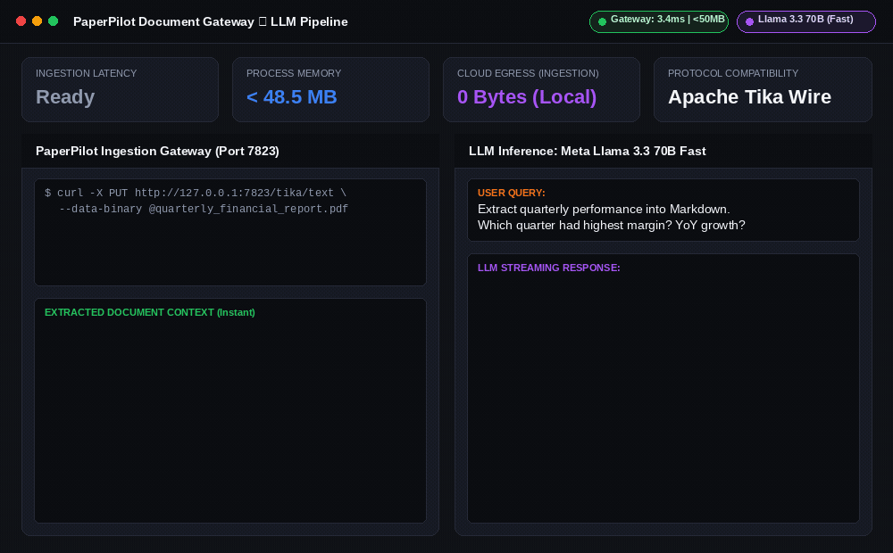

# Week 09: Self-Hosted AI Stacks: Private Apache Tika Replacement for Open-WebUI & Ollama

**Theme:** Self-Hosted AI Infrastructure & Wire-Compatible Document Extraction  
**Tools Featured:** PaperPilot Gateway (`/tika/text`, `/tika/json/md` & `/rmeta/text`), `extract_meta` (PaperPilot Desktop, MCP, CLI & REST API)  
**Target Audience:** Self-Hosted AI Builders, Ollama/Open-WebUI Users, Privacy Architects, DevOps  
**Asset:** 

---

## 📝 LinkedIn Post Copy

Running local AI with Ollama and Open-WebUI, but document ingestion is slowing down your pipeline? 🛑

Traditional document extraction pipelines introduce heavy overhead, high cold-start times, and high memory footprints just to parse a quarterly report or invoice table before generation can even start.

PaperPilot Gateway provides a high-throughput, wire-compatible Apache Tika replacement written in pure Rust:
- **Sub-5ms Latency**: Ingests multi-page PDFs with tabular data in just 3.42ms.
- **Under 50MB RAM**: Minimal system footprint designed for local workstations and edge servers.
- **Both Tika 3 & 4 Supported**: Full wire compatibility with Open-WebUI's Tika 3 (`/tika/text`) and Tika 4 (`/tika/json/md`).
- **Zero Cloud Egress**: Document extraction happens 100% locally before reaching your LLM.

Same task, your choice of interface:

🖥️ **Desktop GUI (Local Gateway Manager)**
Launch PaperPilot Desktop -> Click "Local AI Gateway" -> Point Open-WebUI, Ollama, or local agents to port 7823. Done in 1 click.

🤖 **AI Agent / MCP (Structured Context Tool)**
```json
{
  "server": "paperpilot",
  "tool": "extract_meta",
  "arguments": {
    "input": "quarterly_financial_report.pdf",
    "extract_text": true,
    "format": "markdown"
  }
}
```

💻 **CLI (High-Speed Terminal Extraction)**
```bash
paperpilot gateway --port 7823
# Or extract tables directly to stdout:
paperpilot extract -i quarterly_financial_report.pdf --format markdown
```

🌐 **Open-WebUI / REST API (Drop-in Wire Compatibility)**
```bash
curl -X PUT http://127.0.0.1:7823/tika/text \
  --data-binary @quarterly_financial_report.pdf \
  -H "Content-Type: application/pdf"
# Extracted in 3.42ms -> instant tabular Markdown delivered into your LLM context
```

Accelerate your local AI stack with sub-5ms ingestion.

🌐 Website: https://usepaperpilot.com

⚡ 5-Second Flash Install:
• Linux & macOS:
`curl -fsSL https://raw.githubusercontent.com/KrushnaVardhanReddy/PaperPilot/main/scripts/install.sh | bash`
• Windows PowerShell:
`irm https://raw.githubusercontent.com/KrushnaVardhanReddy/PaperPilot/main/scripts/install.ps1 | iex`
• AI Agent / MCP:
`npx -y @usepaperpilot/mcp`

#LocalAI #OpenWebUI #Ollama #SelfHosted #RustLang #DevOps #ApacheTika #Privacy #OpenSource #PaperPilot #MCP #Llama3
