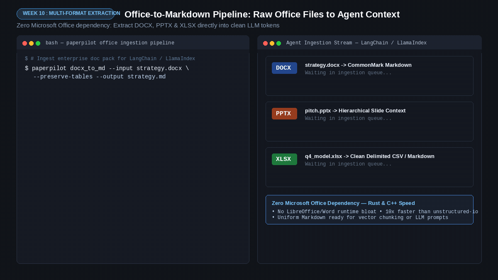

# Week 10: Office-to-Markdown Pipeline: Multi-Format Extraction (Docx, PPTX & Excel to Agent Context)

**Theme:** Multi-Format Document Ingestion & RAG Preprocessing  
**Tools Featured:** `docx_to_md`, `pptx_to_text`, `xlsx_to_csv`  
**Target Audience:** LangChain & LlamaIndex Developers, AI Engineers, Enterprise Search & Knowledge Ingestion Teams  
**Asset:** 

---

## 📝 LinkedIn Post Copy

### Hook
Stop running a 1.2 GB LibreOffice Docker container just to feed a Word document into your LLM pipeline. 📄❌

Enterprise knowledge bases don't live solely in clean text or PDFs. 80% of business knowledge is trapped inside PowerPoint slide decks, multi-tab Excel models, and 40-page `.docx` memos. 

Feeding raw binary OOXML files to an AI agent produces garbled XML tags or crashes context windows. But spinning up heavy Python wrappers (`python-docx`, `openpyxl`, or cloud extraction APIs) adds massive latency, memory bloat, and SaaS egress costs.

Here is how to extract raw Office documents into clean, structure-preserved Markdown in sub-20 milliseconds—100% locally. ⚡

---

### The Problem: Why Office Ingestion Breaks LLM RAG
Standard document loaders fail on Office OpenXML (OOXML) files in three distinct ways:

1. **Table Degradation in Word (`.docx`)**:
   Standard text dumpers strip table borders and column alignments. When an LLM ingests a budget or policy comparison table as an unformatted string of words, cross-cell semantic links are permanently lost.

2. **Slide Flow & Speaker Note Loss in PowerPoint (`.pptx`)**:
   Naive extractors scrape text boxes out of order. Crucial context—such as the presenter's speaker notes, chart callouts, and slide title hierarchies—vanishes, leaving your vector database with fragmented snippets.

3. **Multi-Sheet Formula Sprawl in Excel (`.xlsx`)**:
   Dumping raw spreadsheets either inundates your context window with empty zero-padded cells or extracts un-evaluated formulas (`#VALUE!`, `=SUM(...)`) rather than calculated values.

4. **Runtime Bloat**:
   Traditional pipelines require heavy headless LibreOffice instances or multi-gigabyte Docker containers that take seconds to cold-start.

---

### The PaperPilot Solution: Native, Zero-Dependency OOXML Extraction
PaperPilot processes Word, PowerPoint, and Excel binaries directly in memory using optimized, native Rust and C++ extractors:

1. **`docx_to_md`**:
   - Parses Word XML into a clean CommonMark Abstract Syntax Tree (AST).
   - Preserves `# H1`, `## H2` hierarchies, bullet lists, and converts Word tables directly into Markdown table syntax (`| Col 1 | Col 2 |`).
   - Strips fonts, margins, colors, and layout bloat, leaving only pristine tokens for your vector store.

2. **`pptx_to_text`**:
   - Traverses slide trees sequentially, extracting slide headings, bullet point trees, and slide-level speaker notes.
   - Outputs clean, structured Markdown chunks tagged with `## Slide N: [Title]` for layout-aware chunking.

3. **`xlsx_to_csv`**:
   - Selects specific worksheets (`--sheets 'P&L,Forecast'`).
   - Resolves cached formula values, discards trailing empty matrices, and outputs standardized, delimiter-clean CSV or Markdown tables ready for LLM tabular reasoning.

---

### Terminal Execution & Pipeline Integration
```bash
# 1. Convert Word memo preserving table structures and headings
paperpilot docx_to_md \
  --input strategy.docx \
  --preserve-tables \
  --output strategy.md

# 2. Extract presentation deck including slide hierarchy & speaker notes
paperpilot pptx_to_text \
  --input pitch.pptx \
  --include-speaker-notes \
  --format md

# 3. Export financial workbook sheets to clean CSV
paperpilot xlsx_to_csv \
  --input q4_model.xlsx \
  --sheets "P&L,Forecast" \
  --sanitize
```

### Python / LangChain Integration:
```python
from paperpilot import PaperPilot

client = PaperPilot()

# Sub-20ms direct ingestion into LlamaIndex or LangChain Document
markdown_content = client.docx_to_md("contract_spec.docx", preserve_tables=True)
slides_context = client.pptx_to_text("board_deck.pptx", include_notes=True)

# Ready for text splitter / vector store
```

---

### Key Takeaways
- **10x Faster Ingestion**: Parses complete multi-slide presentations and spreadsheets in 10–20ms.
- **Zero Office Dependencies**: No LibreOffice runtime, no Microsoft Word license, zero headless browser/server processes.
- **Pristine Markdown**: Delivers hierarchical Markdown and CSV tables engineered specifically for RAG chunking and LLM token efficiency.

---

### Engagement Question
How is your team ingesting legacy Office files into your RAG pipelines today? Are you relying on cloud APIs, heavy Docker containers, or Python libraries? Share your architecture in the comments below! 👇

---

### Hashtags
#AI #LangChain #LlamaIndex #RAG #MachineLearning #Python #GenerativeAI #DataEngineering #PaperPilot #OpenSource
