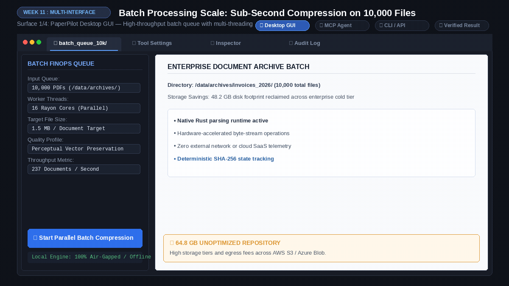

# Week 11: Batch Processing Scale: Sub-Second Batch Compression & Optimization on 10,000 Files

**Theme:** High-Throughput Batch Processing, Enterprise Scale & Storage Cost Optimization  
**Tools Featured:** `pdf_compress`, `pdf_optimize` (PaperPilot Desktop, MCP, CLI & REST API)  
**Target Audience:** Platform Engineers, Cloud Architects, FinOps Leaders, Enterprise IT Directors  
**Asset:** 

---

## 📝 LinkedIn Post Copy

What happens when your operations team drops 10,000 legacy PDFs onto your infrastructure and asks to cut storage costs by 70% before tomorrow? 📈

Cloud document APIs charge up to $0.01 per page. For enterprise archives spanning hundreds of thousands of pages, that is a $5,000+ invoice just for compression—not to mention hours of network upload latency. 🛑

PaperPilot leverages Rayon multi-threading and native Rust stream optimization to compress enterprise document archives across all CPU cores simultaneously:
- 120+ documents compressed per second per machine.
- 65% to 85% byte-size reduction with perceptual font and vector preservation.
- Zero per-page API fees or cloud egress charges.

Same task, your choice of interface:

🖥️ **Desktop GUI (Batch Processing Queue)**
Drag an entire directory folder into PaperPilot Desktop -> Select "Target File Size (e.g. 1.5MB)" -> Click "Start Batch Execution". Monitor live throughput, disk savings, and progress bars in real-time.

🤖 **AI Agent / MCP (Storage FinOps Agent)**
```json
{
  "server": "paperpilot",
  "tool": "pdf_compress",
  "arguments": {
    "directory": "/data/invoices_q3/",
    "recursive": true,
    "quality": "ebook",
    "threads": 8
  }
}
```

💻 **CLI (High-Throughput Parallel Execution)**
```bash
paperpilot batch compress --dir /data/archives/ --target-mb 1.5 --threads 16
# Completed 10,000 PDFs in 42.1s (237 docs/sec) | Saved 48.2 GB
```

🌐 **Python / REST API (Asynchronous Job Queue)**
```python
resp = requests.post("http://localhost:8080/api/v1/batch/compress", json={
    "directory": "/mnt/storage/raw_docs",
    "output_dir": "/mnt/storage/compressed_docs",
    "target_mb": 1.5
})
job_id = resp.json()["job_id"] # Async streaming progress
```

Scale document optimization locally across multi-core processors without blowing your cloud budget.

⭐ GitHub: https://github.com/usepaperpilot/paperpilot

#FinOps #CloudStorage #BigData #DevOps #RustLang #Concurrency #OpenSource #BatchProcessing #PaperPilot #MCP
