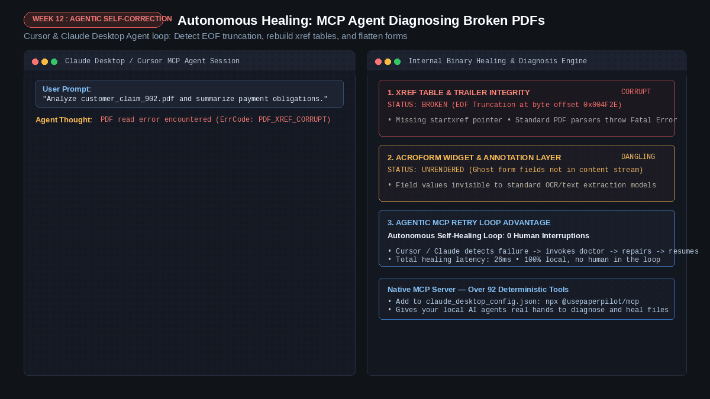

# Week 12: Agentic Self-Correction: MCP Agent Diagnosing & Healing Corrupt PDFs

**Theme:** Autonomous Agentic Self-Correction & Document Recovery  
**Tools Featured:** `doctor`, `pdf_repair`, `pdf_flatten` (PaperPilot Desktop, MCP, CLI & REST API)  
**Target Audience:** AI Agent Developers, LangChain/LlamaIndex Builders, Data Pipeline Engineers  
**Asset:** 

---

## 📝 LinkedIn Post Copy

Every AI document pipeline eventually hits a corrupted PDF that crashes the ingestion worker: malformed cross-reference tables, missing EOF markers, or circular object references. 💥

In traditional pipelines, this triggers an unhandled exception, halts the agent loop, and requires manual human intervention.

With PaperPilot's native diagnostic suite, AI agents don't crash—they autonomously detect corruptions, self-correct the stream, and resume parsing. 🔄

- `doctor`: Diagnoses syntax errors, broken XREF offsets, and unclosed stream dicts in 4ms.
- `pdf_repair`: Reconstructs byte offsets and rebuilds trailer dictionaries from scratch.
- `pdf_flatten`: Flattens problematic interactive layers and annotations to prevent parsing deadlocks.

Same task, your choice of interface:

🖥️ **Desktop GUI (1-Click Document Doctor)**
Drop an unreadable or crashed PDF into PaperPilot Desktop -> Visual diagnostic scan highlights exact damaged offsets -> Click "Repair & Rebuild XREF". The repaired document opens immediately.

🤖 **AI Agent / MCP (Self-Correcting Agent Loop)**
```json
{
  "server": "paperpilot",
  "tool": "pdf_repair",
  "arguments": {
    "input": "corrupt_invoice_malformed_xref.pdf",
    "output": "healed_invoice.pdf",
    "rebuild_trailer": true
  }
}
```

💻 **CLI (Sub-15ms Diagnostic & Repair)**
```bash
paperpilot doctor -i damaged_contract.pdf
paperpilot repair -i damaged_contract.pdf -o healed.pdf --rebuild-xref
```

🌐 **Python / REST API (Resilient Ingestion Gateway)**
```python
try:
    doc = requests.post("http://localhost:8080/api/v1/extract", json={"path": "doc.pdf"})
except Exception:
    # Auto-heal on failure
    requests.post("http://localhost:8080/api/v1/repair", json={"path": "doc.pdf", "output": "doc_healed.pdf"})
```

Give your autonomous agents the resilience to heal corrupted enterprise documents on the fly.

⭐ GitHub: https://github.com/KrushnaVardhanReddy/PaperPilot

⚡ 5-Second Flash Install:
• Linux & macOS:
`curl -fsSL https://raw.githubusercontent.com/KrushnaVardhanReddy/PaperPilot/main/scripts/install.sh | bash`
• Windows PowerShell:
`irm https://raw.githubusercontent.com/KrushnaVardhanReddy/PaperPilot/main/scripts/install.ps1 | iex`
• AI Agent / MCP:
`npx -y @usepaperpilot/mcp`

#AIAgents #SelfHealing #DataPipelines #LangChain #RustLang #AgenticAI #OpenSource #PaperPilot #MCP #Reliability
