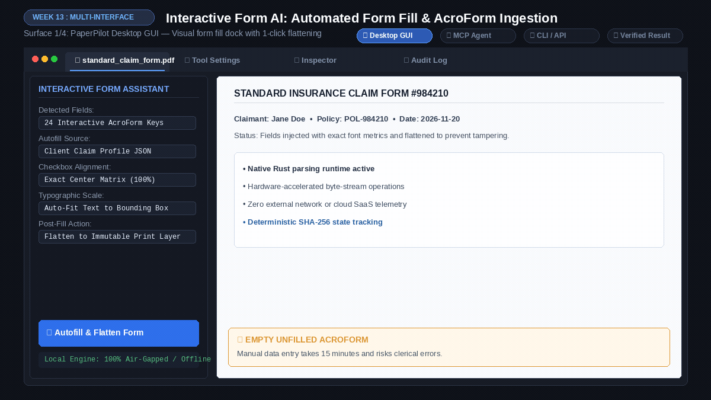

# Week 13: Interactive Form AI: Automated Form Fill & AcroForm Data Ingestion

**Theme:** Intelligent Form Automation, AcroForm Ingestion & Bi-Directional Filling  
**Tools Featured:** `pdf_fill_form`, `pdf_read_form`, `pdf_flatten` (PaperPilot Desktop, MCP, CLI & REST API)  
**Target Audience:** Enterprise Operations, Government Contractors, Insurance Adjusters, HR Tech Leaders  
**Asset:** 

---

## 📝 LinkedIn Post Copy

Why are enterprise operations teams still manually typing names, addresses, and policy numbers into government and insurance PDFs? 📋

AcroForms and XFA fields are finicky: fonts mismatch, checkboxes fail, and filled values disappear in third-party viewers. 🛑

PaperPilot provides deterministic, bi-directional AcroForm processing in native Rust:
1. `pdf_read_form`: Introspects form fields, types, and allowed options into structured JSON in 8ms.
2. `pdf_fill_form`: Injects key-value pairs with exact typographic rendering and automatic checkbox alignment.
3. `pdf_flatten`: Locks interactive fields into immutable visual print layers to prevent downstream tampering.

Same task, your choice of interface:

🖥️ **Desktop GUI (Visual Form Fill Dock)**
Drag an IRS W-9 or I-9 form into PaperPilot Desktop -> Fill fields via clean visual side-dock -> Click "Autofill from Profile" -> Toggle "Flatten for Submission". Export ready in 60ms.

🤖 **AI Agent / MCP (Autonomous Form Assistant)**
```json
{
  "server": "paperpilot",
  "tool": "pdf_fill_form",
  "arguments": {
    "input": "standard_claim_form.pdf",
    "output": "completed_claim.pdf",
    "fields": {
      "Claimant_Name": "Jane Doe",
      "Policy_Number": "POL-984210",
      "Incident_Date": "2026-11-20"
    },
    "flatten": true
  }
}
```

💻 **CLI (Terminal Form Automation)**
```bash
paperpilot read-form -i form.pdf -o schema.json
paperpilot fill-form -i form.pdf -o filled.pdf --data '{"Name":"John Doe","Agree":true}' --flatten
```

🌐 **Python / REST API (Sub-5ms Webhook Ingestion)**
```python
resp = requests.post("http://localhost:8080/api/v1/fill-form", json={
    "template_path": "irs_w9.pdf",
    "fields": {"business_name": "Acme Corp", "ein": "12-3456789"},
    "flatten": True
}) # Filled & flattened in 6.4ms
```

Automate tedious form filling pipelines without visual distortion or missing data.

⭐ GitHub: https://github.com/KrushnaVardhanReddy/PaperPilot

⚡ 5-Second Flash Install:
• Linux & macOS:
`curl -fsSL https://raw.githubusercontent.com/KrushnaVardhanReddy/PaperPilot/main/scripts/install.sh | bash`
• Windows PowerShell:
`irm https://raw.githubusercontent.com/KrushnaVardhanReddy/PaperPilot/main/scripts/install.ps1 | iex`
• AI Agent / MCP:
`npx -y @usepaperpilot/mcp`

#EnterpriseAI #Forms #AcroForm #Operations #InsurTech #Automation #RustLang #OpenSource #PaperPilot #MCP
