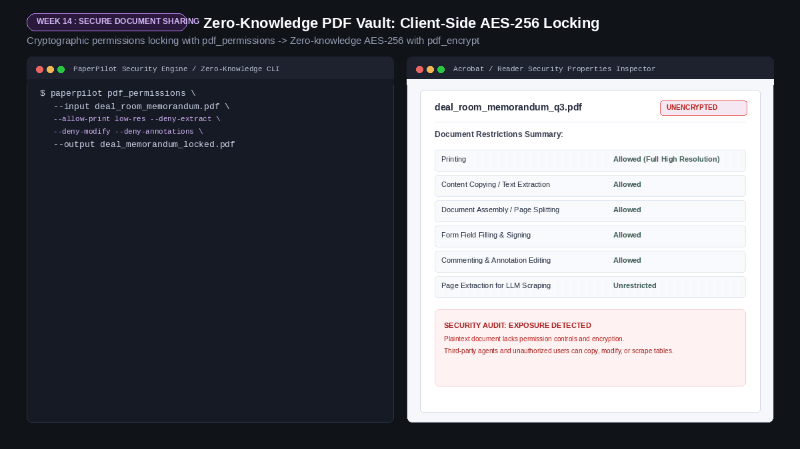

# Week 14: Secure Document Sharing: Zero-Knowledge PDF Vault: Client-Side Password & Permission Locking

**Theme:** Zero-Knowledge Document Encryption & Fine-Grained Permissions  
**Tools Featured:** `pdf_encrypt`, `pdf_permissions`, `pdf_inspect` (PaperPilot Desktop, MCP, CLI & REST API)  
**Target Audience:** FinTech Security Architects, Wealth Management, C-Suite Counsel, Privacy Officers  
**Asset:** 

---

## 📝 LinkedIn Post Copy

Sharing sensitive executive compensation, merger drafts, or financial audits via email? Slapping a basic password on a PDF doesn't protect you if the cipher is obsolete. 🔐

Legacy tools often generate PDF encryption using weak 40-bit/128-bit RC4 ciphers that modern GPUs crack in seconds, leaving permissions unconfigured. 🛑

PaperPilot enforces revision 6 **AES-256 cipher encryption** with fine-grained cryptographic locking:
- Separates Owner (admin) and User (read-only) passwords.
- Restricts copying, printing, annotations, and assembly.
- 100% client-side: Keys are derived in local memory. 0 bytes leave your machine.

Same task, your choice of interface:

🖥️ **Desktop GUI (Security Vault Dock)**
Drop confidential financials into PaperPilot Desktop -> Check "Disable Copying", "Disable High-Res Printing", and "Enforce AES-256" -> Type recipient passphrase -> Click "Lock Vault". Ready in 25ms.

🤖 **AI Agent / MCP (Automated Security Gate)**
```json
{
  "server": "paperpilot",
  "tool": "pdf_encrypt",
  "arguments": {
    "input": "board_deck_q4.pdf",
    "output": "board_deck_q4_secured.pdf",
    "user_password": "BoardMember2026!",
    "cipher": "aes-256",
    "permissions": { "copy": false, "print": "low_resolution" }
  }
}
```

💻 **CLI (Sub-15ms Terminal Security Command)**
```bash
paperpilot encrypt -i financials.pdf -o vault.pdf   --user-pw "Client2026!" --owner-pw "AdminSecret!"   --cipher aes-256 --no-copy --no-print
```

🌐 **Python / REST API (Sub-5ms Microservice)**
```python
resp = requests.post("http://localhost:8080/api/v1/encrypt", json={
    "input_path": "tax_return.pdf",
    "user_password": "TaxClient987!",
    "cipher": "aes-256"
}) # Locked with AES-256 in 4.8ms
```

Lock confidential enterprise documents with military-grade encryption without sending keys to cloud SaaS providers.

⭐ GitHub: https://github.com/KrushnaVardhanReddy/PaperPilot

⚡ 5-Second Flash Install:
• Linux & macOS:
`curl -fsSL https://raw.githubusercontent.com/KrushnaVardhanReddy/PaperPilot/main/scripts/install.sh | bash`
• Windows PowerShell:
`irm https://raw.githubusercontent.com/KrushnaVardhanReddy/PaperPilot/main/scripts/install.ps1 | iex`
• AI Agent / MCP:
`npx -y @usepaperpilot/mcp`

#CyberSecurity #ZeroKnowledge #Encryption #FinTech #Privacy #InfoSec #RustLang #OpenSource #PaperPilot #MCP
