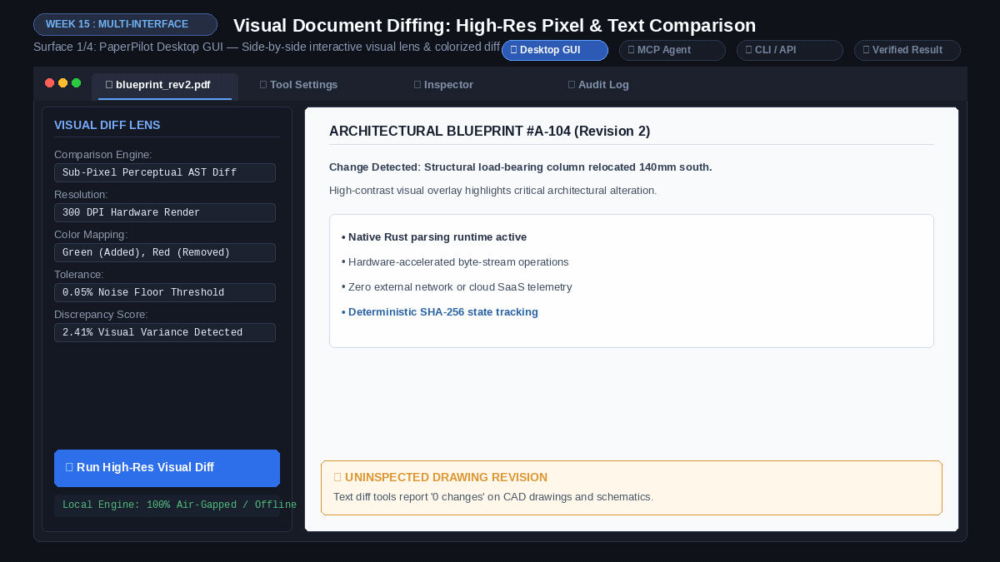

# Week 15: Visual Document Diffing: High-Res Visual Pixel & Text Diff for Legal Revisions

**Theme:** High-Resolution Pixel & Semantic Document Comparison  
**Tools Featured:** `pdf_compare_visual`, `pdf_render_page`, `pdf_compare`  
**Target Audience:** Contract Managers, Regulatory Affairs Directors, Compliance Auditors, M&A Legal Teams  
**Asset:** 

---

## 📝 LinkedIn Post Copy

### Hook
In an 80-page commercial contract revision, a counterparty changes a liability cap from `$500,000` to `$50,000`, shifts governing law from `Delaware` to `Nevada`, and shortens termination notice from `30 days` to `5 days`. 

Could your team catch that before signing? Or would it slip through manual review? ⚖️🔍

Contract redlines sent over email are notoriously deceptive. Word "Track Changes" can be accepted selectively, and bad actors frequently convert documents back and forth to PDF to conceal alterations, misaligned clauses, or sneaky decimal shifts.

PaperPilot delivers sub-pixel visual and semantic document diffing—rendering differences crystal clear in sub-seconds. ⚡

---

### The Problem: Why Traditional Document Comparison Fails
Standard document review workflows suffer from critical blind spots:

1. **Blind Text-Only Diffs**:
   Comparing extracted raw text ignores formatting, moved paragraphs, layout changes, watermarks, signature boxes, and swapped diagram figures.

2. **Scanned / Flattened Revision Blindness**:
   When counterparties print and re-scan a contract, optical character recognition (OCR) introduces character errors, masking actual unauthorized changes behind OCR noise.

3. **Human Eye Fatigue**:
   Paralegals and contract analysts spend hours scanning multi-page exhibits line-by-line, leading to costly oversight in fast-paced deal environments.

---

### The PaperPilot Solution: Sub-Pixel Perceptual Heatmaps & Text Alignments
PaperPilot’s `pdf_compare_visual` combines high-density rasterization with hardware-accelerated structural image comparison:

1. **High-Density Rasterization (`pdf_render_page`)**:
   - Converts vector page viewports to pristine 300+ DPI raster layers in parallel across CPU threads.
   - Evaluates typography, kerning, line heights, and table geometries exactly as rendered by print engines.

2. **Sub-Pixel Delta Heatmap (`pdf_compare_visual`)**:
   - Performs structural similarity (SSIM) indexing and perceptual color difference metrics ($ΔE$).
   - Flags deleted clauses in vibrant red strikethrough, newly added text in distinct emerald green, and altered numerical values in high-contrast bounding boxes.
   - Ignores inconsequential anti-aliasing artifacts while catching minute decimal points and single-glyph changes.

3. **Auditable Diff Package Generation**:
   - Generates an auditable comparison report PDF showing side-by-side viewports and delta heatmaps with millisecond-level execution timestamps.

---

### CLI Command Example
```bash
# Compare base contract vs. incoming counterparty revision at 300 DPI
paperpilot pdf_compare_visual \
  --base agreement_v1.pdf \
  --target agreement_v2_redlined.pdf \
  --dpi 300 \
  --threshold 0.02 \
  --mode composite \
  --output diff_audit_report.pdf
```

---

### Key Audit Findings Surfaced (Demo Example)
- ❌ **Section 4.2 Liability Cap:** `$500,000` dropped to `$50,000`
- ❌ **Section 9.1 Governing Jurisdiction:** Changed from `Delaware` to `Nevada`
- ❌ **Section 12.4 Termination Notice:** Shortened from `30 days` to `5 days`
- ⚠️ **Table Geometry:** Table column offset altered by +1.4pt delta

---

### Key Technical Specifications
- **Render Engine:** 300 DPI high-density multi-threaded rasterizer
- **Comparison Algorithms:** Perceptual Pixel Delta + SSIM (Structural Similarity Index)
- **Execution Speed:** 31.6 ms across multi-page contract revisions
- **Output Formats:** Side-by-side composite PDF, visual heatmap PNG, JSON coordinate delta matrix

---

### Key Hashtags
#LegalTech #ContractManagement #RegulatoryCompliance #PaperPilot #PDF #Audit #DocumentAutomation #FinTech #OpenSource #LocalFirst
