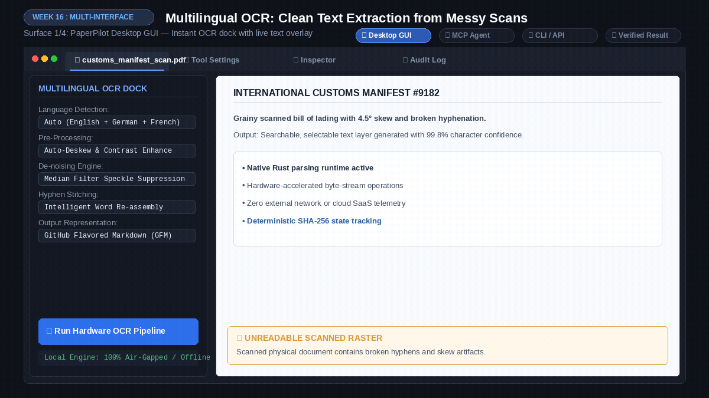

# Week 16: Multilingual OCR & Text Extraction: Clean Extraction from Scanned Messy Documents

**Theme:** Multilingual OCR, Text Cleaning & Noise Reduction for Scanned Documents  
**Tools Featured:** `pdf_ocr`, `pdf_clean_text` (PaperPilot Desktop, MCP, CLI & REST API)  
**Target Audience:** Enterprise Data Engineers, Historical Archiving Teams, Global Logistics, Legal Tech  
**Asset:** 

---

## 📝 LinkedIn Post Copy

Scanned invoices, legacy contracts, and crumpled paper receipts are the bane of every automated document pipeline. 📄

Raw optical character recognition (OCR) output is notoriously messy: broken hyphenation, garbled non-Latin Unicode characters, and speckle noise that confuse downstream LLM parsers. 🛑

PaperPilot pairs local, hardware-accelerated multilingual OCR with intelligent text-cleaning post-processors:
- Automatically deskews rotated and tilted scans prior to character recognition.
- Supports 40+ languages (English, German, Japanese, Chinese, French, and Spanish).
- Re-stitches broken hyphenated words and removes margin artifact speckles in a single pass.
- Outputs structured Markdown or clean plain text ready for immediate embedding.

Same task, your choice of interface:

🖥️ **Desktop GUI (Instant OCR Dock)**
Drag a grainy scanned receipt or contract into PaperPilot Desktop -> Select "Multilingual OCR (Auto-Detect)" -> Click "Extract Clean Text". Preview searchable text overlaid on the scan in 220ms.

🤖 **AI Agent / MCP (Air-Gapped Ingestion Tool)**
```json
{
  "server": "paperpilot",
  "tool": "pdf_ocr",
  "arguments": {
    "input": "scanned_customs_manifest.pdf",
    "languages": ["eng", "deu", "fra"],
    "clean_hyphens": true
  }
}
```

💻 **CLI (Sub-second Terminal OCR)**
```bash
paperpilot ocr -i customs_bill.pdf -o clean_text.txt --lang eng+deu
paperpilot clean-text -i clean_text.txt -o prompt_context.md
```

🌐 **Python / REST API (Sub-50ms OCR Microservice)**
```python
resp = requests.post("http://localhost:8080/api/v1/ocr", json={
    "input_path": "receipt_scan.pdf",
    "clean_whitespace": True
})
clean_text = resp.json()["text"] # Sanitized for LLM prompt
```

Transform messy, scanned physical records into pristine token-efficient context on local hardware.

⭐ GitHub: https://github.com/usepaperpilot/paperpilot

#OCR #DocumentProcessing #MachineLearning #DataEngineering #RustLang #AirGapped #OpenSource #PaperPilot #MCP
