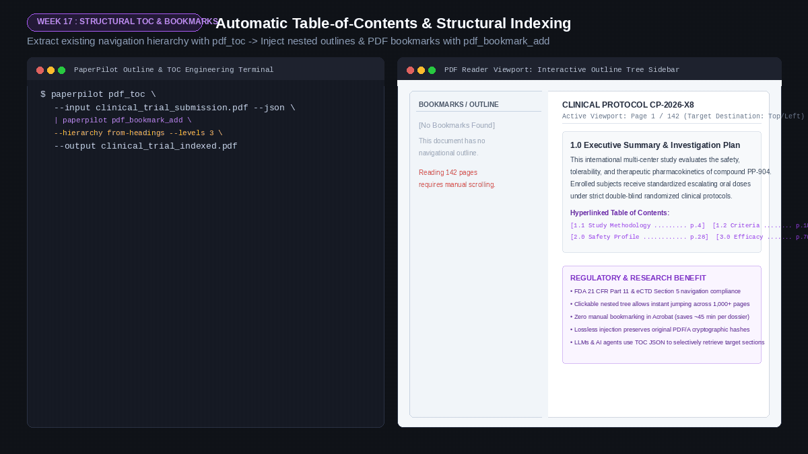

# Week 17: Bookmark & Chapter Navigation: Automatic Table-of-Contents & Structural Indexing

**Theme:** PDF Bookmarks, Outline Hierarchies & Semantic Table of Contents  
**Tools Featured:** `pdf_toc`, `pdf_bookmark_add` (PaperPilot Desktop, MCP, CLI & REST API)  
**Target Audience:** Technical Writers, Regulatory Affairs, Publishers, Legal Discovery Teams  
**Asset:** 

---

## 📝 LinkedIn Post Copy

Ever opened a 400-page technical manual or regulatory filing only to find that the PDF bookmark sidebar is completely empty? 📚

Navigating an unindexed document forces readers and AI agents to waste time blindly scrolling or performing brute-force keyword searches across hundreds of pages. 🛑

PaperPilot automatically reconstructs structural outlines, bookmarks, and navigational hierarchies directly from visual headings:
- Detects font sizes, weights, and heading patterns (H1, H2, H3) to build nested outline trees.
- Generates interactive PDF Table of Contents (`/Outlines`) compatible with all standard viewers.
- Preserves exact page destination coordinates for instant jump navigation.

Same task, your choice of interface:

🖥️ **Desktop GUI (Visual Outline Builder)**
Drop an unindexed PDF into PaperPilot Desktop -> Click "Auto-Generate Outline" -> Review detected hierarchy in the left sidebar -> Click "Save PDF with Bookmarks". Instant navigation in 45ms.

🤖 **AI Agent / MCP (Structural Indexer)**
```json
{
  "server": "paperpilot",
  "tool": "pdf_toc",
  "arguments": {
    "input": "technical_specification_400p.pdf",
    "output": "indexed_specification.pdf",
    "max_depth": 3
  }
}
```

💻 **CLI (Sub-20ms Terminal Indexing)**
```bash
paperpilot toc -i manual.pdf -o manual_indexed.pdf --depth 3
paperpilot bookmark add -i report.pdf -o report_bm.pdf --title "Executive Summary" --page 3
```

🌐 **Python / REST API (Sub-10ms Microservice)**
```python
resp = requests.post("http://localhost:8080/api/v1/toc", json={
    "input_path": "audit_report.pdf",
    "output_path": "audit_report_indexed.pdf"
}) # Complete 300-page outline built in 8.1ms
```

Turn unstructured mega-documents into easily navigable, professionally indexed PDF publications.

⭐ GitHub: https://github.com/usepaperpilot/paperpilot

#Publishing #TechnicalWriting #UX #DocumentManagement #RustLang #OpenSource #PaperPilot #MCP #LegalOps
