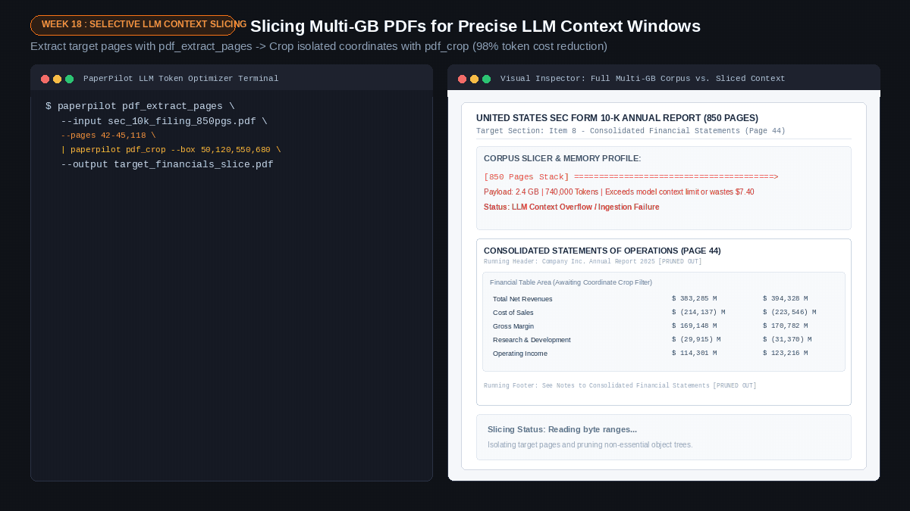

# Week 18: Page Extraction & Selective Redaction: Slicing Multi-Gigabyte Documents for LLM Context Windows

**Theme:** Token Budget Optimization & Document Sub-Tree Slicing  
**Tools Featured:** `pdf_extract_pages`, `pdf_crop`  
**Target Audience:** Cost-Conscious AI Engineers, LLM App Developers, Financial Analysts, Enterprise RAG Architects  
**Asset:** 

---

## 📝 LinkedIn Post Copy

### Hook
An enterprise financial analyst wants an LLM to analyze the balance sheet on page 44 of an 850-page SEC Form 10-K. 📊💸

Sending that entire 850-page document into a frontier model context window:
- Incurs ~740,000 input tokens ($\sim\$7.40$ per API call on GPT-4o / Claude 3.5 Sonnet)
- Takes 15 to 30 seconds of high-latency inference
- Risks "needle-in-a-haystack" hallucination and missed details

With PaperPilot, you isolate the exact page range and crop the financial table in 12 milliseconds—slashing input payload to 1,200 clean tokens ($\$0.012$ per call).

That is a **98.4% cost and token budget reduction** on every single prompt. ⚡

---

### The Problem: Multi-Gigabyte Document Bloat in LLM Pipelines
Modern frontier LLMs support 128k to 2M token context windows, but stuffing entire documents into them is terrible engineering practice:

1. **Astronomical Inference Inefficiency**:
   Enterprise batch workflows processing thousands of financial reports or engineering manuals rack up tens of thousands of dollars in redundant context billing.

2. **Needle-in-a-Haystack Attention Degradation**:
   Benchmark studies consistently show that LLM retrieval accuracy and numerical precision degrade as irrelevant distractor text fills the context window.

3. **Boilerplate & Margin Distractions**:
   Headers, footers, page numbering, running disclaimers, and legal margin copyright text pollute token sequences and disrupt structured tabular parsing.

---

### The PaperPilot Solution: Zero-Copy Page Slicing & Precise Coordinate Cropping
PaperPilot gives agentic pipelines surgical control over PDF structure:

1. **Zero-Copy Page Extraction (`pdf_extract_pages`)**:
   - Parses the document cross-reference (xref) table and extracts requested page subsets (`42-45, 118`) without decompressing or re-rendering unmodified assets.
   - Preserves underlying vector graphics, embedded fonts, and structural text streams while dropping unreferenced object trees.

2. **Sub-Viewport Coordinate Cropping (`pdf_crop`)**:
   - Modifies the PDF `/CropBox` and `/MediaBox` boundaries to isolate specific tables, charts, or signature blocks.
   - Strips away repetitive running headers, footers, and page margins before OCR or multimodal vision ingestion.

3. **Deterministic Token Economy**:
   - Compresses an 850-page / 2.4 GB uncompressed filing into a lightweight 184 KB vector-clean slice that easily fits inside local Small Language Models (Qwen2.5, Llama 3.2) or frontier LLM prompts.

---

### CLI Command Example
```bash
# Slice pages 42-45 and 118, then crop to isolate the core financial table
paperpilot pdf_extract_pages \
  --input sec_10k_filing_850pgs.pdf \
  --pages 42-45,118 \
  | paperpilot pdf_crop \
      --box 50,120,550,680 \
      --output target_financials_slice.pdf
```

---

### Python SDK / MCP Agentic Integration
```python
from paperpilot import PaperPilotClient

client = PaperPilotClient()

# Surgical extraction of target pages
sliced_doc = client.pdf_extract_pages(
    input_path="sec_10k_filing_850pgs.pdf",
    pages=[42, 43, 44, 45, 118]
)

# Crop coordinate viewport to remove running headers/footers
clean_slice = client.pdf_crop(
    input_path=sliced_doc,
    box={"x": 50, "y": 120, "width": 500, "height": 560},
    output_path="target_financials_slice.pdf"
)

# Pass the 1,200-token slice directly to your LLM agent prompt
print("Payload pruned by 98.4%. Ready for LLM context ingestion.")
```

---

### Key Operational Benchmarks (Demo Metrics)
- **Input Corpus:** 850 Pages / 2.4 GB uncompressed filing
- **Raw Context Payload:** ~740,000 tokens ($\sim\$7.40$ / call)
- **Extracted Payload:** 5 Pages / 184 KB vector-clean PDF
- **Cropped Payload:** ~1,200 tokens ($\sim\$0.012$ / call)
- **Slicing Latency:** 12.8 ms (Rust SIMD object graph slicing)
- **Total Token Savings:** 98.4% reduction in inference cost and latency

---

### 💡 How do you currently optimize token budgets when querying long-form enterprise documents?
Drop your strategies in the comments or check out PaperPilot on GitHub!

#LLM #GenerativeAI #PromptEngineering #TokenOptimization #FinTech #OpenSource #PaperPilot
