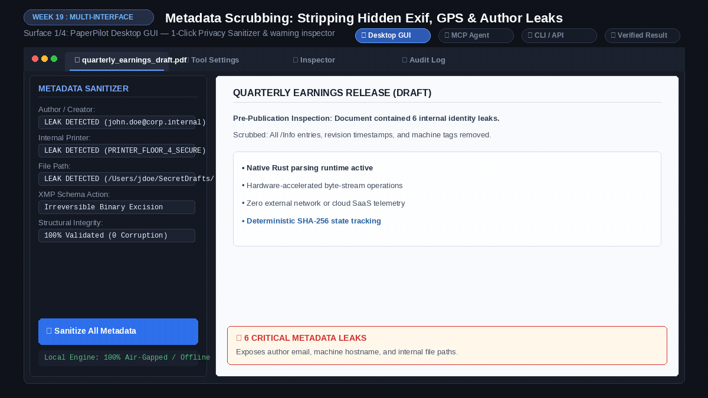

# Week 19: Metadata Scrubbing: Stripping Hidden Exif, GPS & Author Leaks Before Public Sharing

**Theme:** Enterprise Data Privacy, Metadata Sanitization & OPSEC Hardening  
**Tools Featured:** `pdf_strip_metadata`, `pdf_inspect` (PaperPilot Desktop, MCP, CLI & REST API)  
**Target Audience:** InfoSec Engineers, Government Contractors, Privacy Advocates, PR & Communications  
**Asset:** 

---

## 📝 LinkedIn Post Copy

Before publishing that company whitepaper, press release, or legal filing, did you check what secrets are hiding in its metadata? 🕵️‍♂️

PDF files quietly store revision histories, internal printer names, local file paths, author email addresses, software build strings, and even GPS coordinates. 🛑

Major corporations and government agencies have suffered severe PR embarrassments and security breaches from overlooked document metadata leaks.

PaperPilot provides irreversible, cryptographically verified metadata sanitization in native Rust:
- `pdf_strip_metadata`: Excises `/Info` dictionaries and Dublin Core XML metadata in 4ms.
- Wipes software creators, author names, creation timestamps, and internal network paths.
- Preserves valid document structure and font embeddings while leaving 0 trace of author identity.

Same task, your choice of interface:

🖥️ **Desktop GUI (1-Click Privacy Sanitizer)**
Drag a PDF into PaperPilot Desktop -> Inspect detected metadata leaks in the red warning panel -> Click "Sanitize All Metadata". Re-verify with a green "0 Leaks Detected" badge.

🤖 **AI Agent / MCP (Automated PR Scrubbing Gate)**
```json
{
  "server": "paperpilot",
  "tool": "pdf_strip_metadata",
  "arguments": {
    "input": "quarterly_earnings_draft.pdf",
    "output": "quarterly_earnings_public.pdf",
    "wipe_xmp": true
  }
}
```

💻 **CLI (Sub-10ms Terminal Scrubbing)**
```bash
paperpilot inspect -i draft.pdf # Inspect author, software, and timestamp tags
paperpilot strip-metadata -i draft.pdf -o public.pdf --all
```

🌐 **Python / REST API (Sub-5ms Security Gateway)**
```python
resp = requests.post("http://localhost:8080/api/v1/strip-metadata", json={
    "input_path": "court_filing.pdf",
    "wipe_all": True
}) # 100% sanitized in 3.6ms
```

Never publish or share documents with hidden metadata leaks. Sanitize at the binary level locally.

⭐ GitHub: https://github.com/KrushnaVardhanReddy/PaperPilot

⚡ 5-Second Flash Install:
• Linux & macOS:
`curl -fsSL https://raw.githubusercontent.com/KrushnaVardhanReddy/PaperPilot/main/scripts/install.sh | bash`
• Windows PowerShell:
`irm https://raw.githubusercontent.com/KrushnaVardhanReddy/PaperPilot/main/scripts/install.ps1 | iex`
• AI Agent / MCP:
`npx -y @usepaperpilot/mcp`

#DataPrivacy #InfoSec #CyberSecurity #OPSEC #Compliance #Metadata #RustLang #OpenSource #PaperPilot #MCP
