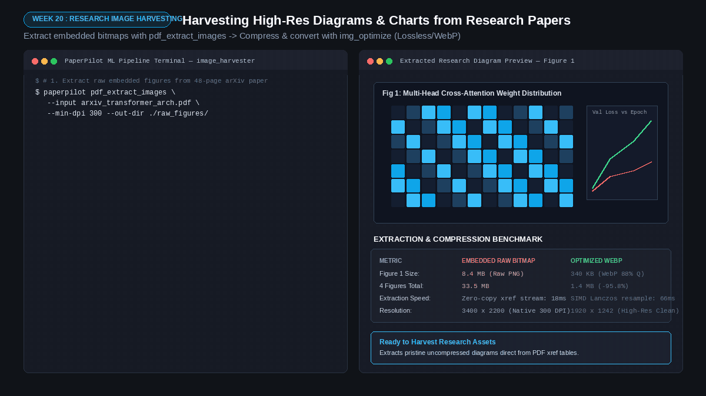

# Week 20: Image Extraction & Optimization: Harvesting High-Res Diagrams from Research Papers

**Theme:** Embedded Asset Extraction, High-Resolution Diagram Harvesting & Compression  
**Tools Featured:** `pdf_extract_images`, `img_optimize` (PaperPilot Desktop, MCP, CLI & REST API)  
**Target Audience:** ML Researchers, Academic Institutions, Patent Examiners, Technical Publishers  
**Asset:** 

---

## 📝 LinkedIn Post Copy

Research papers, medical journals, and patent filings contain dense visual diagrams, charts, and figures locked deep inside PDF object streams. 🔬

Taking low-resolution screenshot snippets distorts labels, introduces raster compression artifacts, and loses color accuracy. 🛑

PaperPilot extracts embedded raster images and figures directly from the raw PDF binary stream at their native resolution without re-compression degradation:
- Extracts JPEG, PNG, TIFF, and JBIG2 image streams in native fidelity.
- Automatically organizes figures by page number and document order.
- `img_optimize`: Recompresses extracted figures with WebP or optimized PNG for high-density web publishing.

Same task, your choice of interface:

🖥️ **Desktop GUI (Visual Figure Harvester)**
Drop a 50-page research paper into PaperPilot Desktop -> Click "Harvest Embedded Figures" -> Browse extracted high-res figures in a visual gallery -> Export all images with 1 click.

🤖 **AI Agent / MCP (Multimodal Dataset Builder)**
```json
{
  "server": "paperpilot",
  "tool": "pdf_extract_images",
  "arguments": {
    "input": "nature_biotech_paper.pdf",
    "output_dir": "./extracted_figures/",
    "min_width": 300
  }
}
```

💻 **CLI (Sub-25ms Terminal Figure Extraction)**
```bash
paperpilot extract-images -i paper.pdf -o ./figures/ --format png
paperpilot optimize-img -i ./figures/*.png --quality 85
```

🌐 **Python / REST API (Sub-15ms Figure Extraction)**
```python
resp = requests.post("http://localhost:8080/api/v1/extract-images", json={
    "input_path": "patent_spec.pdf",
    "output_dir": "/tmp/figures"
})
images = resp.json()["extracted_files"] # Ready for multimodal model ingest
```

Harvest pristine, high-resolution scientific diagrams and figures without manual screenshotting.

⭐ GitHub: https://github.com/usepaperpilot/paperpilot

#MachineLearning #Research #AcademicTwitter #BioTech #DataExtraction #RustLang #OpenSource #PaperPilot #MCP
