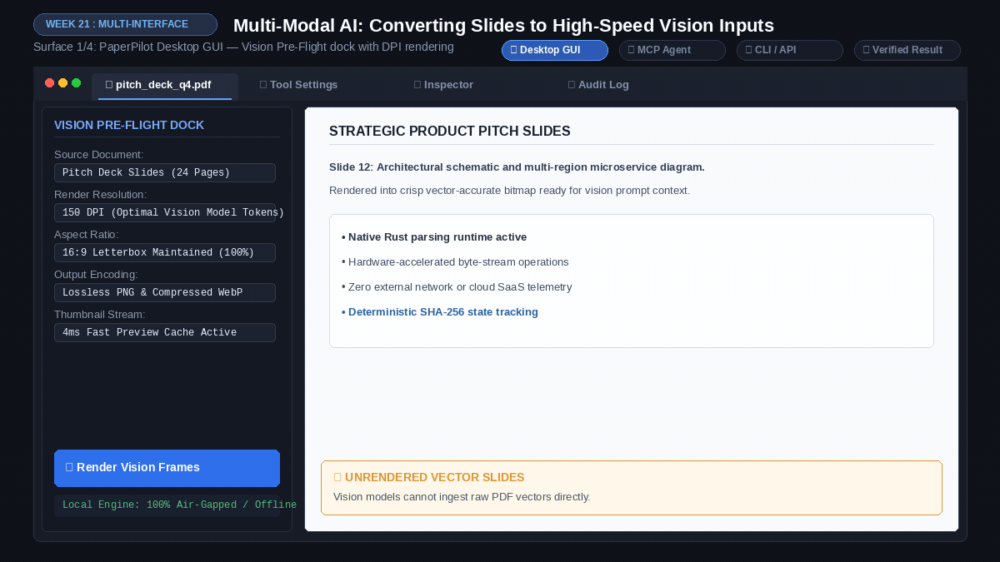

# Week 21: Multi-Modal AI Ingestion: Converting PDF Slides to High-Speed Vision Model Inputs

**Theme:** Frontier Multimodal Pipelines & Visual Token Stream Ingestion  
**Tools Featured:** `pdf_to_png`, `pdf_thumbnail`  
**Target Audience:** AI Application Engineers, Multimodal Agent Developers, Enterprise Workflow Architects, Knowledge Automation Builders  
**Asset:** 

---

## 📝 LinkedIn Post Copy

### Hook
Sending 60-slide executive pitch decks, architectural blueprints, or technical brochures into GPT-4o or Claude 3.5 Sonnet shouldn’t stall your application pipeline. ⚡🖼️

Traditional approaches force you into an unappealing tradeoff:
- Convert entire documents via heavyweight headless browsers (taking 1.5 seconds per page)
- Or feed raw text extraction that completely scrambles multi-column slide layouts, flowcharts, and infographics

With PaperPilot, you convert vector slide decks to high-resolution raster vision tokens at **6.8ms per page** and generate rapid routing thumbnails in under 2ms.

That means an entire 20-slide executive keynote is converted, tiled, and ready for vision LLM ingestion in **136 milliseconds**. 🚀

---

### The Problem: Slide Decks Break Standard Text-Based OCR & RAG
Presentation decks and visual reports are fundamentally non-linear:

1. **Spatial Layout Confusion**:
   Slide decks rely on 2D geometric arrangements—3-pillar strategy cards, circular process flows, quadrant charts, and side-by-side callouts. Linear OCR extracts text out of order, destroying the author’s conceptual hierarchy.

2. **Heavyweight Rendering Latency**:
   Converting PDF pages to raster images using legacy server stacks (like headless LibreOffice or Chromium) consumes huge RAM footprints and introduces multi-second delays per document.

3. **Vision Token Inefficiency**:
   Passing non-standard resolutions or unoptimized DPI causes frontier vision models to over-tile images, triggering massive token consumption charges (up to 1,600 vision tokens per slide) without any gain in legibility.

---

### The PaperPilot Solution: Sub-10ms Rasterization & Multi-Resolution Tile Routing
PaperPilot bridges the gap between static PDF presentations and dynamic multimodal vision architectures:

1. **High-Speed Vector Rasterization (`pdf_to_png`)**:
   - Compiles vector graphics, fonts, and embedded elements into ultra-sharp PNG/WebP raster frames at sub-10ms per page using SIMD-accelerated rendering.
   - Configurable DPI targeting (e.g., 144 DPI) perfectly aligns with the native 512x512 tile patch dimensions of frontier vision transformers (GPT-4o, Claude 3.5 Sonnet).

2. **Ultra-Fast Thumbnail Generation (`pdf_thumbnail`)**:
   - Generates compact, 512px preview thumbnails in 1.9ms per page.
   - Allows lightweight Small Language Models (SLMs) or classification routers to triage which slides require deep frontier vision inspection and which can be skipped.

3. **Deterministic Vision Token Economy**:
   - Caps multimodal input costs by ensuring slides map to an exact 3x2 tile grid (765 tokens per slide) while guaranteeing that 8pt chart labels remain crisp and readable.

---

### CLI Command Example
```bash
# 1. Render keynote pages into high-speed vision model inputs
paperpilot pdf_to_png \
  --input q3_strategy_keynote.pdf \
  --dpi 144 \
  --pages 1-5 \
  --format png \
  --out-dir ./vision_buffer/

# 2. Generate rapid preview thumbnails for fast agent routing
paperpilot pdf_thumbnail \
  --input q3_strategy_keynote.pdf \
  --width 512 \
  --out-dir ./thumbnails/
```

---

### Python SDK / MCP Agentic Integration
```python
from paperpilot import PaperPilotClient
import base64
from openai import OpenAI

client = PaperPilotClient()
ai = OpenAI()

# 1. Sub-millisecond slide conversion
rendered_slides = client.pdf_to_png(
    input_path="q3_strategy_keynote.pdf",
    dpi=144,
    pages=[1, 2, 3, 4, 5]
)

# 2. Ingest slide directly into GPT-4o Vision
with open(rendered_slides.paths[2], "rb") as f:
    b64_image = base64.b64encode(f.read()).decode("utf-8")

response = ai.chat.completions.create(
    model="gpt-4o",
    messages=[
        {
            "role": "user",
            "content": [
                {"type": "text", "text": "Analyze the 3 infrastructure pillars and roadmap milestones in this slide:"},
                {
                    "type": "image_url",
                    "image_url": {"url": f"data:image/png;base64,{b64_image}"}
                }
            ]
        }
    ]
)

print(response.choices[0].message.content)
```

---

### Technical Highlights
- **Engineered for Frontier Vision Models**: Tailored DPI scaling precisely targets GPT-4o (512x512 tiles) and Claude 3.5 Sonnet (1568px max dimension) token boundaries.
- **SIMD Rendering Acceleration**: Takes full advantage of native CPU vector extensions for blazingly fast raster rendering without GPU overhead.
- **Agentic Routing**: Low-overhead thumbnail caching enables hybrid agent workflows: triage 100 slides with a local SLM, then route only high-value slides to frontier models.

---

### Hashtags
#MultimodalAI #ComputerVision #GenerativeAI #GPT4o #ClaudeSonnet #AgenticAI #PDF #Python #OpenSource #PaperPilot
