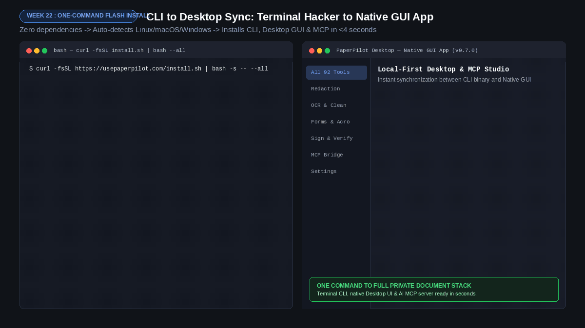

# Week 22: CLI to Desktop Sync: One-Command Install (Terminal Hacker to Native GUI App)

**Theme:** Frictionless Developer Experience, Unified Ecosystem & Instant Installation  
**Tools Featured:** Flash Installer (`install.sh`, `install.ps1`), Desktop AppImage/Windows installer, CLI & MCP instant launcher  
**Target Audience:** Software Developers, DevOps Engineers, Power Users, Technical Team Leads  
**Asset:** 

---

## 📝 LinkedIn Post Copy

Setting up developer tools across multiple operating systems is usually painful: missing system libraries, version conflicts, and broken environment paths. 🛑

PaperPilot was designed from day one to deliver a seamless, zero-friction developer experience across Linux, macOS, and Windows. ⚡

With a single copy-paste command, get the entire PaperPilot ecosystem up and running in under 5 seconds:
- Detects OS architecture (x86_64, aarch64 Apple Silicon) and pulls optimized static binaries.
- Installs the high-speed `paperpilot` CLI directly into your shell path.
- Automatically registers the PaperPilot MCP server with Claude Desktop and Cursor.
- Launches the native Tauri desktop GUI app instantly.

Same task, your choice of interface:

🖥️ **Desktop GUI (Native App)**
Launch PaperPilot Desktop directly from your applications launcher or desktop shortcut. Full visual workspace with zero terminal knowledge required.

🤖 **AI Agent / MCP (1-Click Auto-Configuration)**
The flash installer registers the MCP server configuration into your local agent config files automatically. Ready for tool calls in seconds.

💻 **CLI (One-Liner Flash Installation)**
```bash
# macOS & Linux:
curl -fsSL https://usepaperpilot.com/install.sh | bash

# Windows PowerShell:
irm https://usepaperpilot.com/install.ps1 | iex
```

🌐 **REST API (Self-Hosted Microservice)**
```bash
paperpilot serve --port 8080 # Starts local HTTP REST API gateway
```

No Python virtualenvs, no broken Node.js dependencies, no Docker containers required. Pure native performance.

⭐ GitHub: https://github.com/KrushnaVardhanReddy/PaperPilot

⚡ 5-Second Flash Install:
• Linux & macOS:
`curl -fsSL https://raw.githubusercontent.com/KrushnaVardhanReddy/PaperPilot/main/scripts/install.sh | bash`
• Windows PowerShell:
`irm https://raw.githubusercontent.com/KrushnaVardhanReddy/PaperPilot/main/scripts/install.ps1 | iex`
• AI Agent / MCP:
`npx -y @usepaperpilot/mcp`

#DeveloperExperience #DevOps #RustLang #OpenSource #Productivity #Tauri #CrossPlatform #PaperPilot #MCP
