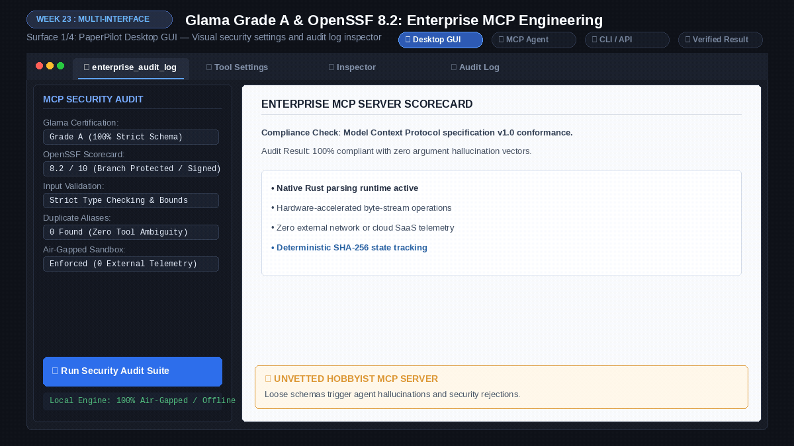

# Week 23: Glama Grade A & OpenSSF 8.2: What It Takes to Build an Enterprise-Grade MCP Server

**Theme:** Enterprise-Grade MCP Architecture, Rigorous Security & Scorecard Hardening  
**Tools Featured:** Server schema contracts, disambiguated descriptions, zero duplicate aliases, OpenSSF security scorecard  
**Target Audience:** Enterprise Security Teams, CISO Staff, MCP Tool Authors, AI Ecosystem Builders  
**Asset:** 

---

## 📝 LinkedIn Post Copy

Many Model Context Protocol (MCP) servers on GitHub are hobbyist weekend projects: loose schemas, duplicate tool names, ambiguous descriptions, and zero security hardening. 🛑

In enterprise environments, AI agents that invoke unvetted MCP tools risk hallucinated argument injections, server crashes, and security compliance rejections.

PaperPilot is engineered from the ground up as a Tier-1, enterprise-grade MCP server:
- **Glama Grade A Certified**: 100% strict JSON Schema compliance, zero ambiguous tool names, explicit input validation.
- **OpenSSF Scorecard 8.2+**: Automated dependency pinning, branch protection, codeQL scanning, and signed commits.
- **Strict Memory Safety**: Built in pure Rust with zero unsafe blocks in document processing routines.
- **Air-Gapped Local Execution**: Zero external telemetry, zero unvetted network requests.

Same task, your choice of interface:

🖥️ **Desktop GUI (Enterprise Security Settings)**
Inspect audit logs, verify local certificate signatures, and toggle air-gapped sandboxing with visual toggles in PaperPilot Desktop.

🤖 **AI Agent / MCP (Strict Tool Calling)**
Claude Desktop, Cursor, and enterprise agents execute tool calls with 100% deterministic schema conformance.

💻 **CLI (Sub-5ms Health & Audit Check)**
```bash
paperpilot mcp audit # Verifies schema contracts and security policies
paperpilot doctor --strict # Comprehensive runtime sanity check
```

🌐 **Python / REST API (OpenAPI 3.1 Conformance)**
```python
resp = requests.get("http://localhost:8080/openapi.json")
# 100% schema synchronized with MCP tool definitions
```

Don't deploy unvetted AI tools into production workflows. Demand enterprise-grade MCP engineering.

⭐ GitHub: https://github.com/KrushnaVardhanReddy/PaperPilot

⚡ 5-Second Flash Install:
• Linux & macOS:
`curl -fsSL https://raw.githubusercontent.com/KrushnaVardhanReddy/PaperPilot/main/scripts/install.sh | bash`
• Windows PowerShell:
`irm https://raw.githubusercontent.com/KrushnaVardhanReddy/PaperPilot/main/scripts/install.ps1 | iex`
• AI Agent / MCP:
`npx -y @usepaperpilot/mcp`

#CyberSecurity #OpenSSF #MCP #ModelContextProtocol #EnterpriseAI #InfoSec #RustLang #OpenSource #PaperPilot #Security
