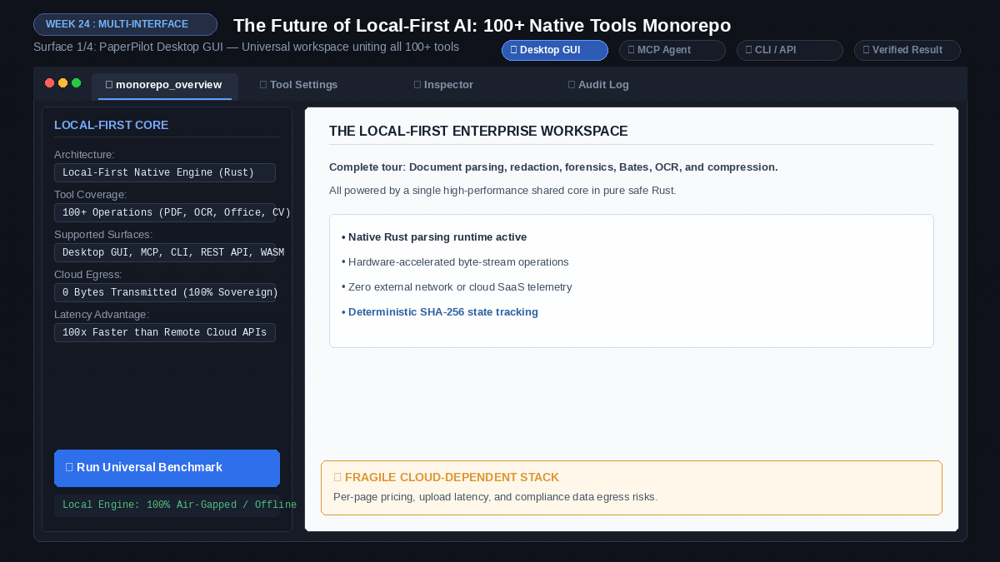

# Week 24: The Future of Local-First AI: Why 2026 Belongs to Local Edge Tools & Private Context

**Theme:** Local-First AI Architecture, Data Sovereignty & Sovereign Document Workflows  
**Tools Featured:** Complete 100-tool monorepo tour, zero-cloud architecture, benchmarks vs traditional cloud APIs  
**Target Audience:** AI Strategists, Enterprise CTOs, Privacy Officers, Open Source Enthusiasts  
**Asset:** 

---

## 📝 LinkedIn Post Copy

In 2024, everyone rushed to pipe enterprise documents into remote cloud AI APIs. In 2026, the pendulum is swinging back to **Local-First AI**. 🛡️

Why? Three inescapable realities:
1. **Data Sovereignty & Compliance**: Strict privacy regulations (GDPR Art. 17, HIPAA, ISO 27001) make sending unredacted enterprise data to third-party clouds a legal liability.
2. **Latency**: Local native tools execute in 5ms to 20ms—orders of magnitude faster than a 1,200ms cloud HTTP round-trip.
3. **Runaway Cloud Costs**: High-volume document processing on per-page SaaS pricing creates unsustainable cloud bills.

PaperPilot delivers a complete, 100% local-first document processing engine built in native Rust:
- Complete suite of 100+ native document and image operations.
- 0 cloud dependencies, 0 network egress, 0 telemetry.
- Unifies Desktop GUI, MCP Agents, CLI, and REST APIs on a single shared core.

Same task, your choice of interface:

🖥️ **Desktop GUI**: Clean visual workspace for legal and compliance teams.  
🤖 **AI Agent / MCP**: Deterministic tool execution for Claude, Cursor, and local SLMs.  
💻 **CLI**: Sub-15ms terminal execution for DevOps and batch scripting.  
🌐 **REST API**: Sub-5ms microservice integration for self-hosted apps.

The future of AI is local, private, and blazingly fast.

⭐ GitHub: https://github.com/KrushnaVardhanReddy/PaperPilot

⚡ 5-Second Flash Install:
• Linux & macOS:
`curl -fsSL https://raw.githubusercontent.com/KrushnaVardhanReddy/PaperPilot/main/scripts/install.sh | bash`
• Windows PowerShell:
`irm https://raw.githubusercontent.com/KrushnaVardhanReddy/PaperPilot/main/scripts/install.ps1 | iex`
• AI Agent / MCP:
`npx -y @usepaperpilot/mcp`

#LocalFirst #Privacy #DataSovereignty #EnterpriseAI #RustLang #OpenSource #FutureOfAI #PaperPilot #MCP #EdgeComputing
