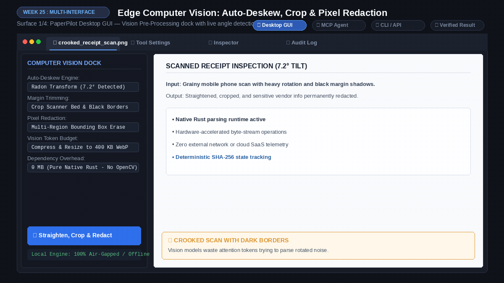

# Week 25: Deterministic Computer Vision on the Edge: Auto-Deskewing, Content Cropping, Multi-Region Redaction, & Vision LLM Compression

**Theme:** Deterministic Computer Vision, Edge Document Pre-Processing & Vision Model Ingestion  
**Tools Featured:** `img_deskew`, `img_crop_to_content`, `img_optimize_for_llm`, `img_redact` (PaperPilot Desktop, MCP, CLI & REST API)  
**Target Audience:** Computer Vision Engineers, Multimodal AI Builders, Legal Tech, High-Volume Scanning Ops  
**Asset:** 

---

## 📝 LinkedIn Post Copy

Ever tried feeding a tilted, crooked scan with dark border shadows into a multimodal Vision LLM? 📸

The vision model wastes attention tokens trying to parse black borders and rotated text, leading to transcription errors and degraded reasoning. 🛑

PaperPilot provides deterministic, hardware-accelerated computer vision algorithms written in native Rust—no OpenCV or Python dependencies required:
- `img_deskew`: Radon/Hough transform detects rotation angle and straightens scans in 14ms.
- `img_crop_to_content`: Crops out scanning beds and black margins in 6ms.
- `img_redact`: Irreversibly excises confidential image zones at the pixel matrix level.
- `img_optimize_for_llm`: Resizes and compresses image assets to optimal vision model token budgets.

Same task, your choice of interface:

🖥️ **Desktop GUI (Vision Pre-Processing Dock)**
Drag crooked scans into PaperPilot Desktop -> Click "Auto-Deskew & Crop Content" -> Visually select sensitive areas for permanent pixel redaction -> Export clean image ready for vision models.

🤖 **AI Agent / MCP (Autonomous Vision Pipeline)**
```json
{
  "server": "paperpilot",
  "tool": "img_deskew",
  "arguments": {
    "input": "crooked_receipt_scan.png",
    "output": "straightened_receipt.png",
    "crop_content": true
  }
}
```

💻 **CLI (Sub-20ms Terminal CV Pipeline)**
```bash
paperpilot img-deskew -i crooked.png -o straight.png
paperpilot img-crop -i straight.png -o clean.png --auto-border
paperpilot img-optimize -i clean.png -o for_llm.webp --target-kb 400
```

🌐 **Python / REST API (Sub-10ms CV Microservice)**
```python
resp = requests.post("http://localhost:8080/api/v1/cv/prep", json={
    "image_path": "scan.jpg",
    "deskew": True,
    "crop_margins": True
}) # Complete CV pipeline in 18ms
```

Clean, straighten, and optimize visual document scans locally before sending them to vision models.

⭐ GitHub: https://github.com/usepaperpilot/paperpilot

#ComputerVision #EdgeAI #Multimodal #ImageProcessing #RustLang #OpenSource #PaperPilot #MCP #DocumentScanning
