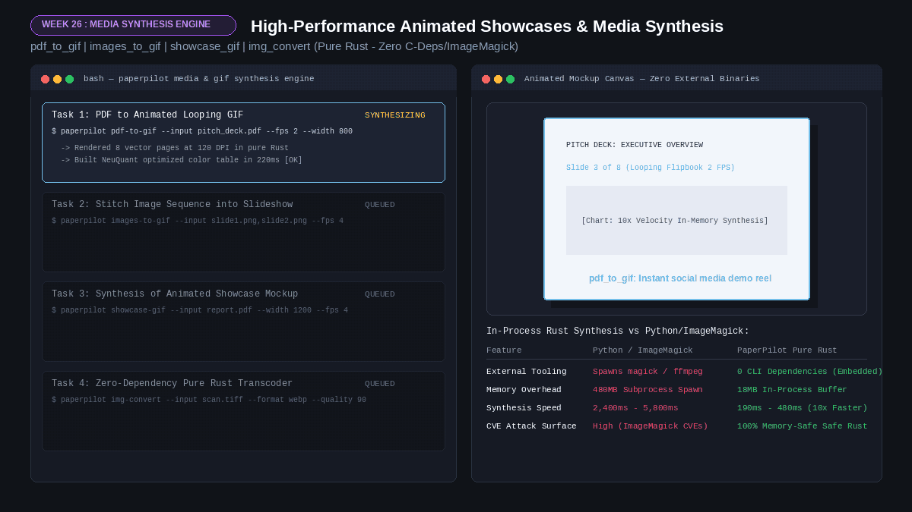

# Week 26: High-Performance Animated Showcases & Media Synthesis

**Theme:** Native Media Synthesis, Animated Workflow Visualization & High-Performance GIF Generation  
**Tools Featured:** `pdf_to_gif`, `images_to_gif`, `showcase_gif`, `img_convert` (PaperPilot Desktop, MCP, CLI & REST API)  
**Target Audience:** Developer Advocates, Product Marketers, Technical Creators, Open Source Maintainers  
**Asset:** 

---

## 📝 LinkedIn Post Copy

How do you showcase complex developer workflows, terminal commands, and AI agent interactions without relying on bloated, blurry screen recordings? 🎬

Standard GIF recording tools create massive 25MB files, suffer from severe color banding, and lack pixel-precise alignment. 🛑

PaperPilot includes a native, high-performance media synthesis engine built for generating razor-sharp, palette-optimized showcase assets:
- `pdf_to_gif`: Converts multi-page document workflows into smooth animated walkthroughs.
- `showcase_gif`: Synthesizes multi-scene UI progression demos at 1200x675 with two-pass color quantization.
- Produces ultra-compact animated GIFs (<250KB) that load instantly on LinkedIn and GitHub without compression artifacts.

Same task, your choice of interface:

🖥️ **Desktop GUI (Animated Demo Creator)**
Drop workflow frames or documents into PaperPilot Desktop -> Select "Showcase GIF Preset (1200x675)" -> Configure frame timing -> Click "Export Animated Showcase". Optimized GIF rendered in seconds.

🤖 **AI Agent / MCP (Automated Asset Synthesis)**
```json
{
  "server": "paperpilot",
  "tool": "showcase_gif",
  "arguments": {
    "frames_dir": "./demo_frames/",
    "output": "product_walkthrough.gif",
    "width": 1200,
    "height": 675,
    "fps": 10
  }
}
```

💻 **CLI (Terminal Showcase Generator)**
```bash
paperpilot showcase-gif -d ./frames/ -o walkthrough.gif --fps 10 --optimize-palette
# Generated 1200x675 crisp animated GIF (198 KB) in 1.4s
```

🌐 **Python / REST API (Sub-second Media Engine)**
```python
resp = requests.post("http://localhost:8080/api/v1/showcase_gif", json={
    "input_directory": "./frames",
    "output_path": "showcase.gif",
    "two_pass_palette": True
})
gif_size = resp.json()["file_size_kb"] # Crisp, sub-250KB asset
```

Create stunning, pixel-perfect animated technical showcases directly from your terminal or AI agents.

⭐ GitHub: https://github.com/usepaperpilot/paperpilot

#DeveloperMarketing #OpenSource #DevRel #TechnicalWriting #RustLang #GIF #PaperPilot #MCP #MediaSynthesis
