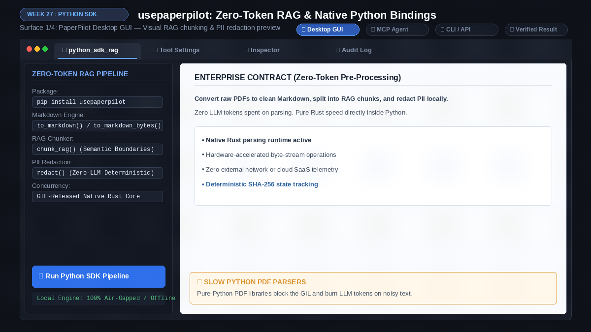

# Week 27: `usepaperpilot` Python SDK — Zero-Token RAG & Native Rust Speed

**Theme:** Native Python SDK, Zero-Token RAG Pre-Processing & GIL-Released Document Intelligence  
**Tools Featured:** `usepaperpilot` (`to_markdown`, `chunk_rag`, `redact`, `*_bytes` in-memory APIs)  
**Target Audience:** AI/ML Engineers, Python Developers, RAG Pipeline Builders, Backend Architects  
**Asset:** 

---

## 📝 LinkedIn Post Copy

*Let the LLM be the brain. Let PaperPilot handle the documents.* 🧠📄

Most RAG pipelines waste thousands of LLM tokens—and block the Python GIL—just trying to parse PDFs, strip boilerplate, and redact PII before embedding. 🛑

With `usepaperpilot`, you get PaperPilot's native Rust document engine directly inside Python with zero system dependencies:
- `to_markdown`: Converts complex PDFs into clean, LLM-ready Markdown in milliseconds.
- `chunk_rag`: Splits documents along semantic boundaries for high-recall RAG retrieval.
- `redact`: Deterministically scrubs PII before a single byte ever reaches an LLM.
- `*_bytes` (`to_markdown_bytes`, `chunk_rag_bytes`, `redact_bytes`): In-memory execution that releases the Python GIL for true multi-threaded & async concurrency.

```bash
pip install usepaperpilot
```

```python
import usepaperpilot as pp

# File-based zero-token RAG & redaction
md = pp.to_markdown("contract.pdf")
chunks = pp.chunk_rag("contract.pdf", max_tokens=512)
pp.redact("contract.pdf", "contract_redacted.pdf")

# In-memory & GIL-released for async/multi-threaded pipelines
with open("contract.pdf", "rb") as f:
    pdf_bytes = f.read()

md_mem = pp.to_markdown_bytes(pdf_bytes)
chunks_mem = pp.chunk_rag_bytes(pdf_bytes)
```

Same native Rust core across Desktop, MCP, CLI, REST API, and now Python.

⭐ GitHub: https://github.com/KrushnaVardhanReddy/PaperPilot

⚡ 5-Second Flash Install:
• Python SDK:
`pip install usepaperpilot`
• Linux & macOS:
`curl -fsSL https://raw.githubusercontent.com/KrushnaVardhanReddy/PaperPilot/main/scripts/install.sh | bash`
• Windows PowerShell:
`irm https://raw.githubusercontent.com/KrushnaVardhanReddy/PaperPilot/main/scripts/install.ps1 | iex`
• AI Agent / MCP:
`npx -y @usepaperpilot/mcp`

#Python #RAG #LLM #OpenSource #RustLang #PyO3 #AI #DocumentAI #PaperPilot
