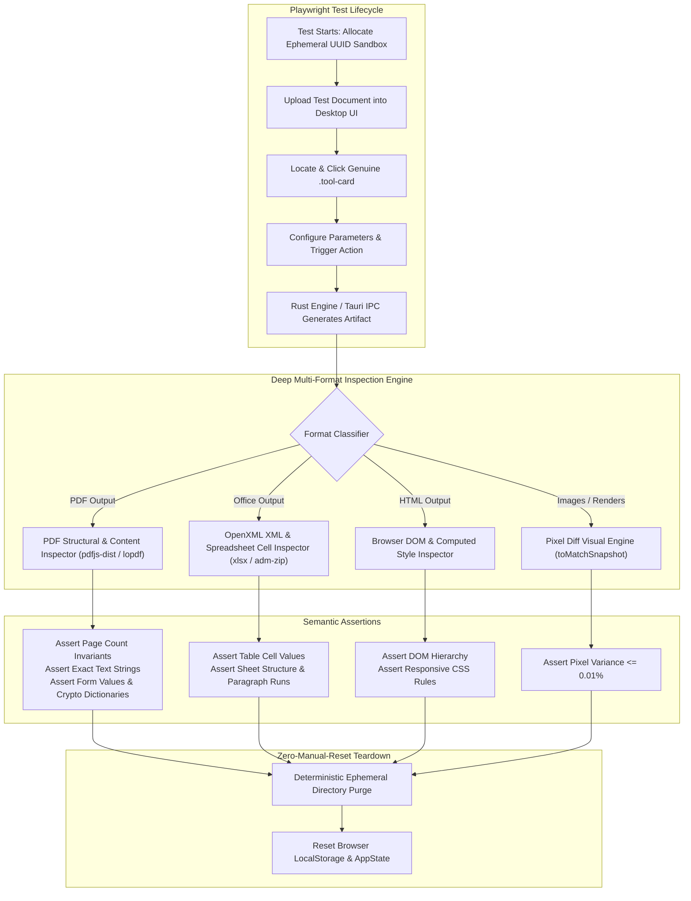

# Spec 151: Next-Level Deep Semantic & Self-Healing Playwright E2E Validation Architecture

**Status:** Planned (Following Initial 90-Tool Pass)  
**Author:** Antigravity Engineering  
**Domain:** End-to-End QA, Deep Semantic Content Assertions, Visual Regression & Ephemeral Sandbox Lifecycle  
**Target:** `apps/desktop/tests/` & `tests/e2e_fixtures/`

---

## 1. Executive Summary & Vision

The objective of **Spec 151** is to elevate PaperPilot's desktop test automation from baseline execution verification (tool ran and generated a valid file header) to **autonomous, deep semantic verification**.

Under this architecture:
1. Every generated document is inspected down to internal text streams, table structures, AcroForm fields, cryptographic signatures, and font metrics.
2. Every test run executes in an **ephemeral, isolated filesystem sandbox** that guarantees zero test pollution and completely eliminates the need for manual cleanup or environment resets.
3. High-DPI page rendering and visual modifications (imposition, watermarks, stamps, redacting) are validated using **pixel-diff golden masters**.

---

## 2. Architecture & Tiered Validation Pipeline



---

## 3. Core Capabilities by Document Format

### 3.1 Deep PDF Structural & Content Inspection
- **Library Integration**: `pdfjs-dist` (already packaged in `apps/desktop`) and pure-Node binary inspectors.
- **Page Mathematical Invariants**:
  - `pdf_merge`: $\text{Pages}(\text{Output}) = \sum \text{Pages}(\text{Inputs})$.
  - `pdf_split`: Sum of split output pages equals original input pages.
  - `pdf_delete_pages`: Input pages minus deleted list length.
- **Text Stream Extraction**:
  - Search specific coordinates for stamped watermarks, Bates numbers, or header/footer strings.
  - For `pdf_redact`: Verify that redacted words **do not exist anywhere** in the raw `/Contents` stream or decoded text chunks.
- **AcroForm State Inspection**:
  - Load the interactive form dictionary; assert that `field.name` has value `expectedValue`.
  - For `pdf_flatten`: Confirm all interactive `/Widget` annotations and `/AcroForm` dictionaries are stripped, and form fields are permanently baked into page content streams.
- **Cryptographic & Permissions Verification**:
  - For `pdf_encrypt`: Assert that attempting to open the document without password throws a password challenge error; opening with `password123` succeeds.
  - For `pdf_sign` & `pdf_timestamp`: Parse the `/Sig` dictionary, confirm the presence of `/ByteRange`, `/Contents`, and valid PKCS#7 or RFC 3161 timestamp token.

### 3.2 Office Document Validation (`.docx`, `.xlsx`, `.pptx`)
- **Excel & Tabular Validation (`.xlsx`, `.csv`)**:
  - Parse using `xlsx` library.
  - Assert sheet names (`workbook.SheetNames`).
  - Assert exact cell coordinates and data types (`expect(sheet['B2'].v).toBe('Total')`).
- **Word & PowerPoint OpenXML (`.docx`, `.pptx`)**:
  - Unpack archive in memory via zip stream.
  - Read `word/document.xml` or `ppt/slides/slide1.xml`.
  - Validate that text paragraphs, tables, and styles are well-formed XML and contain the expected extracted text.

### 3.3 HTML & Web Conversion Validation
- Open converted HTML documents in an isolated Playwright page context (`await page.goto('file://' + path)`).
- Verify that semantic tags (`<header>`, `<article>`, `<table>`, `<code>`) are present.
- Inspect computed CSS styles (font families, layout flexbox/grid) to ensure styles were compiled cleanly.

### 3.4 Visual Regression & Pixel Diffs
- For rasterization, canvas stitching, N-up imposition, poster slicing, and dark-mode color inversion:
  - Generate raster image outputs at 150 DPI.
  - Run Playwright native image comparison:
    ```typescript
    expect(fs.readFileSync(renderedImage)).toMatchSnapshot('expected-nup-4grid.png', {
      maxDiffPixelRatio: 0.005 // 0.5% threshold for anti-aliasing
    });
    ```

---

## 4. Self-Healing & Zero-Manual-Reset Architecture

To guarantee that developers and CI never need to manually reset files, directories, or state:

1. **UUID-Scoped Ephemeral Workspaces**:
   Every test creates its own sandboxed output folder:
   ```typescript
   const runId = crypto.randomUUID();
   const sandboxDir = path.resolve(outBaseDir, `run_${runId}`);
   ```
   Tests operate strictly inside their assigned directory. Concurrency or test retries never collide.

2. **Deterministic Pre- & Post-Test Lifecycle**:
   - `beforeEach`: Clear localStorage, reset Tauri mock IPC state, reset document rail in `appState.clearAllDocuments()`.
   - `afterEach`: Cleanly unlink the test's `sandboxDir`.
   - `afterAll`: Sweep any abandoned folders older than 1 hour.

3. **Auto-Recovery on Unhandled Exception**:
   If an unexpected error or timeout occurs mid-test, the test harness automatically catches the exception, closes any open modal/dialogs (`.modal-overlay`), routes back to `#tab-btn-home`, and unlinks temporary artifacts so subsequent tests run in a pristine state.

---

## 5. Implementation Roadmap & Task Mapping

- **Phase 1: Deep Verification Helpers** (`apps/desktop/tests/helpers/`):
  - `pdfInspector.ts`: Text extraction, page count, form field parsing, dictionary checks.
  - `officeInspector.ts`: Excel cell assertions, OpenXML document reader.
  - `sandboxManager.ts`: Ephemeral UUID workspace provisioning and teardown.
- **Phase 2: Suite 1 Deepening (Tools 01–30)**:
  - Apply page count invariants, MediaBox/CropBox geometry checks, and raster PNG validation.
- **Phase 3: Suite 2 Deepening (Tools 31–60)**:
  - Apply password challenge/unlock checks, digital signature dictionary validation, and AcroForm field content checks.
- **Phase 4: Suite 3 Deepening (Tools 61–90)**:
  - Apply Excel cell matrix checks, Word OpenXML checks, and OCR text string matching.

