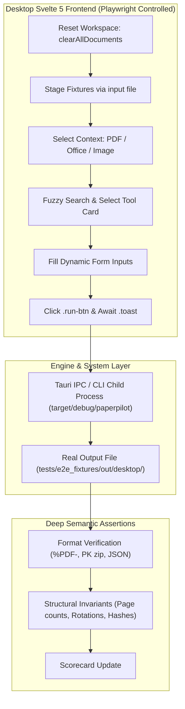

# Technical Specification: Complete 90-Tool Playwright Automation

**Project**: PaperPilot Desktop App  
**Target Branch**: `feature/dev`  
**Scope**: Full end-to-end automation across all 90 tools and operations in the PaperPilot catalog.  
**Execution Paradigm**: Zero-Mock Real Execution (Tauri UI Interaction $\rightarrow$ Real Engine Child Process $\rightarrow$ Byte-Level Output Verification).

---

## 1. System Architecture & Constraints

### Constraints & Standards
1. **Branch Protection**: All modifications must remain on `feature/dev`. Direct pushes to `main` are strictly forbidden.
2. **Build Concurrency**: If compiling Rust binaries, strictly enforce `cargo build -j 4`.
3. **Isolation & Modularity**: The 90 tools must be split across **3 modular suites** corresponding to the manual testing divisions (30 tools per suite) to avoid browser session memory exhaustion and unbounded test timeouts.
4. **Proxy & Port Invariants**: Playwright must launch Chromium with `--proxy-bypass-list=<-loopback>` and empty proxy environment variables (`NO_PROXY=localhost,127.0.0.1`).
5. **OCR Environment**: When invoking OCR operations, `PAPERPILOT_OCR_MODELS_DIR` must point to the onnx models path (`../../models/ocr/ppocrv4`).

---

## 2. Domain & Suite Breakdown (3 Suites × 30 Tools)

### Suite 1: Page Operations, Imposition, Optimization & Rendering
* **Spec File**: `apps/desktop/tests/e2e_suite_1_page_operations.spec.ts`
* **Reference QA Guide**: `qa/manual_desktop_testing/TESTER_1_PAGE_OPERATIONS.md`
* **Tools (01–30)**:
  1. `pdf_merge`
  2. `pdf_merge_alternate`
  3. `pdf_split`
  4. `pdf_split_by_size`
  5. `pdf_split_by_outline`
  6. `pdf_split_half`
  7. `pdf_extract_pages`
  8. `pdf_delete_pages`
  9. `pdf_reorder_pages`
  10. `pdf_rotate`
  11. `pdf_crop`
  12. `pdf_auto_crop`
  13. `pdf_nup`
  14. `pdf_booklet`
  15. `pdf_poster`
  16. `pdf_remove_blank`
  17. `pdf_add_blank_page`
  18. `pdf_duplicate_pages`
  19. `pdf_reverse_order`
  20. `pdf_interleave`
  21. `pdf_deinterleave`
  22. `pdf_adjust_page_box`
  23. `pdf_scale_pages`
  24. `pdf_burst`
  25. `pdf_compress`
  26. `pdf_compress_lossless`
  27. `pdf_grayscale`
  28. `pdf_render`
  29. `pdf_render_page_selection`
  30. `pdf_extract_embedded_images`

### Suite 2: Security, Signatures, AcroForms, Watermarks & Synthesis
* **Spec File**: `apps/desktop/tests/e2e_suite_2_security_forms.spec.ts`
* **Reference QA Guide**: `qa/manual_desktop_testing/TESTER_2_SECURITY_FORMS.md`
* **Tools (31–60)**:
  31. `pdf_encrypt`
  32. `pdf_decrypt`
  33. `pdf_change_password`
  34. `pdf_set_permissions`
  35. `pdf_redact`
  36. `pdf_sanitize`
  37. `pdf_repair`
  38. `pdf_linearize`
  39. `pdf_sign`
  40. `pdf_validate_signatures`
  41. `pdf_remove_signatures`
  42. `pdf_extract_certs`
  43. `pdf_fill_form`
  44. `pdf_read_form_fields`
  45. `pdf_flatten_form`
  46. `pdf_remove_form_fields`
  47. `pdf_watermark`
  48. `pdf_watermark_image`
  49. `pdf_header_footer`
  50. `pdf_bates`
  51. `pdf_page_numbers`
  52. `pdf_add_border`
  53. `pdf_add_margin`
  54. `pdf_flatten`
  55. `pdf_metadata`
  56. `pdf_set_metadata`
  57. `pdf_strip_metadata`
  58. `pdf_bookmarks`
  59. `pdf_set_bookmarks`
  60. `pdf_hash`

### Suite 3: Conversions, Modernization, AI Intelligence & Workflow
* **Spec File**: `apps/desktop/tests/e2e_suite_3_conversions_ai.spec.ts`
* **Reference QA Guide**: `qa/manual_desktop_testing/TESTER_3_CONVERSIONS_INTELLIGENCE.md`
* **Tools (61–90)**:
  61. `pdf_to_docx`
  62. `pdf_to_pptx`
  63. `pdf_to_xlsx`
  64. `pdf_to_html`
  65. `pdf_to_markdown`
  66. `pdf_to_txt`
  67. `pdf_to_json`
  68. `pdf_to_csv`
  69. `pdf_to_pdf_a`
  70. `docx_to_pdf`
  71. `pptx_to_pdf`
  72. `xlsx_to_pdf`
  73. `html_to_pdf`
  74. `markdown_to_pdf`
  75. `txt_to_pdf`
  76. `images_to_pdf`
  77. `excel_to_json`
  78. `excel_to_csv`
  79. `office_to_markdown`
  80. `office_extract_text`
  81. `office_modernize_legacy`
  82. `pdf_ocr`
  83. `pdf_extract_text`
  84. `pdf_search`
  85. `pdf_classify_type`
  86. `pdf_rag_chunks`
  87. `pdf_compare`
  88. `pdf_validate`
  89. `pdf_pipeline_builder`
  90. `pdf_watch_folder`

---

## 3. Fixtures Matrix

| Fixture File | Location | Purpose / Tools Used |
| :--- | :--- | :--- |
| `single_page.pdf` | `tests/e2e_fixtures/real/single_page.pdf` | Base 1-page document for single-page transforms, rotations, metadata, watermarks. |
| `multi_page.pdf` | `tests/e2e_fixtures/real/multi_page.pdf` | 5-page document for splitting, burst, deletion, reordering, N-up, booklet. |
| `merge_a.pdf`, `merge_b.pdf` | `tests/e2e_fixtures/real/` | Document pairs for merge, interleave, and compare. |
| `form.pdf`, `form_data.json` | `tests/e2e_fixtures/real/` | AcroForm template and field population payloads. |
| `dummy.p12` | `tests/e2e_fixtures/real/dummy.p12` | PKCS#12 test certificate (`password123`) for digital signing and verification. |
| `test.xlsx`, `test.xls`, `test.csv` | `tests/e2e_fixtures/real/` | Office tables and legacy workbook modernize inputs. |
| `test.png`, `sample_photo.png` | `tests/e2e_fixtures/real/` | Raster images for `images_to_pdf`, image watermarking, and OCR test paths. |

---

## 4. Semantic Validation Rules

Each tool test must verify file output against the following invariants:
1. **PDF Binary Validity**: Output starts with `%PDF-` and ends with `%%EOF` or valid cross-reference table.
2. **Page Count Geometry**: 
   - `pdf_merge`: Output page count equals sum of input pages.
   - `pdf_split` / `pdf_extract`: Output page count matches selected partition.
   - `pdf_rotate`: PDF dictionary stream contains `/Rotate <angle>`.
3. **Cryptographic State**:
   - `pdf_encrypt`: PDF dictionary contains `/Encrypt`.
   - `pdf_decrypt`: PDF dictionary lacks `/Encrypt` and is readable without password.
   - `pdf_sign`: Signature dictionary `/ByteRange` and `/Contents` present.
4. **Structured Data Outputs**:
   - `pdf_to_json`, `excel_to_json`, `pdf_rag_chunks`: Parses via `JSON.parse()`; required arrays/objects exist.
   - `pdf_search`: Output contains query matches array with line coordinates.
5. **Office Formats**:
   - `.docx`, `.xlsx`, `.pptx`: Validates ZIP signature bytes `PK\x03\x04` at offset 0.
