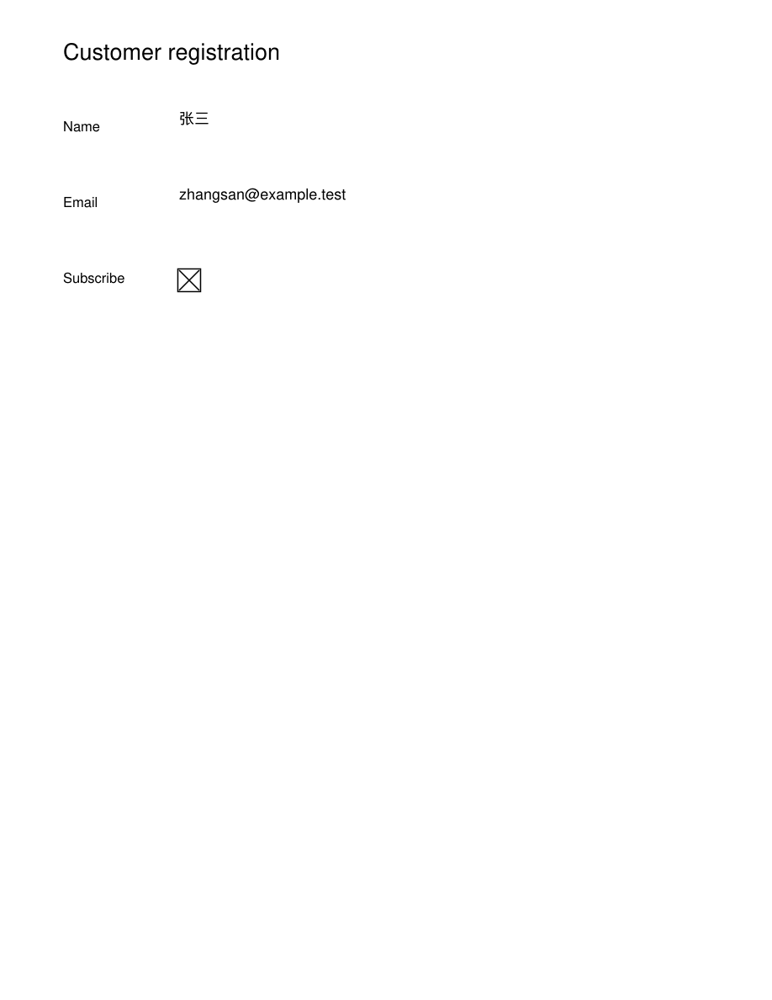

# Task 4.7.4 — AcroForm batch mail merge

- Date: October 28, 2026 (Asia/Hong_Kong)
- Branch: `feat/cli-fill-batch-task-4-7-4`
- Base: `origin/feature/dev` at `51c59fd`
- Status: implemented and locally verified; proposed for review on this branch, not merged.

## Result

`paperpilot fill-batch` generates one filled PDF per CSV/JSON record. It supports
field mapping, filename tokens, default form flattening, editable output, and a
machine-readable execution receipt. A failed row does not stop later rows.
Existing PDFs and receipts are never overwritten; any failed row returns a
nonzero process exit code. `--json` emits a single result object including the
batch receipt, rather than multiple concatenated JSON documents.

```bash
paperpilot fill-batch --template form.pdf --data records.csv --output-dir ./out \
  --name-template '{row.name}_{date}_{index:04}.pdf' --json
```

`--field-map mapping.json` maps PDF field names to source columns.
`--keep-editable` preserves interactive fields. The default output name is
`{index:04}.pdf`; `{row.column}`, `{date}` and index padding up to 12 digits are
supported. Dates default to UTC; `--date YYYY-MM-DD` provides a deterministic
override. Broader recipe/watcher naming tokens remain outside this task.

CSV input supports UTF-8 BOMs, quoted commas and quoted multiline values. JSON
input is an array of flat record objects with string/number/boolean/null values;
null becomes an empty string. Missing bound fields fail that row. Extra columns
may be used for naming. Duplicate CSV headers and malformed global input fail
before the output directory is created.

## Core implementation

The CLI orchestrates rows and files. `paperpilot-pdf/src/operations/form_fill.rs`
owns the in-memory PDF implementation, including the reusable `FormFillTemplate`
and `run_operation_bytes` entry point. The template is parsed once and cloned
independently per row. Existing `ReadFormOperation`, `FillFormOperation` and
`FlattenOperation` delegate to this same implementation.

The old fill operation only wrote field values and requested viewer-generated
appearances; flattening only removed `/AcroForm`. The shared implementation now:

- Traverses hierarchical field names and decodes UTF-16 values correctly,
  including Chinese. ASCII multiline values retain their line breaks.
- Generates actual text and checkbox appearance streams, preserving checkbox
  export states and editable on/off appearances.
- Places appearances into page content using their bounds and transformation
  matrices. Existing page resources, page content and non-widget annotations are
  retained. Hidden widgets are removed without revealing their values.
- Detects cyclic field trees and rejects unsupported template/field configurations.
- Publishes PDF files through no-clobber temporary-file persistence and records
  per-row hashes, paths, errors, job ID, UTC timestamps and elapsed time.

The existing form unit fixture was upgraded to include a real widget rectangle,
field type, page annotation and page geometry. Tests continue to use genuine
synthetic PDFs; no document bytes or operation responses are mocked.

## Verification

| Check | Observed result |
| --- | --- |
| `cargo test -p paperpilot-cli --test test_fill_batch -j 2 -- --test-threads=2` | **10 passed** |
| `cargo test -p paperpilot-pdf --test form_fill_regression -j 2` | **6 passed** |
| `cargo test -p paperpilot-pdf --lib operations::form::tests -j 2` | **3 passed** |
| `cargo test -p paperpilot-pdf --lib operations::flatten::tests -j 2` | **1 passed** |
| Scale case in CLI tests | **1,000 records → 1,000 PDFs**, each reopened and checked; 1,000 receipt results |
| Independent ReportLab template and pypdf reader | Both flattened and editable modes generated two outputs; Chinese values, original page text and receipt hashes verified |
| Independent PyMuPDF 2.0 reader/renderer | **4 outputs** read and rendered; no widgets remain in flattened output; Chinese preview visually inspected |
| `cargo check -p paperpilot-cli -j 2` | Passed |
| Changed Rust formatting and `git diff --check` | Passed |
| Tool handbook generation and docs build | **76 reference entries, 89 pages built, 88 pages indexed** |

The 20 targeted Rust tests cover Unicode, hierarchical fields, checkboxes,
multiline CSV values, mapping, null/empty values, missing/invalid rows, duplicate
filenames, existing files/receipts, path sanitization, malformed configuration,
resource inheritance, unrelated annotations, hidden widgets, and cyclic fields.
All checks ran locally on Windows. The new GitHub workflow also schedules these
regressions on Linux and Windows; remote CI has not yet run for this branch.

Windows sandbox temporary-directory restrictions initially prevented file
publication during a test run. Setting `TEMP` and `TMP` to the dedicated workspace
test directory resolved the issue. The documentation build likewise required
normal permissions to write its generated output/search index. Rust's
incremental-cache hard-link warnings used the compiler's copy fallback.

## Inspectable evidence

- [Source template](fill-batch-validation/template.pdf)
- [Flattened Chinese example](fill-batch-validation/filled-flattened.pdf)
- [Editable Chinese example](fill-batch-validation/filled-editable.pdf)
- [Example input records](fill-batch-validation/records.json)
- [Machine-readable verification](fill-batch-validation/verification.json)



## Scope and limitations

Supported templates contain text fields and checkboxes. Read-only fields, radio
buttons, pushbuttons, XFA forms and other unsupported fields are rejected before
batch execution. Text appearances use Helvetica for ASCII and the standard
STSong/Adobe-GB1 CJK fallback for BMP text; fonts are not downloaded or embedded.
Viewer CJK font support is required. Non-BMP values and values that cannot fit at
a readable size fail the affected row. This is not a general font-embedding or
universal-script layout engine. Adobe's [CMap resources](https://github.com/adobe-type-tools/cmap-resources)
document the standard CJK encoding used by these appearances.

This task adds the CLI batch command and shared core behavior. Dedicated MCP/REST
batch endpoints and desktop automation UI remain separate tasks. Full workspace,
desktop and platform suites were not run. The unavailable `graphify-rs` CLI
prevented rebuilding the optional graph; the command was attempted and no graph
artifacts were changed.

Task 4.7.4, the partial naming/receipt milestones, tool references and
`HANDOFF.md` have been updated without marking the branch merged. The next
scheduled development item remains Task 4.7.6, the conditional recipe engine.
