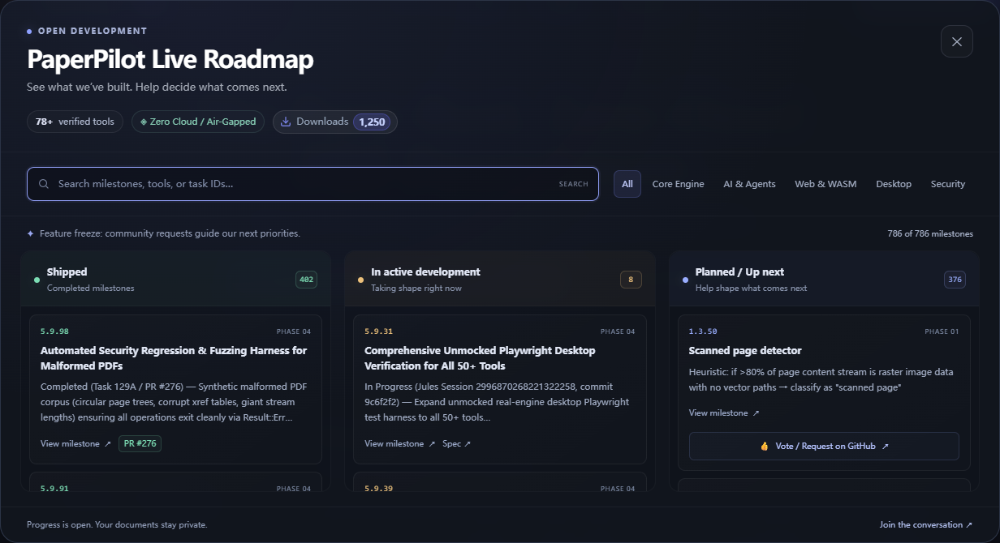
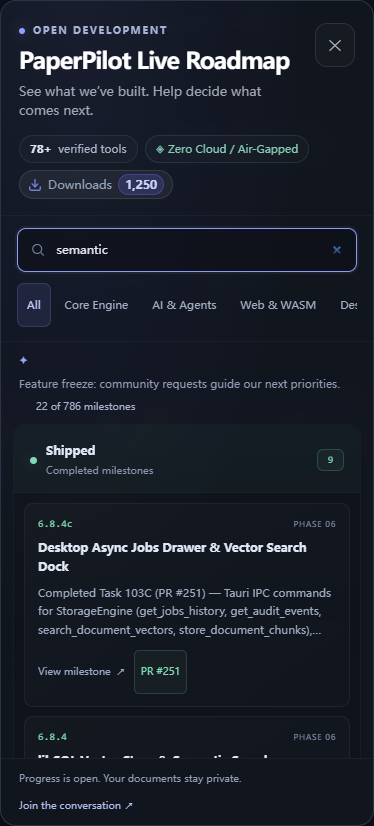

# Task 131A — Dynamic Public Roadmap

Date: October 27, 2026 (Asia/Hong_Kong).
Baseline: `origin/feature/dev` / `origin/main` at `bac7682`.
Continuation: `feat/public-roadmap`; implementation is local and pending integration.

## Upstream refresh

Fetched upstream and fork references before creating this continuation. The prior
Tika adapter was merged as [PR #273](https://github.com/KrushnaVardhanReddy/PaperPilot/pull/273),
and [PR #267](https://github.com/KrushnaVardhanReddy/PaperPilot/pull/267) integrated
the development branch into main. The updated handoff explicitly scheduled
Task 131A; the feature-freeze policy remains in place.

## Result

The web portal now opens a public roadmap from its header/footer and the direct
`/roadmap` URL. The modal has three milestone columns, keyword search, category
filters, PR/spec/source references, and prefilled GitHub feature-request links.
It supports native modal semantics with explicit first/last keyboard focus
cycling, Escape/backdrop closing, focus restoration, mobile stacking, and
loading/error/retry states. Browser history and refresh preserve the route.

`scripts/sync_roadmap.ts` generates `apps/web/public/roadmap.json` from the modular
phase documents during `prebuild` and `predev`. Output is deterministic and
retains source references. Explicit notes take priority over stale emoji;
unmerged work stays in progress; duplicate task numbers retain separate keys.
An empty parse fails without overwriting the last valid snapshot.

Current snapshot: **13 phase documents, 786 milestone records** — 402 shipped,
8 in progress, and 376 planned. These are phase-document milestone statuses.
The separate 78+ tool metric comes from the existing `PHASES.md` dashboard.
Source fingerprint and verification summary: [verification.json](roadmap-validation/verification.json).

The existing download badge supplies public GitHub release metadata with its
cache/fallback behavior. Roadmap data is a build-time snapshot published with
the site; it does not poll PR state or submit issues. Usage and data rules are
documented in [PUBLIC_ROADMAP.md](../docs/PUBLIC_ROADMAP.md).

## Verification

| Check | Result |
|---|---|
| Parser/data tests | 8 passed; status precedence, escaped/code pipes, fenced samples, duplicate IDs, text/checklist milestones, issue form fields, deterministic regeneration and empty-parse recovery |
| Roadmap TypeScript check | Passed in strict mode |
| Full web Svelte/TypeScript check | 0 errors, 0 warnings |
| Production web build | Passed; prebuild regenerated the snapshot automatically |
| Production-preview browser suite | 7 passed using installed Chrome through Playwright |
| Desktop/mobile screenshots | Visually inspected; no cropped modal content or horizontal overflow |
| `git diff --check` | Passed |

The browser suite used actual generated roadmap data and covered all column
counts, search/category clearing, issue-form URLs, keyboard boundary wrapping,
Escape/backdrop close, focus restoration, direct-route refresh, back/forward,
request failure/retry, and a 390×844 mobile viewport. The download badge cache
was seeded with **1,250 as a visual test value**; it is not a reported live count.
The failure/retry case aborts the metadata request and then recovers from the
real production asset. No PDF processing responses were mocked.

Reproduce from the repository root:

```sh
pnpm --dir apps/web test-roadmap
pnpm --dir apps/web check-roadmap
pnpm --dir apps/web check
pnpm --dir apps/web build
pnpm --dir apps/web test-roadmap-ui
```

Set `PLAYWRIGHT_CHANNEL=chrome` to use an installed Chrome browser, or install
Playwright Chromium. Browser tests start and stop a local production preview at
`127.0.0.1:4187`. Node.js 24.22.1 and pnpm 11.25.0 were used for this verification.

## Related maintenance

- Corrected the spec's accidental Python acceptance command to the required
  TypeScript workflow.
- Reconciled the already-merged posterize task with PR #270 so it no longer
  appears as active work in the public snapshot.
- Replaced machine-specific `file:///home/...` dashboard links with portable
  repository links.
- Associated existing web control labels/groups and removed invalid/unused CSS
  to meet the warning-free build requirement.
- Updated both npm and pnpm locks for the `tsx` development dependency. The web
  pnpm configuration explicitly permits only the existing SWC/esbuild native
  installation scripts.

This change touches the web portal and project metadata. Rust engine, MCP, CLI,
and desktop runtime code were not changed or re-tested in this continuation.
`graphify-rs build .` was attempted, but the CLI is unavailable and no existing
`graphify-out/graph.json` was present. The site has not been deployed and this
continuation has not been committed or pushed. Previous branches and the original
untracked `reports/agent-validation/` artifacts were preserved.

## Screenshots

Desktop (production preview):



Mobile, with a semantic-search query:


