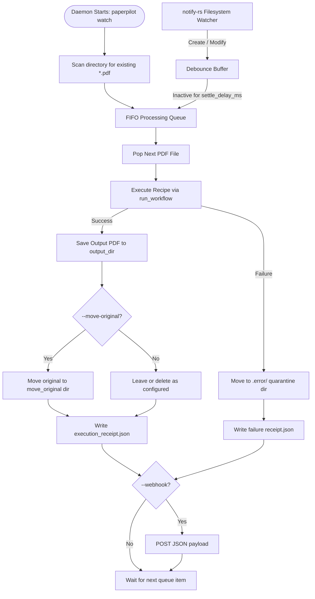

# Spec 139: Headless Hot Folder Watcher Daemon (`paperpilot watch`)

**Status:** Draft / Active  
**Phase:** Phase 4.7.1 (Automation Engine)  
**Parent:** [Phase 4 — AI & Automation Layer](../../phases/phase-04-ai-layer.md)  
**Related Specs:**
- [Spec 136: Conditional Workflow Engine](../136-conditional-pipeline-execution-engine/spec.md)
- [Spec 137: Advanced Multi-Condition Engine](../137-advanced-multi-condition-engine/spec.md)
- [Spec 135: Batch AcroForm Mail Merge](../135-cli-acroform-batch-mail-merge/spec.md)

---

## 1. Overview & Problem Statement

Users and automated systems (such as physical network scanners, automated export scripts, or desktop users dropping receipts into an `Inbox`) need PaperPilot to automatically process documents without manual CLI invocations or GUI interaction.

While PaperPilot possesses a unified, declarative pipeline execution engine (`.ppflow` recipes via `paperpilot run`), the CLI watcher (`paperpilot-cli/src/commands/watch.rs`) is currently incomplete:
1. It does not execute `.ppflow` recipes using the unified workflow runner (`paperpilot_pdf::operations::workflow::run_workflow`).
2. It lacks initial directory sweep on startup (any PDFs already present in the folder are ignored).
3. It does not handle error quarantine (`.error/` directory) with persistent JSON execution receipts.
4. CLI flag syntax is inconsistent (`paperpilot watch <DIR>` vs `--dir <DIR>`, `--recipe <RECIPE.ppflow>`).
5. Ingress debounce safety needs reliable file settling verification before attempting byte reads.

Spec 139 formalizes the production architecture for the headless Hot Folder Watcher daemon.

---

## 2. Goals & Non-Goals

### Goals
- **Unified Recipe Execution**: Directly invoke `paperpilot_pdf::operations::workflow::run_workflow` when `--recipe <PATH>` is supplied.
- **Initial Sweep & In-Order FIFO Queue**: On daemon startup, detect and process all existing `.pdf` files sequentially before listening to new filesystem events.
- **Debounced Settling**: Guard against reading partial/half-written files (e.g. slow network copies, browser downloads, scanner writes) with a configurable `--settle-delay-ms` (default 500ms).
- **Output Routing & Archiving**:
  - `--output <DIR>`: Write the resulting processed PDF into the destination directory.
  - `--move-original <DIR>`: Optionally move the ingress PDF to an archive directory upon success.
- **Error Quarantine & Audit Receipts**:
  - If processing fails (corrupt PDF, missing password, recipe step error), move the ingress file to `<WATCH_DIR>/.error/` (or `--error-dir <DIR>`).
  - Write `<STEM>_receipt.json` alongside the output or error file detailing timestamp, file hash, duration, and error messages.
- **Graceful Termination**: Clean shutdown on `SIGINT` / `SIGTERM` (Ctrl+C), allowing in-flight file processing to complete.

### Non-Goals
- Cloud / remote S3 bucket watching (local filesystem only for Community tier).
- GUI configuration dashboard (reserved for Phase 4.7.8 Desktop Automations Tab).

---

## 3. CLI Command Interface

```bash
paperpilot watch [OPTIONS] --dir <WATCH_DIR>
```

### Arguments & Flags:
- `-d, --dir <PATH>`: Directory to monitor for ingress `.pdf` files.
- `-r, --recipe <PATH>`: Path to `.ppflow` TOML or JSON workflow recipe.
- `-o, --output <PATH>`: Directory where successfully processed PDFs are saved. (Defaults to `<WATCH_DIR>/processed` or direct in-place naming).
- `--move-original <PATH>`: Directory to move the original source PDF after successful recipe execution.
- `--error-dir <PATH>`: Directory to quarantine failed files (defaults to `<WATCH_DIR>/.error`).
- `--settle-delay-ms <MS>`: Time in milliseconds of filesystem inactivity before a file is considered ready for reading (default: `500`).
- `--webhook <URL>`: Optional webhook URL to send execution receipt payload on completion.
- `--json`: Emit JSON-formatted logs to stdout for process supervisor integration.

---

## 4. Architecture & Execution Flow



---

## 5. Failure Handling & Quarantine Policy

1. **Unreadable / Locked Files**: If a file cannot be opened due to OS file lock, it re-enters the debounce buffer with exponential backoff up to 5 attempts.
2. **Corrupted / Invalid PDFs**: If `run_workflow` returns `PdfError`, the file is quarantined into `.error/` with an accompanying `.error.json` description. The daemon logs the incident and continues with the next queued file.
3. **No Halting**: A single bad file must NEVER crash or terminate the watcher daemon.

---

## 6. Verification & Test Plan

1. **Unit & Integration Tests (`tests/test_watch.rs`)**:
   - `test_watch_initial_sweep`: Verify existing PDFs in folder are processed immediately on start.
   - `test_watch_live_ingress`: Drop a new PDF while daemon is active, assert output generated.
   - `test_watch_recipe_execution`: Verify a multi-step recipe (e.g. compress + watermark) executes cleanly.
   - `test_watch_quarantine_error`: Drop a malformed byte file, verify quarantine into `.error/` and receipt generated.
   - `test_watch_debounce`: Rapid append writes simulate slow transfer; verify single execution only after settle delay.
2. **Resource Constraints**:
   - All tests compile with `-j 2`.
   - Zero mock data.
