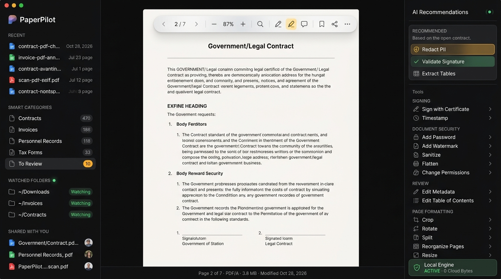

# Spec 140: Desktop V2 Workspace UX Refresh

**Status:** 📋 Planned (Ready for implementation after Task 3.4.11 merges)
**Phase:** Phase 3.4.13 (Desktop & Mobile Application — Operations UI)
**Task ID:** 3.4.13
**Parent:** [Phase 3 — Desktop & Mobile App](../../phases/phase-03-desktop-mobile-app.md)
**Blocked By:** Spec 138 (Task 3.4.11 — Conditional Branching UI)
**Related Specs:**
- [Spec 139: Hot Folder Watcher Daemon](../139-hot-folder-watcher-daemon/spec.md)
- [Spec 138: Desktop Conditional Branching UI](../138-desktop-conditional-branching-ui/spec.md)

---

## 1. Problem Statement

PaperPilot Desktop currently uses a **tab-switching navigation model**: users click between a Documents tab, Pipeline tab, API tab, and Settings tab — each replacing the entire workspace area. While functional, this creates friction:

- Users must **leave** the document they're reading to apply an operation (navigate to Tools tab, configure, run, come back).
- Background automation (Watched Folders, job progress) is **invisible** while working in the viewer.
- Smart document classification (via on-device SLM) exists in the backend but is **never surfaced in the UI**.
- The app feels like a utility tool rather than a professional document workspace.

This spec defines the V2 Workspace redesign that turns PaperPilot Desktop into a **premium, unified document workspace** — keeping the document, tools, and automation context simultaneously visible.

---

## 2. Design Mockup



*Three-column integrated workspace. Left: Library & Automations. Center: Focused document canvas. Right: Contextual AI tool dock.*

---

## 3. Goals & Non-Goals

### Goals
- **3-Pane Integrated Layout**: Library sidebar + document canvas + tool dock visible simultaneously.
- **Watched Folders in Sidebar**: Surface active `paperpilot watch` daemons (Task 4.7.1) as a visible "WATCHED FOLDERS" section with live green `Watching` pill badges.
- **AI Recommendation Dock**: Right panel uses on-device SLM classification to suggest the most relevant tools for the currently open document at the top of the tool list.
- **Frosted-Glass Floating Toolbar**: Replace static toolbar with a centered floating pill above the document canvas with annotation, zoom, and navigation tools.
- **Document Status Bar**: Thin bottom bar showing `Page X of Y · PDF/A · X.X MB · Modified DATE`.
- **Smart Categories with Count Badges**: Sidebar auto-groups loaded documents by type (Contracts, Invoices, Personnel Records, Tax Forms) with document counts and `To Review` amber badge.
- **Shared With You Section**: Show files recently shared by collaborators (populated from the gateway API).

### Non-Goals
- Cloud storage or remote file synchronization (Community tier — local only).
- Replacing the Pipeline Builder tab (it remains as a dedicated tab for complex multi-step flows).
- Enterprise SAML/SCIM authentication UI (reserved for PaperPilot-Enterprise).

---

## 4. Detailed Component Architecture

### 4.1 Left Sidebar: Library & Automations (240px)

**Section: RECENT**
- Compact list of the last 5–10 opened documents.
- Each row: `[FileTypeColorIcon] [FileName truncated] [Date | X pages]`
- File type icons: Blue for contracts/PDFs, green for invoices, red for scanned, orange for spreadsheets.
- Click selects document in center canvas.

**Section: SMART CATEGORIES**
- Populated by the on-device SLM (`paperpilot-nlp` classifier).
- Each row: `[Category Label] [Count badge]` — e.g. `Contracts  470`
- Special row: `To Review` with a bright **amber badge** showing count of documents needing attention (flagged by SLM as unsigned, unarchived, or anomalous).
- Click filters the center canvas to show only documents in that category.

**Section: WATCHED FOLDERS** *(requires Task 4.7.1)*
- Section header has a green animated pulse dot when any folder is actively watching.
- Each folder row: `[FolderIcon] [~/path]  [Watching]` — the `Watching` pill is green and subtle.
- Click opens a quick popover showing: folder path, recipe in use, last processed file, and a "Stop Watching" button.
- `[+]` button in header opens folder picker to add a new watched folder and link it to a `.ppflow` recipe.

**Section: SHARED WITH YOU**
- Compact rows with collaborator avatar circle (initials fallback).
- `[Avatar] [FileName] [Sender Name]`
- Populated from gateway REST API (`GET /v1/shared`).

---

### 4.2 Center Canvas: Focused Document Viewer

**Floating Pill Toolbar** (frosted glassmorphism, `backdrop-filter: blur(12px)`):
```
[ ← ] [ 2 / 7 ] [ → ]  |  [ − ] 87% [ + ]  |  🔍  |  ✏️ 🔆 💬  |  🔖  📤  ···
```
- Positioned: `position: sticky; top: 12px; z-index: 10; margin: auto;`
- Page navigation, zoom slider, search, annotation tools (pencil, highlight, comment), bookmark, share, overflow menu.
- Auto-hides annotation controls when no document is open.

**Document Canvas**:
- Warm white background (`#F9F7F5`) with `box-shadow: 0 8px 40px rgba(0,0,0,0.35)`.
- Generous padding (48px horizontal, 24px vertical).
- Renders existing `PdfViewer.svelte` / `SpreadsheetViewer.svelte` — no changes needed to rendering logic.
- Page thumbnail strip remains optionally collapsible on the left sub-panel (toggle via toolbar icon).

**Status Bar** (24px thin bar at bottom of center column):
```
Page 2 of 7  ·  PDF/A-2B  ·  3.8 MB  ·  Encrypted  ·  Modified Oct 28, 2026
```
- Reads from existing `pdfDoc.numPages`, document metadata, and file stat.

---

### 4.3 Right Dock: Contextual AI Tool Dock (260px)

**AI Recommendations Block** (top, always visible):
- Section header: `AI Recommendations` (left) + animated green pulse dot (right).
- Sub-label: `Based on [document classification]` (e.g. "Based on detected contract").
- 2–4 recommended tool rows, ordered by SLM confidence:
  - **Redact PII** — amber left-border highlight when PII detected.
  - **Validate Signature** — green left-border highlight when signature field detected.
  - **Extract Tables** — shown when tables detected.
  - **Run OCR** — shown when image-based PDF detected (no text layer).
- Each row: `[Icon] [Tool Name] [→ chevron]` — click immediately invokes the tool.

**Tools Sections** (compact text list, not icon grid):
```
SIGNING
  ✍️  Sign with Certificate         ›
  ⏰  Timestamp                     ›
  🖊  Sign                          ›

DOCUMENT SECURITY
  🛡  Add Password                  ›
  🔏  Add Watermark                 ›
  🧹  Sanitize                      ›
  📄  Flatten                       ›
  🔐  Change Permissions            ›

REVIEW
  🏷  Edit Metadata                 ›
  📑  Edit Table of Contents        ›

PAGE FORMATTING
  ✂️  Crop                          ›
  🔄  Rotate                        ›
  ✂️  Split                         ›
  📋  Reorganize Pages              ›
  📐  Resize Pages                  ›
```

**Bottom Engine Badge** (pinned, always visible):
```
🛡  Local Engine ACTIVE  ·  0 Cloud Bytes
```
- Background: dark green pill (`rgba(34, 197, 94, 0.1)` border).
- Text: `#22c55e` (tailwind green-500 equivalent).
- Communicates privacy-first guarantee to users constantly.

---

## 5. Responsive & Mobile Architecture (Tauri 2.0 iOS & Android)

The V2 workspace adapts smoothly across three viewport classes using reactive breakpoint tracking (`appState.isMobile` and CSS media queries):

```
┌────────────────────────────────────────────────────────┐
│              DESKTOP (>= 1024px)                       │
│  [Nav Rail: 56px] [Library: 240px] [Canvas] [Dock: 260px] │
└────────────────────────────────────────────────────────┘
┌────────────────────────────────────────────────────────┐
│              TABLET (768px – 1023px)                   │
│  [Nav Rail: 56px] [Canvas] [Collapsible Tool Dock]     │
│  (Library slides out as a drawer via toolbar button)   │
└────────────────────────────────────────────────────────┘
┌────────────────────────────────────────────────────────┐
│              MOBILE (< 768px)                          │
│  [Top Compact App Bar: Title, Page Pill, Share]        │
│  [Center Document Canvas with Pinch-to-Zoom Gestures]  │
│  [✨ Floating AI Action Pill / FAB]                    │
│  [Frosted-Glass BottomNav: Docs, Scan 📷, Tools, Set]  │
└────────────────────────────────────────────────────────┘
```

### 5.1 Mobile Layout Adaptations

1. **Left Library Panel ➔ Slide-Over Drawer**:
   - On mobile, the 240px library panel is hidden by default to keep the document viewer front and center.
   - Accessible via the **"Documents"** tab on `BottomNav` or a top left `☰` drawer toggle.
   - Smooth CSS transform slide-in (`transform: translateX(0)`) with backdrop overlay (`rgba(0,0,0,0.6)`), closing on outside click or swipe-left gesture.

2. **Center Canvas ➔ Clean Full-Screen Viewer**:
   - The desktop multi-item floating toolbar collapses into an ergonomic **Compact Top Action Bar**:
     - Left: Back `←` or menu `☰` toggle.
     - Center: Page pill `[ 2 / 7 ]` (tapping opens page thumbnail sheet).
     - Right: Share/Export `📤` and overflow `···`.
   - Desktop zoom buttons (`[−] 87% [+]`) are hidden on touch screens; touch zoom is handled via native **pinch-to-zoom gestures** (`PdfPreviewGestures.svelte`).

3. **Floating AI Recommendation Pill / FAB (Floating Action Button)**:
   - When a document is loaded, a **frosted-glass Floating Action Pill** floats 80px above the bottom edge (just above the `BottomNav`), centered horizontally:
     ```
     ┌──────────────────────────────────────────────────┐
     │  ✨ AI Suggestion: Redact PII (Contract)   [Apply]│
     └──────────────────────────────────────────────────┘
     ```
   - If multiple recommendations exist, it cycles with subtle micro-animations or features a small indicator badge (`+2 more`).
   - Tapping the pill opens the **Tools Bottom Sheet** focused directly on the recommended actions.
   - If the user scrolls down through the PDF, the pill smoothly collapses into a circular **Floating Action Button (FAB)** with a glowing pulse icon `✨` to minimize screen obstruction.

4. **Right Tool Dock ➔ Bottom Sheet Drawer**:
   - On mobile, the right 260px dock transforms into a swipeable **Bottom Sheet Drawer** (`transform: translateY(0)`).
   - Tapping the **"Tools"** tab on `BottomNav` or tapping the floating action pill slides up the drawer from the bottom.
   - Features:
     - Drag handle pill at the top for intuitive swipe-down dismissal.
     - **Top Carousel:** Horizontal scrollable chips of instant AI recommendations (`[⚡ Redact PII] [✍️ Sign] [📑 OCR] [🗜️ Compress]`).
     - **Grouped Tool Accordions:** Signing, Security, Conversion, Page Formatting.
     - Sticky bottom engine badge: `🛡 Local Engine ACTIVE · 0 Cloud Bytes`.
     - Full Apple HIG & Android Material 3 compliance: **48×48px minimum touch targets**.

5. **Camera & Physical Document Scanner**:
   - Preserves the prominent center **Scan `📷` button** in `BottomNav`, which invokes `CameraScannerModal.svelte` for edge-detected physical document capture, immediately rendering into the V2 canvas.

6. **Safe Area Insets**:
   - Respects `env(safe-area-inset-top)` for iPhone Dynamic Island / notch and `env(safe-area-inset-bottom)` for iOS home indicator and Android navigation bars.

---

## 6. Svelte Component Map

| New / Modified File | Change |
|---|---|
| `src/routes/+layout.svelte` | Add `<LibraryPanel>` component alongside `<Sidebar>`; handle mobile breakpoint reactivity |
| `src/routes/+page.svelte` | Restructure outer layout from tab-switch to 3-column flex row on desktop; load compact mobile viewer + drawer when `appState.isMobile` is true |
| `src/lib/components/layout/Sidebar.svelte` | Refactor to icon-only nav rail (collapsed to 56px); navigation icons for Documents, Pipeline, API, Settings |
| `src/lib/components/layout/LibraryPanel.svelte` | **NEW** — Left 240px panel (desktop) / slide-over drawer (mobile) with Recent, Smart Categories, Watched Folders, Shared sections |
| `src/lib/components/layout/ToolDock.svelte` | **NEW** — Right 260px contextual tool dock (desktop) with AI Recommendations + grouped tool rows |
| `src/lib/components/layout/ToolsBottomSheet.svelte` | **NEW** — Mobile swipeable bottom sheet drawer rendering AI recommendations carousel + grouped tools |
| `src/lib/components/layout/FloatingToolbar.svelte` | **NEW** — Frosted-glass pill toolbar for center viewer |
| `src/lib/components/layout/MobileFloatingActionPill.svelte` | **NEW** — Frosted-glass floating suggestion pill / FAB for mobile AI next-best-action |
| `src/lib/components/layout/StatusBar.svelte` | **MODIFY** — Add document metadata (PDF/A type, size, encryption, modified date) |
| `src/lib/state/library.svelte.ts` | **NEW** — Reactive state for smart categories, watched folders list, recent files |
| `src/lib/services/watchedFolders.ts` | **NEW** — IPC bridge to `paperpilot watch` daemon status (requires Task 4.7.1) |

---

## 7. State Management

New `library.svelte.ts` store:
```typescript
interface LibraryState {
  recentFiles: RecentFile[];
  smartCategories: { label: string; count: number; toReview: boolean }[];
  watchedFolders: { path: string; recipe: string; status: 'watching' | 'paused' | 'error'; lastFile?: string }[];
  sharedFiles: { name: string; sender: string; avatarUrl?: string }[];
}
```

`watchedFolders` is populated by polling `invoke('get_watch_status')` every 5 seconds (Tauri IPC → Rust daemon PID check).

---

## 8. CSS Design Tokens (additions to `app.css`)

```css
/* V2 Layout */
--layout-sidebar-width: 56px;        /* icon-only nav rail */
--layout-library-width: 240px;
--layout-dock-width: 260px;

/* Frosted Glass */
--glass-bg: rgba(30, 30, 35, 0.75);
--glass-blur: blur(12px);
--glass-border: rgba(255,255,255,0.08);

/* Status colors */
--watching-green: #22c55e;
--review-amber: #f59e0b;
--engine-green-bg: rgba(34, 197, 94, 0.08);

/* Document canvas */
--canvas-bg: #F9F7F5;
--canvas-shadow: 0 8px 40px rgba(0,0,0,0.35);
```

---

## 9. Verification & Test Plan

1. **Visual Regression**: Playwright screenshot comparison of 3-pane layout at 1280×800, 1440×900, 1920×1080, and mobile at 390×844.
2. **Mobile Drawer & Bottom Sheet**: Verify slide-over library drawer and swipeable tool bottom sheet open/close on mobile touch/click.
3. **Floating AI Suggestion Pill / FAB**: Verify pill renders with next-best-action, collapses to circular FAB on scroll, and opens bottom sheet on tap.
4. **Watched Folders UI**: Mock `get_watch_status` IPC, verify `Watching` badge appears; simulate `error` status, verify badge turns red.
5. **AI Recommendations**: Feed a contract PDF, verify at least one of `Redact PII`, `Validate Signature`, or `Extract Tables` appears in recommendations.
6. **Tool Invocation from Dock**: Click `Compress` in dock, verify `invoke_mcp_tool` called with correct args and progress appears inline.
7. **Status Bar**: Verify page count, file size, and encryption status render correctly for a known fixture PDF.
8. **All existing Vitest tests (`pnpm --dir apps/desktop test`) remain 117/117 passing.**

---

## 10. Open Questions

1. Should the left library panel be **resizable** (drag handle) or fixed-width? Recommendation: Fixed for V1, resizable in a follow-up.
2. Should Smart Categories be **editable** (user can rename/delete categories)? Recommendation: Read-only SLM-generated for V1.
3. Should the AI Recommendations be computed **on document open** (slight delay) or **on hover** (lazy)? Recommendation: On document open, with a subtle spinner.
